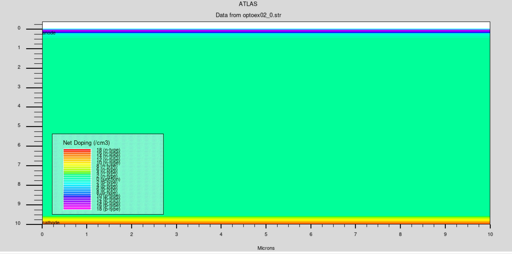
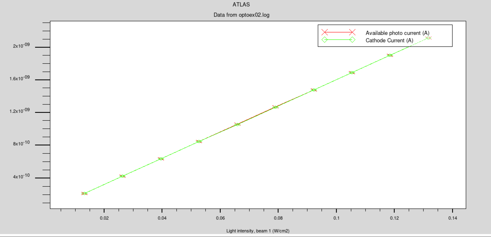
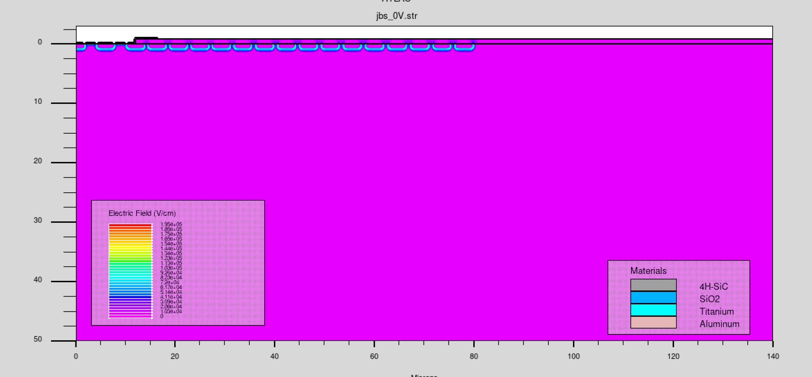
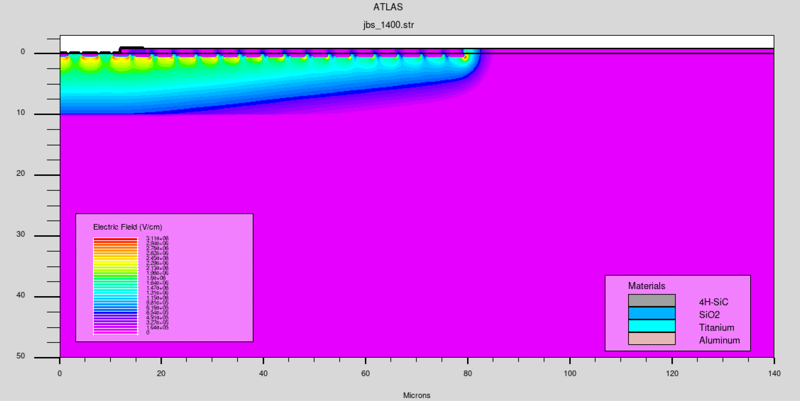
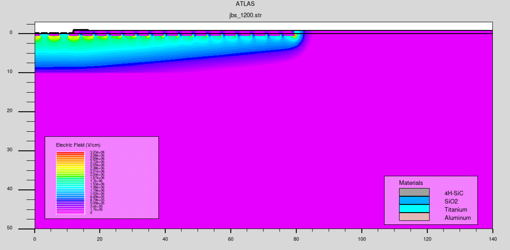
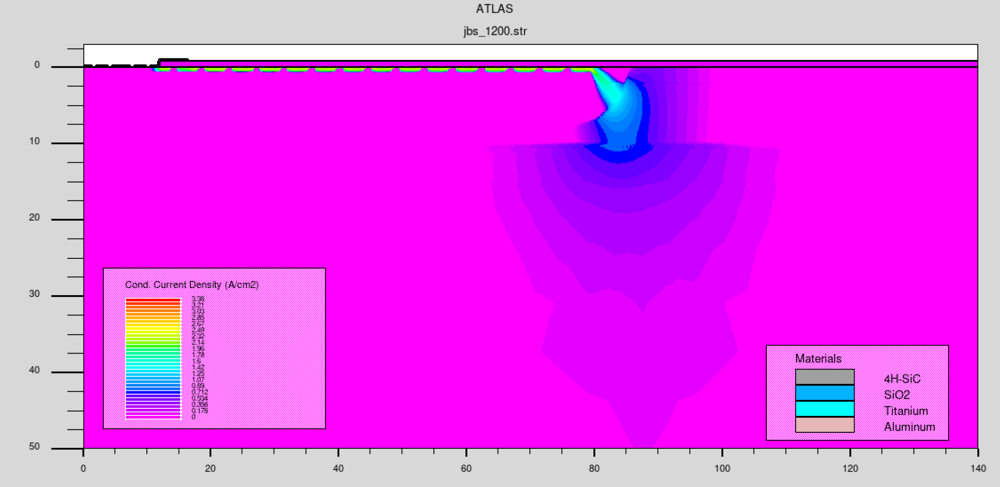
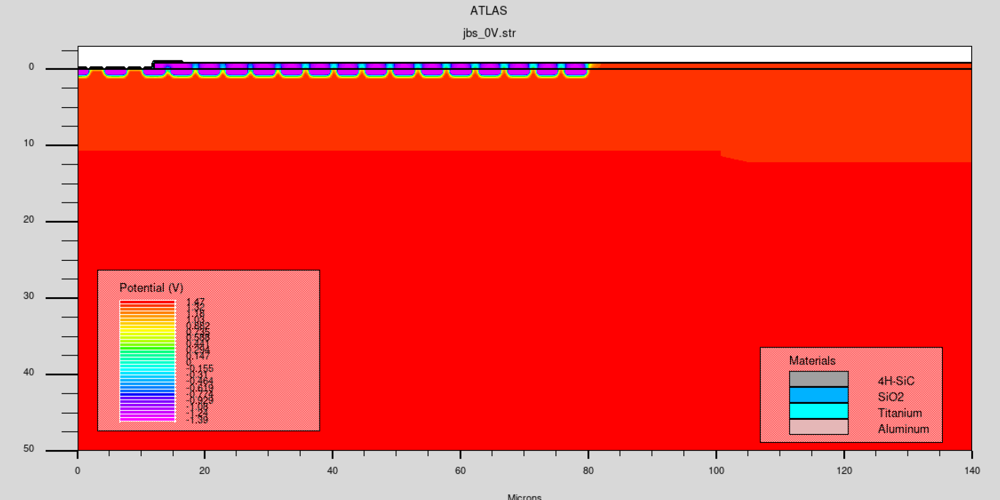
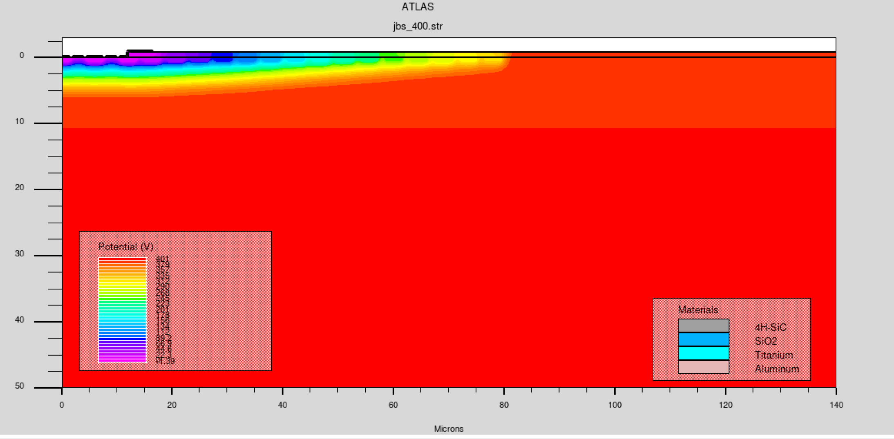
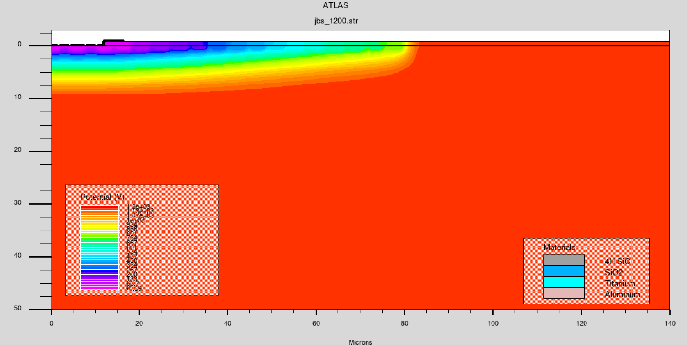
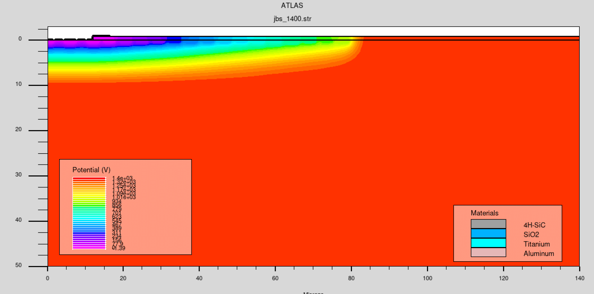

<!-- _class: lead -->

# Silvaco 器件仿真软件

## 功能介绍

研究生选修课

<!-- 讲师备注：介绍本章主题。Silvaco 是后续器件建模、工艺仿真和电学分析案例的工具背景。 -->

---

# 本章学习目标

- 说明 TCAD 在半导体器件开发中的位置。
- 理解工艺仿真、器件仿真和电热耦合分析的基本分工。
- 认识结构、网格、材料、模型和边界条件之间的关系。
- 能够从一张仿真结果图中读出器件、偏压和物理量信息。

<!-- 讲师备注：本章重点是建立工具和问题边界，不要求学生现在掌握全部命令。 -->

---

# Silvaco TCAD 面向功率器件开发

Silvaco TCAD 将工艺、器件结构和物理响应放在同一套仿真框架中：

- **工艺仿真**：形成材料层、几何形貌和掺杂分布。
- **器件仿真**：计算端口特性与内部电势、电场和电流密度。
- **模型分析**：研究击穿、漏电、热效应和结构可靠性。
- 重点对象包括 PiN、SiC JBS、肖特基二极管、MOSFET、IGBT 和保护环。

<!-- 讲师备注：课程只把 TCAD 用于功率器件问题，不扩展到电路设计或显示类器件。 -->

---

# TCAD是半导体工艺开发的重要工具

TCAD（Technology Computer-Aided Design）通过计算机模型描述：

- 工艺步骤如何改变器件结构；
- 材料、掺杂和缺陷如何改变载流子输运；
- 结构和偏压如何共同决定电流、电场与击穿行为。

它连接了**工艺开发、器件设计、实验验证和可靠性评估**。

<!-- 讲师备注：强调 TCAD 的核心不是“画结构”，而是将工艺和物理规律转化为可计算的问题。 -->

---

# TCAD补充实验无法直接观测的信息

实验可以测得端口电流、电压和其他外部响应，但通常难以直接确定器件内部的原因。

TCAD 可以帮助回答：

- 高反偏电压下，哪个区域首先出现高电场？
- 某一电压下发生击穿的物理原因是什么？
- 反向电流—电压曲线的拐点对应怎样的内部状态？
- 半导体内部哪些区域发生了电离、复合或载流子拥挤？

<!-- 讲师备注：用“外部测量结果”和“内部物理解释”作对照。 -->

---

# TCAD 贯穿功率器件设计闭环

功率器件开发需要把多个层次放在同一条证据链中：

- 工艺窗口决定外延、注入、氧化和终端形貌；
- 器件结构决定耗尽区、表面电场和电流路径；
- 物理模型决定击穿、漏电和热响应的预测能力；
- 实验校准决定仿真结论能否用于设计决策。

<!-- 讲师备注：强调功率器件设计闭环，不展开电路级协同或外部电路分析。 -->

---

# 仿真需要与实验相互校准

半导体器件和工艺通常包含多个耦合因素。可靠的建模流程应当：

1. 根据实验结果或文献确定材料和工艺参数。
2. 建立结构、物理模型和边界条件。
3. 将仿真输出与实验测量进行对比。
4. 解释差异来源，再决定是否修正模型。

**仿真不是实验的替代品，而是解释、预测和优化实验的工具。**

<!-- 讲师备注：这是后续学生 PPT 和报告中必须遵守的证据链。 -->

---

# Silvaco工艺仿真：从结构到工艺历史

工艺仿真通常按时间顺序描述器件形成过程：

**初始结构 → 网格 → 材料与掺杂 → 刻蚀/沉积 → 扩散/注入 → 结构输出**

每个工艺步骤都会改变后续仿真的初始条件，因此应保存关键步骤的结构文件和参数。

<!-- 讲师备注：让学生理解工艺仿真是有历史的，不是只对最终结构做一次计算。 -->

---

# 实体建模建立初始结构

实体建模从尺寸和材料出发建立器件结构，包括：

- 区域和材料的几何边界；
- 电极位置与接触关系；
- 初始掺杂或载流子分布；
- 二维或三维器件的空间范围。

例如，功率 MOSFET 可以先用几何尺寸定义外延层、栅介质、栅电极和源漏区，再进入工艺步骤仿真。

<!-- 讲师备注：强调结构文件是器件仿真的输入合同之一。 -->

---

# 刻蚀与沉积改变器件几何

工艺仿真需要描述：

- 刻蚀速率和方向；
- 沉积层的厚度和覆盖范围；
- 工艺步骤后的边界移动；
- 结构转角、凹槽和薄膜界面的变化。

几何变化会进一步改变局部电场、载流子路径和寄生参数。

<!-- 讲师备注：由几何变化引出“工艺参数最终会影响电学性能”。 -->

---

# 形貌变化需要物理模型

形貌模型可以根据晶体学、材料属性和工艺条件描述：

- 各向异性和各向同性刻蚀；
- 薄膜沉积与界面形成；
- 复杂结构中的边界演化；
- 材料属性对表面形貌的影响。

模型精度、计算成本和可获得的工艺参数需要共同权衡。

<!-- 讲师备注：提醒学生不要只看几何结果，还要说明几何是由什么模型产生的。 -->

---

# 注入、扩散和退火决定掺杂分布

离子注入和热处理模型通常需要关注：

- 注入离子种类、剂量和能量；
- 注入角度以及沟道效应；
- 扩散系数和温度历程；
- 退火造成的激活与分布变化。

最终掺杂分布会影响结深、阈值电压、导通电阻和击穿电压。

<!-- 讲师备注：把工艺参数与后续可测电学指标建立对应关系。 -->

---

# 功率器件模型要匹配工作区

功率器件不同工作区关注的物理机制并不相同：

| 工作区 | 主要模型 | 关键输出 |
| --- | --- | --- |
| 正向导通 | 迁移率、复合、电导调制 | I–V、电流密度、导通损耗 |
| 反向阻断 | 耗尽、势垒、碰撞电离 | 漏电、电场、击穿电压 |
| 开关瞬态 | 载流子寿命、俘获与热效应 | 瞬态电流、存储电荷、温度 |
| 终端边缘 | 表面电荷、界面态、曲率效应 | 表面电场、保护环与场板效果 |

模型选择必须由器件类型、偏压范围、温度和需要解释的指标决定。

<!-- 讲师备注：强调模型复杂度要与功率器件工作区和证据目标匹配，而不是盲目启用全部模型。 -->

---

# 功率器件分析是多物理场耦合问题

典型功率器件问题包括：

- PiN 二极管：双极注入、电导调制和关断存储电荷；
- SiC JBS：肖特基路径与 PN 结屏蔽之间的竞争；
- 功率 MOSFET：沟道、漂移区和终端电场的协同；
- IGBT：MOS 控流、双极注入、饱和压降和关断拖尾。

分析时需要同时说明结构、材料、偏压、温度、模型和观测物理量。

<!-- 讲师备注：所有案例都限定在功率器件内部物理及其端口响应。 -->

---

# PiN功率器件的DC分析

PiN 结构的直流分析可以关注：

- 纵向掺杂浓度分布；
- 电流—电压关系；
- 高压下的电场分布；
- 温度变化下的器件响应。

仿真图不能脱离条件解释：必须同时给出器件结构、端口偏压、温度和模型设置。

<!-- 讲师备注：提醒学生“DC 特性”不是单独一条曲线，而是有明确边界条件的结果。 -->

---

# 网格决定空间分辨率与计算成本

网格策略需要在精度和计算量之间平衡：

- 器件边界处需要足够分辨率；
- 结底部和高场区域通常需要局部加密；
- 材料界面附近应避免过粗网格；
- 三维模型的网格数量会显著增加内存和求解时间。

网格加密应服务于物理问题，而不是平均地增加所有网格点。

<!-- 讲师备注：要求学生在报告中说明网格独立性或至少说明局部加密理由。 -->

---

# SiC工艺仿真：离子注入是关键步骤

宽禁带半导体 SiC 的工艺分析可以包括：

- 不同注入条件下的掺杂浓度分布；
- 三维结构中的刻蚀和材料界面；
- 注入能量对掺杂深度的影响；
- 后续激活和退火对器件参数的影响。

<!-- 讲师备注：把 SiC 案例作为工艺参数、结构和电学结果的连接点。 -->

---

# 铝离子注入能量影响分布深度

示例中比较四种铝离子注入能量：

| 条件 | 注入能量 |
| ---: | ---: |
| 1 | 360 keV |
| 2 | 200 keV |
| 3 | 90 keV |
| 4 | 40 keV |

一般而言，注入能量越高，离子进入材料的平均深度越大；实际分布还受到材料、剂量、注入角度和退火条件影响。

<!-- 讲师备注：不要只依据峰值深度下结论，应同时看剂量和分布宽度。 -->

---

# SiC JBS保护环影响击穿特性

SiC JBS 结构的击穿仿真可以比较不同保护环数量下的反向电流—电压关系：

- 保护环用于调节边缘电场；
- 环数量和间距会改变电场分布；
- 反向电流快速增加的区域对应接近击穿的工作状态；
- 需要同时记录结构尺寸、掺杂、偏压扫描范围和收敛设置。

<!-- 讲师备注：让学生区分“曲线变化”与“造成曲线变化的电场机制”。 -->

---

# SiC JBS电场：0 V至1400 V

观察电场随反向偏压的变化：

- **0 V**：建立零偏压下的基线分布。
- **400 V**：耗尽区扩展，电场开始明显重排。
- **1200 V**：高场区域更加集中，需要关注边缘终端。
- **1400 V**：接近击穿状态，局部峰值电场成为主要风险。

同一器件的不同偏压结果应使用一致的色标和坐标，便于比较。

<!-- 讲师备注：将多张云图转成可复述的比较逻辑。 -->

---

# SiC JBS电流密度与电势

除电场外，还应查看：

- **电流密度**：判断导电路径和局部电流拥挤；
- **电势**：观察偏压如何在结构内部展开；
- **材料界面**：解释电势和电场变化的位置；
- **保护环区域**：判断边缘终端是否有效。

结果解释应形成链条：

**偏压 → 电势分布 → 电场分布 → 电流密度 → 击穿响应**

<!-- 讲师备注：这是阅读 TCAD 结果图的通用顺序。 -->

---

# 仿真结果图：功率器件结构与特性

<!-- 讲师备注：讲解时要求学生先读图例、坐标和偏压，再陈述功率器件内部物理结论。 -->

---

<!-- _class: result-slide -->

# 仿真结果图：SiC JBS电场分布

<!-- 讲师备注：比较零偏与高偏压下的电场扩展，重点观察结边缘和保护环区域的峰值变化。 -->

---

<!-- _class: result-slide -->

# 仿真结果图：保护环与击穿曲线

<!-- 讲师备注：联合阅读击穿曲线与终端结构，说明保护环数量和间距对耐压的影响。 -->

---

<!-- _class: result-slide -->

# 仿真结果图：SiC工艺与注入

<!-- 讲师备注：说明工艺结果图应与材料、注入和刻蚀参数一起记录。 -->

---

<!-- _class: result-slide -->

# 仿真结果图：铝离子注入

<!-- 讲师备注：结合 360、200、90 和 40 keV 四种条件，比较注入深度和分布宽度。 -->

---

<!-- _class: result-slide -->

# 仿真结果图：SiC JBS反向特性

<!-- 讲师备注：读取反向电流—电压曲线时，先确认保护环数量和电压扫描条件。 -->

---

<!-- _class: result-slide -->

# 仿真结果图：SiC JBS电场分布

<!-- 讲师备注：比较低偏压下的电场分布，建立后续高压结果的参照。 -->

---

<!-- _class: result-slide -->

# 仿真结果图：高压下的SiC JBS电场

<!-- 讲师备注：比较高压下的电场集中区域，讨论保护环对边缘电场的调节作用。 -->

---

<!-- _class: result-slide -->

# 仿真结果图：电流密度与电势

<!-- 讲师备注：电流密度用于识别局部电流拥挤，不能仅凭色彩深浅判断击穿。 -->

---

<!-- _class: result-slide -->

# 仿真结果图：不同偏压下的电势

<!-- 讲师备注：观察电势等值线随偏压变化的扩展。 -->

---

<!-- _class: result-slide -->

# 仿真结果图：高偏压电势分布

<!-- 讲师备注：将电势、电场和电流密度结果串联起来解释接近击穿时的器件状态。 -->

---

# 本章小结

- TCAD 连接工艺、器件、实验和电路模型。
- 工艺仿真通过结构、网格、材料和工艺历史生成器件输入。
- 光学、热学和电学模型需要根据问题目标选择复杂度。
- SiC JBS 案例说明：结构设计最终要通过电场、电势、电流密度和击穿曲线验证。

**下一步：从一个明确的器件问题出发，建立可复现的仿真输入和输出。**

<!-- 讲师备注：收束本章，并为学生的 PPT/报告选题建立统一的技术表达框架。 -->

---

# 本章参考文献

<ol class="reference-list">
<li>SILVACO INTERNATIONAL. <em>Power Device Physics Revealed: TCAD for Power Device Technologies</em>[Z]. Silvaco International, 2010.</li>
<li>COURSE TEAM. <em>Silvaco Device Simulation Software: Function Overview</em>[Z]. Course materials, 2026.</li>
</ol>

<!-- 讲师备注：正式文献用于说明功率器件案例和本章课件的来源。 -->
