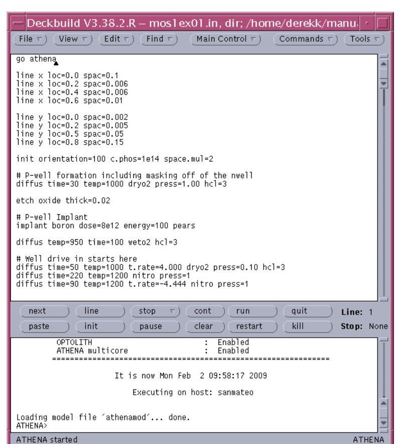
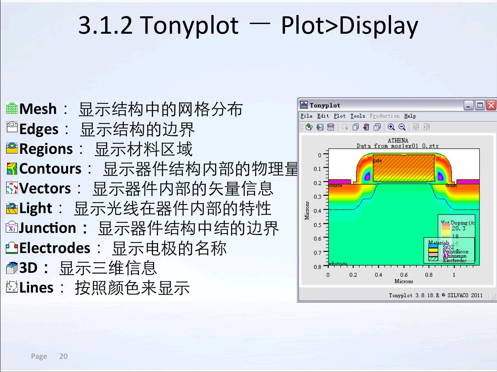
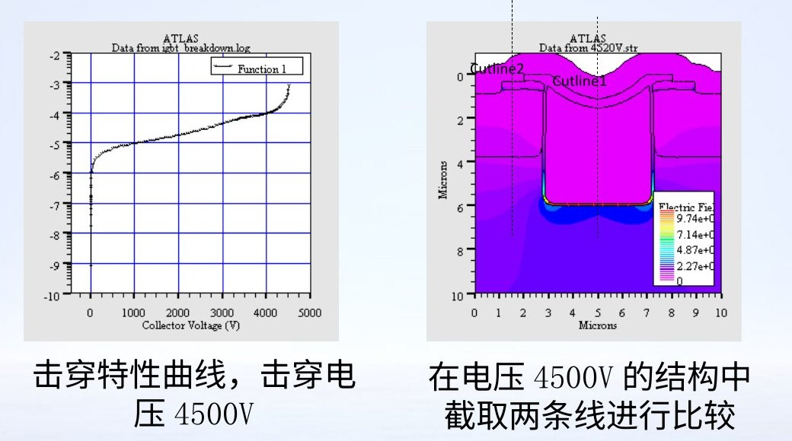

<!-- _class: lead cover -->

# Silvaco TCAD 工作流与语法

## 从交互工具到可追溯的功率器件仿真

课程组 · 微电子器件建模与仿真

<!-- 讲师备注：本章解决工具分工、运行流程、命令语义和结果查看，不进入具体工艺或器件建模细节。 -->

---

# 本章学习目标

<div class="icon-grid">
<div>

<h3>认识工具链</h3>
<p>区分核心仿真器、交互工具和结果文件。</p>
</div>
<div>

<h3>读懂输入</h3>
<p>识别命令、参数、类型、变量和注释。</p>
</div>
<div>

<h3>追踪结果</h3>
<p>从运行输出走到结构、曲线和截线证据。</p>
</div>
</div>

<!-- 讲师备注：目标是建立可复核的工作流，而不是背诵软件菜单。 -->

---

# 三节课的学习路线

<div class="process-flow">
<span>框架与流程</span>
<span>命令与语法</span>
<span>运行与结果</span>
</div>

- 第1节：认识 ATHENA、ATLAS 与交互工具的分工。
- 第2节：理解输入命令的动作、参数和值。
- 第3节：掌握 DeckBuild 运行控制与 TonyPlot 判读。

<!-- 讲师备注：三节共同回答“在哪里写、如何运行、怎样看和怎样保留证据”。 -->

---

<!-- _class: lead -->

# 第1节

## Silvaco TCAD 框架与仿真流程

<!-- 讲师备注：先建立工具地图，避免把所有功能都归到 DeckBuild 或 TonyPlot。 -->

---

# 工具链分为三层

<div class="icon-grid">
<div>

<h3>核心仿真</h3>
<p>ATHENA 与 ATLAS 执行工艺和器件物理计算。</p>
</div>
<div>

<h3>交互环境</h3>
<p>DeckBuild、TonyPlot、DevEdit、MaskViews、Optimizer。</p>
</div>
<div>

<h3>结果与自动化</h3>
<p>输入、结构、日志、数据和显示设置贯穿任务。</p>
</div>
</div>

<!-- 讲师备注：工具名称不是重点，输入和输出在层间如何流动才是重点。 -->

---

# 各工具通过命令与文件协作

<div class="process-flow">
<span>输入文件</span>
<span>工艺或器件核</span>
<span>结构/日志</span>
<span>可视化与提取</span>
</div>

- 命令告诉模拟器执行什么动作。
- 模拟器把状态写入结构、日志和实时输出。
- TonyPlot 和 EXTRACT 把原始状态变成可读视图与指标。
- 工具之间的文件接口决定结果能否继续传递。

<!-- 讲师备注：本章后续所有工具都放回这条数据流里理解。 -->

---

# ATHENA 生成可交给 ATLAS 的工艺结构

- ATHENA 是二维工艺仿真核心，子模块扩展注入、刻蚀、淀积和光刻等能力。
- 工艺步骤按输入顺序改变几何、材料与掺杂。
- 每个关键步骤都可以保存结构，形成“工艺历史”。
- 最终结构可进入 ATLAS，继续计算电学响应。

<div class="icon-callout">

<p>工艺仿真的核心问题是：制造步骤如何塑造可计算的器件结构？</p>
</div>

<!-- 讲师备注：ATHENA 输出的是结构和历史，不是最终的器件结论。 -->

---

# ATLAS 计算端口响应和内部物理量

- ATLAS 是二维器件仿真核心，求解给定结构上的电学、热学等行为。
- 它输出端口特性和内部载流子、电势、电场等分布。
- 材料参数、物理模型、接触和偏压条件必须匹配器件工作区。
- 器件结构可以来自 ATHENA、DevEdit 或已有结构文件。

<!-- 讲师备注：ATLAS 的输入不再是“工艺步骤”，而是已经数值化的器件。 -->

---

# DeckBuild 是输入与运行控制中心

<div class="split">
<div>
<h3>界面分工</h3>
<ul>
<li>上部输入窗口保存可执行命令。</li>
<li>中部控制区负责运行与停止。</li>
<li>下部实时输出显示状态和错误。</li>
<li>菜单提供示例、绘图、提取和工具入口。</li>
</ul>
</div>
<figure>

<figcaption>DeckBuild 将输入、运行控制和实时输出放在同一工作环境</figcaption>
</figure>
</div>

<!-- 讲师备注：真实截图证明 DeckBuild 是调度台，不替代 ATHENA 或 ATLAS 的物理计算。 -->

---

# TonyPlot 把结果变成可读证据

<div class="split">
<div>
<h3>统一的可视化入口</h3>
<ul>
<li>二维结构与材料区域</li>
<li>一维截线和用户数据</li>
<li>端口特性曲线</li>
<li>多个结果的叠加比较</li>
</ul>
<p>理解数据结构，比记住每个按钮位置更重要。</p>
</div>
<figure>

<figcaption>同一工具可打开结构文件与日志文件</figcaption>
</figure>
</div>

<!-- 讲师备注：左右窗口的数据源不同，结构文件和日志文件不能混为同一种结果。 -->

---

# DevEdit 面向结构编辑与重新划分网格

- 用于创建、修改和重新网格化器件结构。
- 适合导入或手工调整无法由标准工艺流直接得到的结构。
- 几何修改会改变后续器件仿真的物理问题。
- 新版结构必须重新检查材料、电极、掺杂和网格。

<!-- 讲师备注：结构编辑不是“修图”，而是改变数值模型输入。 -->

---

# MaskViews 把版图截面接入工艺仿真

<div class="icon-callout">

<p>MaskViews 是面向 TCAD 的集成电路版图接口，可从版图选择感兴趣区域并生成截面，供工艺仿真使用。</p>
</div>

- 支持用户绘制或导入版图数据。
- 工艺输入中的层名或掩膜名必须与版图定义一致。
- 截面的位置和范围决定后续二维仿真看到什么。
- 版图尺寸、晶圆尺寸和工艺偏差需要分别说明。

<!-- 讲师备注：二维仿真的代表性取决于截面选择和掩膜命名的一致性。 -->

---

# Optimizer 用目标和变量组织参数搜索

| 组成 | 含义 | 例子 |
| --- | --- | --- |
| 变量 | 输入文件中的可调数值 | 剂量、时间、几何尺寸 |
| 目标 | 由 EXTRACT 得到的参数或曲线 | 结深、阈值、击穿指标 |
| 循环 | 反复运行模拟器并比较目标误差 | 校准或多目标搜索 |

*Optimizer 依赖 DeckBuild，适合组织搜索，但不能替代物理合理性判断。*

<!-- 讲师备注：优化必须与可追溯参数边界和独立验证配套。 -->

---

# 工具分工清晰，结果责任才不会丢失

- ATHENA 对工艺结构与掺杂负责。
- ATLAS 对器件方程、模型和端口响应负责。
- DeckBuild 对输入与运行控制负责。
- TonyPlot 对可视化负责。
- 使用者对条件、解释和结论负责。

<div class="emphasis-box">软件工具可以分工，最终技术结论不能无人负责。</div>

<!-- 讲师备注：把“工具产生结果”与“工程师解释结果”明确分开。 -->

---

# 仿真工作从问题定义开始

<div class="icon-strip">


</div>

1. 器件类型与工作状态是什么？
2. 结构来自工艺、版图还是已有文件？
3. 需要哪些材料与物理模型？
4. 偏压和温度如何扫描？
5. 最终用哪些指标和内部场判断结果？

<!-- 讲师备注：问题定义完成后，工具选择和命令编写才有依据。 -->

---

# 输入文件是一份可执行的技术说明

一个输入文件通常包含：

- 模拟器和版本选择；
- 网格、区域、材料和电极；
- 掺杂或工艺步骤；
- 物理模型与接触；
- 求解、扫描和输出命令；
- 注释和变量，用于解释与复用。

*输入文件应当让另一个研究者在不询问作者的情况下重建任务框架。*

<!-- 讲师备注：可读性、可执行性和可追溯性都属于输入文件质量。 -->

---

# 完整链路需要四类交接物

<div class="slide-grid">
<div><h3>输入</h3><p>命令、参数、模型、注释和变量。</p></div>
<div><h3>结构</h3><p>材料、几何、掺杂、电极和网格。</p></div>
<div><h3>日志</h3><p>端口电压、电流和扫描过程。</p></div>
<div><h3>设置</h3><p>曲线、场图、截线和显示范围。</p></div>
</div>

<!-- 讲师备注：缺少任何一类交接物，另一个研究者都难以复现完整结果。 -->

---

# GO 语句切换仿真器但不应切断上下文

<div class="icon-callout">

<p>GO 语句让 DeckBuild 从当前环境进入指定模拟器。切换后，已有结构、文件路径和运行状态仍然影响后续任务。</p>
</div>

- 明确当前模拟器与目标模拟器。
- 检查结构文件是否已保存并位于预期目录。
- 确认后续命令属于新模拟器的语法体系。
- 在日志中保留从工艺到器件的切换点。

<!-- 讲师备注：GO 是工作流节点，不只是输入文件里的一个关键字。 -->

---

# 输出文件承担不同证据角色

| 输出 | 主要作用 | 不应替代什么 |
| --- | --- | --- |
| 实时输出 | 运行状态、警告、错误和提取结果 | 完整结构或端口数据 |
| 结构文件 | 保存材料、几何、掺杂、电极和网格 | 端口特性日志 |
| 日志文件 | 保存扫描变量和端口响应 | 内部场分布图 |
| 数据文件 | 保存提取后的指标或曲线 | 原始输入和模型设置 |

<!-- 讲师备注：不同证据角色不能互相替代，截图更不能替代原生数据。 -->

---

# 统一工作目录避免文件找错

- 输入、结构、日志和图像应放在可识别的任务目录。
- 文件名应体现器件、偏压或参数差异。
- 不要在多个目录随意覆盖同名结构。
- 运行前确认相对路径的起点。
- 结束前将设置文件与对应结果一起保存。

<div class="icon-inline-note">文件管理是仿真流程的一部分。</div>

<!-- 讲师备注：大量“软件问题”实际是路径、覆盖或版本错位。 -->

---

# 交互模式适合探索，批处理适合复现

<div class="split">
<div>
<h3>交互模式</h3>
<ul>
<li>逐步运行、设断点、查看中间结构。</li>
<li>适合学习、排错和探索参数。</li>
<li>操作过程需要被记录。</li>
</ul>
<h3>批处理模式</h3>
<ul>
<li>无图形界面运行完整输入。</li>
<li>适合重复任务和自动记录。</li>
<li>仍需要检查日志和产物。</li>
</ul>
</div>
<div>
<div class="emphasis-box">模式不同，物理问题不变；结果证据也不应变弱。</div>
<p>批量运行不会自动提升可信度，只是提高重复性。</p>
</div>
</div>

<!-- 讲师备注：培训资料介绍交互、批处理和非图形批处理启动方式，本课只比较工作性质。 -->

---

# 示例库与手册是最可靠的学习入口

<div class="icon-grid">
<div>

<h3>示例</h3>
<p>完整输入展示命令顺序、文件交接和典型结构。</p>
</div>
<div>

<h3>用户手册</h3>
<p>给出参数定义、默认值、单位和模型说明。</p>
</div>
<div>

<h3>当前版本</h3>
<p>版本变化可能改变功能与默认行为。</p>
</div>
</div>

<!-- 讲师备注：从示例学习结构，从对应版本手册确认真实语义。 -->

---

# 运行历史支持回溯和分支比较

- 工艺历史记录每个工艺步骤后的状态。
- 可以选择较早的输入行重新初始化，再尝试不同分支。
- 历史文件有助于比较工艺变化，但必须保留分支点。
- 器件仿真日志同样记录扫描状态，但不是工艺历史。

<div class="emphasis-box">回溯的价值是减少重复计算，同时保留条件差异。</div>

<!-- 讲师备注：历史重启不等同于从零开始，必须知道继承的是哪个结构状态。 -->

---

# 第1节复盘：画出一次仿真链

<div class="icon-callout">

<p>请用“问题—工具—输入—中间结构—最终结果—证据文件”六个框，画出一个功率二极管的仿真链。</p>
</div>

- 工具选择服务于问题，而不是反过来。
- ATHENA 与 ATLAS 之间以结构文件交接。
- DeckBuild 组织输入和运行，TonyPlot 负责可视化。
- 目录、历史和版本决定结果能否复现。

<!-- 讲师备注：第一节检查学生是否能画出数据流，而不是背出全部工具名称。 -->

---

<!-- _class: lead -->

# 第2节

## 命令、参数与语法规则

<!-- 讲师备注：本节只做理论读法训练，不要求现场运行输入文件。 -->

---

# Silvaco 命令遵循动作加参数结构

<pre><code>command parameter1=&lt;n&gt; parameter2=&lt;c&gt; [parameter3 | parameter4]</code></pre>

- 第一个词说明要执行的动作。
- 后续字段用参数名和参数值描述细节。
- 方括号表示文档中的可选部分。
- 竖线表示同一组选项之间的互斥关系。

<!-- 讲师备注：先掌握通用格式，再理解具体模拟器的命令集合。 -->

---

# 命令关键字不区分大小写

<div class="icon-inline-note">培训资料明确指出，Silvaco 命令关键字不区分大小写。</div>

- 大小写不改变命令类别。
- 但参数值中的材料名、文件名和层名仍应遵循文档与文件系统。
- 团队协作时应统一书写风格。
- 不要依赖“能运行”来证明大小写语义完全一致。

<!-- 讲师备注：语法不敏感与工程规范是两件事，建议统一使用小写关键字。 -->

---

# 空格划分命令与参数边界

- 命令与第一个参数之间需要分隔。
- 不同参数之间同样需要清晰分隔。
- 参数值内部如包含空格，应按文档要求使用引号或字符串形式。
- 不应通过删除空格来“压缩”命令。

<div class="emphasis-box">可读的空格能减少解析歧义，也方便逐项检查。</div>

<!-- 讲师备注：输入错误经常来自复制粘贴后丢失分隔符。 -->

---

# 参数值分为字符、整数、逻辑和实数

| 类型 | 含义 | 示例形式 |
| --- | --- | --- |
| 字符 | 材料、文件名、名称或选项 | `material=silicon` |
| 整数 | 区域编号、数量等整数值 | `region=1` |
| 逻辑 | 开关或真假条件 | `gaussian` |
| 实数 | 长度、时间、浓度、电压等 | `x.min=0.1` |

*类型错误即使“看起来像数字”，也可能无法被正确解释。*

<!-- 讲师备注：参数类型来自培训资料中的语法分类，具体可用值和单位仍需查对应命令。 -->

---

# 参数名常由属性路径拼接而成

- 单属性参数可能使用完整单词或标准缩写。
- 多属性参数常把对象、方向、量或范围拼在一起。
- 点号常用于组织层级，例如位置、方向和属性。
- 长参数名更容易读，缩写更短但需要核对。

<div class="icon-callout">

<p>不要根据字面猜单位。参数名的含义、默认值和量纲应以当前版本手册为准。</p>
</div>

<!-- 讲师备注：这里强调语义来源，避免用未经验证的经验规则替代手册。 -->

---

# 单位和缺省值必须查对应手册

- 同一物理量在不同命令中可能采用不同默认单位。
- 省略参数不等于没有效果，可能采用默认值。
- 单位换算错误会表现为数量级异常，而不是语法错误。
- 材料、温度和几何参数尤其容易出现量纲混用。

*输入文件中应保留关键单位和来源注释。*

<!-- 讲师备注：程序能解析数字只说明格式合法，不说明物理量正确。 -->

---

# 缩写能省字符，也可能制造歧义

- 培训资料允许在无冲突时使用命令缩写。
- 缩写是否合法取决于可用命令集合和当前版本。
- 团队代码应优先选择清楚、稳定的写法。
- 修改命令后要重新检查缩写是否仍无冲突。

<div class="emphasis-box">可运行、可阅读、可维护是三个不同标准。</div>

<!-- 讲师备注：教学输入优先完整关键字，降低初学者的解析负担。 -->

---

# 长命令要优先保持可读性

- 一条逻辑命令包含大量参数时，可借助文档允许的续行方式排版。
- 不要随意在参数值中间断行。
- 续行符、空格和注释的具体规则应以当前手册为准。
- 每条命令旁可记录物理目的，而不是只写语法说明。

<!-- 讲师备注：避免把续行写成猜测；本课强调查手册和保持结构清晰。 -->

---

# 注释解释物理意图

培训资料使用 `#` 标记输入注释。

```text
# 4H-SiC drift region: doping and thickness are calibrated together
doping uniform conc=1e15 n.type
```

- 注释不进入物理求解。
- 好的注释说明为什么采用该参数。
- 注释应引用数据来源或校准条件。
- 注释不能替代实际存在的命令。

<!-- 讲师备注：注释是给未来读者和自己留下的推理轨迹。 -->

---

# 空行服务结构阅读

- 空行通常不执行命令。
- 可用空行分隔网格、工艺、器件和输出段落。
- 分段应体现输入文件的逻辑层级。
- 空行过多或没有分段都会增加审阅成本。

<div class="icon-inline-note">让输入文件像实验记录一样有段落。</div>

<!-- 讲师备注：输入文件也是技术文档，排版影响错误发现速度。 -->

---

# 文档中的竖线表示互斥选项

<pre><code>[ parameter3 | parameter4 ]</code></pre>

- 方括号内的内容可能是可选项。
- 竖线表示在若干选项中选择一个。
- 选项是否可组合，要看命令说明，不能只凭括号推断。
- 省略可选项时，默认行为需要单独确认。

<!-- 讲师备注：这不是输入文件中的实际符号，而是文档表达语法的记号。 -->

---

# SET 把重复数值变成可追踪变量

<div class="icon-callout">

<p>SET 语句可以把输入文件中的数值变为变量，供后续命令复用，也为参数扫描和优化提供统一入口。</p>
</div>

- 变量名应表达物理含义。
- 一个参数只在一个位置赋初值。
- 修改变量后检查所有依赖命令。
- 变量值和单位来源应可追溯。

<!-- 讲师备注：变量的作用是减少不一致，不是隐藏真实参数。 -->

---

# 网格命令定义求解空间骨架

- `LINE` 语句用于定义坐标线和局部间距。
- 网格需要覆盖器件几何和后续工艺变化区域。
- 间距应从关键界面向外平滑过渡。
- 工艺仿真得到的网格进入器件仿真后仍需复核。

<div class="emphasis-box">坐标、间距和单位写错时，后面的材料与偏置命令都会建立在错误空间上。</div>

<!-- 讲师备注：本章只解释网格命令在工作流中的位置，具体网格设计留到后续章节。 -->

---

# 区域与材料命令建立结构语义

- 区域命令把几何空间分配给具体材料和编号。
- 材料名称决定可用参数与模型集合。
- 区域重叠、空隙或编号错误会改变物理问题。
- 结构输出后应检查材料图和边界，而不是只看命令是否通过。

<!-- 讲师备注：语法正确不能保证空间分区合理。 -->

---

# 电极和掺杂把端口与电荷带入模型

<div class="slide-grid">
<div><h3>电极</h3><p>名称和位置决定端口边界，接触类型决定载流子交换方式。</p></div>
<div><h3>掺杂</h3><p>极性和浓度决定空间电荷、结与漂移区。</p></div>
<div><h3>材料</h3><p>决定介电常数、迁移率、带隙和模型参数。</p></div>
<div><h3>网格</h3><p>决定这些信息在何处被分辨和求解。</p></div>
</div>

<!-- 讲师备注：四类命令共同构成结构语义，不能孤立检查。 -->

---

# 求解与扫描命令组成偏置路径

- 求解命令设定器件在当前偏置下的状态。
- 扫描命令按顺序改变电压、电流或温度。
- 保存命令在关键状态写出结构或日志。
- 输出命令连接可视化与数据提取。

*偏置路径应覆盖目标工作区，并在快速变化处减小步长。*

<!-- 讲师备注：命令顺序本身就是实验顺序，不能随意重排。 -->

---

# EXTRACT 把原始结果转换为指标

- 工艺仿真可提取结深、氧化层厚度、表面浓度等。
- 器件仿真可从日志提取端口参数或曲线目标。
- 提取结果可以打印到实时输出或写入数据文件。
- 提取公式、作用对象和条件必须随结果保存。

<div class="icon-callout">

<p>指标提取不是最后一步装饰，而是连接仿真结果与工程判据的桥梁。</p>
</div>

<!-- 讲师备注：引用原始曲线和报告指标之间应存在可复现的提取过程。 -->

---

# TONYPLOT 语句连接运行与可视化

- 可在输入中调用 TonyPlot 打开指定结构或日志。
- 自动绘图提高效率，但显示内容依赖默认设置。
- 关键结果仍应主动设置物理量、范围、图例和截线。
- 保存显示设置，才能重现同一张图。

<!-- 讲师备注：自动弹出的图不等于已经完成结果分析。 -->

---

# 错误信息要回到命令与状态

<div class="icon-strip">


</div>

1. 找到报错前最后执行成功的命令。
2. 对照当前模拟器、参数类型和单位。
3. 检查结构或模型是否已进入异常状态。
4. 在对应版本文档中确认合法取值。
5. 做最小修改后重新运行，避免同时改多项。

<!-- 讲师备注：排错要保留因果关系，而不是一次改动整段输入。 -->

---

# 第2节复盘：逐词拆解一条命令

<div class="emphasis-box">动作 + 参数名 + 参数值 + 单位/来源 + 物理目的</div>

- 哪个词决定动作？
- 哪些字段是参数名？
- 参数是字符、整数、逻辑还是实数？
- 数值对应什么单位和适用条件？
- 该命令改变结构、模型还是偏置状态？

<!-- 讲师备注：学生能逐词解释一条命令，才真正具备阅读新命令的基础。 -->

---

<!-- _class: lead -->

# 第3节

## DeckBuild 运行控制与 TonyPlot 判读

<!-- 讲师备注：本节把工具界面、运行状态、结构视图和曲线分析连成闭环。 -->

---

# DeckBuild 分为输入区和输出区

- 上部窗口显示当前输入文件。
- 下部窗口显示运行状态、警告、错误和提取结果。
- 控制条提供运行、逐步执行、停止和初始化。
- 菜单组织文件、编辑、命令、执行、示例和工具。

*读界面时先找“当前文件”和“当前状态”。*

<!-- 讲师备注：先定位数据源，再判断按钮含义。 -->

---

# 菜单按任务阶段组织

<div class="icon-grid">
<div>

<h3>文件与编辑</h3>
<p>打开、保存、设置工作路径和修改输入。</p>
</div>
<div>

<h3>命令与工具</h3>
<p>插入标准命令、绘图、提取或调用其他工具。</p>
</div>
<div>

<h3>执行状态</h3>
<p>运行、暂停、继续、停止与初始化。</p>
</div>
</div>

<!-- 讲师备注：菜单名称可能随版本变化，任务阶段和数据流不变。 -->

---

# Run 执行到末尾或断点

- Run 从当前状态开始向下执行输入。
- 如果设置了断点，运行可在断点前停止。
- 运行过程中实时输出持续更新。
- 结束条件不保证结果收敛或物理正确。

<div class="icon-callout">

<p>看到“运行结束”后仍要检查警告、收敛状态和输出文件是否完整。</p>
</div>

<!-- 讲师备注：Run 是流程动作，不是质量判据。 -->

---

# Stop、Next 与 Continue 对应不同粒度

| 控制 | 主要行为 | 适用场景 |
| --- | --- | --- |
| Stop | 当前行执行完后停止 | 在步骤边界安全暂停 |
| Next | 执行下一行后停止 | 逐行定位错误 |
| Continue | 从上次停止处继续 | 保持当前状态向下运行 |

*Kill 会立即强制结束，可能留下不完整产物。*

<!-- 讲师备注：区分“安全停止”和“强制结束”，避免把中断状态当完整结果。 -->

---

# Initialize 从历史步骤重启

<div class="split reverse">
<div>
<h3>它解决什么</h3>
<ul>
<li>从已有工艺历史恢复到较早步骤。</li>
<li>避免从初始网格重新执行全部流程。</li>
<li>支持比较不同工艺分支。</li>
<li>必须记录继承点和新分支。</li>
</ul>
<p>它不会自动修正模型或提供新的物理依据。</p>
</div>
<div>
<div class="emphasis-box">重启点决定后续继承了哪些结构、掺杂和网格。</div>
</div>
</div>

<!-- 讲师备注：Initialize 是状态恢复，不是“清理所有错误”的按钮。 -->

---

# 断点把长输入切成观察节点

- 在关键工艺或偏置步骤前设置停止行。
- 运行到断点后查看结构、日志和实时输出。
- 每次只改变一个条件，比较分支差异。
- 分支完成后保留新的结果文件和输入版本。

<div class="icon-inline-note">断点让调试从“整段黑箱”变为“可观察步骤”。</div>

<!-- 讲师备注：固定断点位置有助于横向比较不同参数版本。 -->

---

# 实时输出要先找第一条错误

- 状态信息说明当前模拟器和执行进度。
- 警告可能在后续导致结构或收敛异常。
- 错误通常包含行号、命令和参数线索。
- 后续大量重复错误可能只是第一个错误的连锁反应。

*先定位首因，再判断是否需要修改模型。*

<!-- 讲师备注：不要从输出末尾倒着猜，也不要忽略早期警告。 -->

---

# TonyPlot 的同一界面承载两类数据

<div class="split">
<div>
<h3>先识别数据源</h3>
<ul>
<li>结构文件给空间分布和材料几何。</li>
<li>日志文件给端口变量和扫描曲线。</li>
<li>显示菜单中的可用量与数据类型有关。</li>
<li>标题栏和文件路径应被保留在记录中。</li>
</ul>
</div>
<figure>

<figcaption>结构视图与端口曲线来自不同文件，但共享同一分析工具</figcaption>
</figure>
</div>

<!-- 讲师备注：先识别文件，再选择显示项，避免在错误数据上做“漂亮分析”。 -->

---

# Display 菜单决定你看见什么

<div class="split">
<div>
<h3>常用显示层</h3>
<ul>
<li>Mesh：查看网格分布</li>
<li>Edges / Regions：查看边界与材料</li>
<li>Contours：查看物理量等值线</li>
<li>Junction / Electrodes：查看结与电极</li>
</ul>
<p>显示层可以叠加，但不应一次打开全部内容。</p>
</div>
<figure>

<figcaption>Plot Display 菜单控制网格、边界、区域、等值线和电极</figcaption>
</figure>
</div>

<!-- 讲师备注：截图中的历史界面用于说明功能分类，具体菜单位置以当前版本为准。 -->

---

# 结构视图要分别检查三类语义

<div class="icon-grid">
<div>

<h3>材料区域</h3>
<p>区域是否闭合，材料名称和界面是否符合设计。</p>
</div>
<div>

<h3>结与边界</h3>
<p>PN 结、异质界面和耗尽区位置是否合理。</p>
</div>
<div>

<h3>电极</h3>
<p>名称、位置和接触类型是否与偏置命令一致。</p>
</div>
</div>

<!-- 讲师备注：结构图不是只判断“像不像”，而要逐项核对建模语义。 -->

---

# 曲线视图要核对轴、图例与单位

- 横轴表示什么扫描变量？
- 纵轴是电流、电流密度还是其他量？
- 对数轴是否改变了视觉趋势？
- 图例中的曲线对应哪个文件或条件？
- 曲线是否覆盖目标工作区和电流拐点？

<div class="emphasis-box">曲线标题、图例和单位是结论的一部分。</div>

<!-- 讲师备注：缺少坐标与条件的曲线不能用于工程判断。 -->

---

# Cutline 将二维分布转为一维证据

<div class="split">
<div>
<h3>读图顺序</h3>
<ol>
<li>确认截线所在的结构和偏压。</li>
<li>确认起点、终点和方向。</li>
<li>检查一维曲线的物理量和单位。</li>
<li>与二维图中的高场或结位置对应。</li>
</ol>
<p>截线位置必须记录，否则曲线不可复核。</p>
</div>
<figure>

<figcaption>二维结构上的截线生成对应的一维浓度分布</figcaption>
</figure>
</div>

<!-- 讲师备注：Cutline 是连接空间场图与定量结论的关键工具。 -->

---

# Ruler 与函数运算服务派生指标

- Ruler 可读取两点距离、连线角度和斜率。
- 一维曲线可做积分或函数组合。
- 派生量必须写清原函数和单位。
- 视觉测量要与原始数据提取交叉核对。

<div class="icon-callout">

<p>能从图上量出来，不等于应当只靠手工量；关键指标应尽量由数据或 EXTRACT 生成。</p>
</div>

<!-- 讲师备注：TonyPlot 工具适合检查，正式指标应可重复提取。 -->

---

# 叠加比较要求条件一致

- 结构比较应尽量采用相同坐标范围和色标。
- 曲线比较应采用相同轴范围与电流判据。
- 图例要区分结构、偏压、温度或参数值。
- 叠加前先单独检查每条曲线或每个结构。
- 不要用不同网格或模型的结果直接得出参数趋势。

<!-- 讲师备注：叠加提高比较效率，也会放大不一致条件造成的误读。 -->

---

# 保存显示设置让图可复现

- 保存曲线、场图、色标和截线设置。
- 记录设置文件与对应结构或日志。
- 重新打开时核对默认路径和文件版本。
- 报告中的图应能由保存设置重建。

<div class="icon-inline-note">图的外观也是结果证据的一部分。</div>

<!-- 讲师备注：显示设置不是个人偏好，它决定哪些物理信息被展示。 -->

---

# 输出文件与运行记录共同构成证据

<div class="icon-grid">
<div>

<h3>可执行输入</h3>
<p>命令、变量、模型、注释和版本。</p>
</div>
<div>

<h3>原生结果</h3>
<p>结构、日志、提取数据和显示设置。</p>
</div>
<div>

<h3>运行记录</h3>
<p>警告、失败点、参数来源和人工判断。</p>
</div>
</div>

<!-- 讲师备注：截图必须放在这条证据链中，而不是替代它。 -->

---

# 注释与变量降低复现成本

- 用注释解释每个物理段落的意图。
- 用变量统一重复数值和扫描参数。
- 变量名包含物理对象和单位含义。
- 参数来源写在注释或外部记录中。
- 修改后保留输入版本和输出对应关系。

*可复现的输入通常比“最短的输入”更有价值。*

<!-- 讲师备注：规范化书写直接减少后续参数扫描和校准的错误。 -->

---

# 从示例学习语法要回到当前文档

<div class="icon-strip">


</div>

1. 先读示例说明和预期结果。
2. 识别命令所属模拟器和版本。
3. 在用户手册中确认参数定义。
4. 只修改一个变量并观察变化。
5. 保存修改后的输入和结果证据。

<!-- 讲师备注：示例教会结构，手册确认语义，实验记录证明修改效果。 -->

---

# 理论案例：复原一次功率器件分析链

<div class="split">
<div>
<h3>从界面到结论</h3>
<ol>
<li>DeckBuild 输入并运行结构或器件任务。</li>
<li>检查实时输出是否完整、是否收敛。</li>
<li>TonyPlot 打开结构，核对材料、电极和网格。</li>
<li>打开日志曲线，定位击穿或通态指标。</li>
<li>用 Cutline 读取关键位置的内部场。</li>
</ol>
</div>
<figure>

<figcaption>一个完整案例同时需要端口曲线、结构偏压和截线证据</figcaption>
</figure>
</div>

<!-- 讲师备注：纯理论案例只复原证据链，不安排学生现场操作。 -->

---

# 第3节复盘：界面、命令与文件闭环

<div class="icon-callout">

<p>能运行只是起点；能说明输入做了什么、结果来自哪个文件、图对应哪个条件，才算完成闭环。</p>
</div>

- DeckBuild 管理输入、运行状态和历史。
- TonyPlot 识别的第一件事应是文件类型。
- Display 选择显示语义，Cutline 提供一维证据。
- 输入、原生结果、显示设置和运行记录共同支撑结论。

<!-- 讲师备注：最后一节把工具知识回收为可复核的工程流程。 -->

---

# 本章小结

- Silvaco 工具链由核心仿真、交互环境和结果数据共同组成。
- ATHENA 输出工艺结构，ATLAS 计算器件响应。
- 输入命令由动作、参数名、参数值和适用条件构成。
- DeckBuild 组织运行，TonyPlot 负责结构、曲线和截线判读。
- 只有输入、原生结果、设置和运行记录形成闭环，截图才具备证据价值。

<!-- 讲师备注：回收本章学习目标，并为后续工艺与器件模块章节铺垫。 -->

---

# 课堂任务与检查点

<div class="icon-callout">

<p>任选一个功率器件结果页，书面还原它的工具链：输入文件做了什么、产生哪些原生文件、图从哪个文件来、关键条件是什么。</p>
</div>

- 检查点 1：能否区分工艺结构、器件日志和显示设置？
- 检查点 2：能否逐词解释一条输入命令？
- 检查点 3：能否定位 Run、Stop、Continue 和 Initialize 的状态差异？
- 检查点 4：能否记录 cutline 的位置、偏压和来源文件？

<!-- 讲师备注：这是流程理解检查，不要求现场操作，也不检查按钮速度。 -->

---

# 本章参考文献

<ol class="reference-list">
<li>SILVACO INTERNATIONAL. <em>Silvaco TCAD Framework, Interactive Tools and Basic Operations</em>[Z]. Silvaco TCAD Training Materials, n.d.</li>
<li>SILVACO INTERNATIONAL. <em>Silvaco TCAD Simulation Flow and Syntax Rules</em>[Z]. Silvaco TCAD Training Materials, n.d.</li>
<li>SILVACO INTERNATIONAL. <em>Introduction to Interactive Tools</em>[Z]. Silvaco International, n.d.</li>
<li>SILVACO INTERNATIONAL. <em>Guide to Using TCAD with Examples</em>[Z]. Silvaco International, 2009.</li>
<li>SILVACO INTERNATIONAL. <em>TCAD Workshop Using Silvaco TCAD Tools: Volume I</em>[Z]. Silvaco International, n.d.</li>
</ol>

<!-- 讲师备注：文献对应本章的工具界面、流程控制、语法和文件类型来源。 -->
