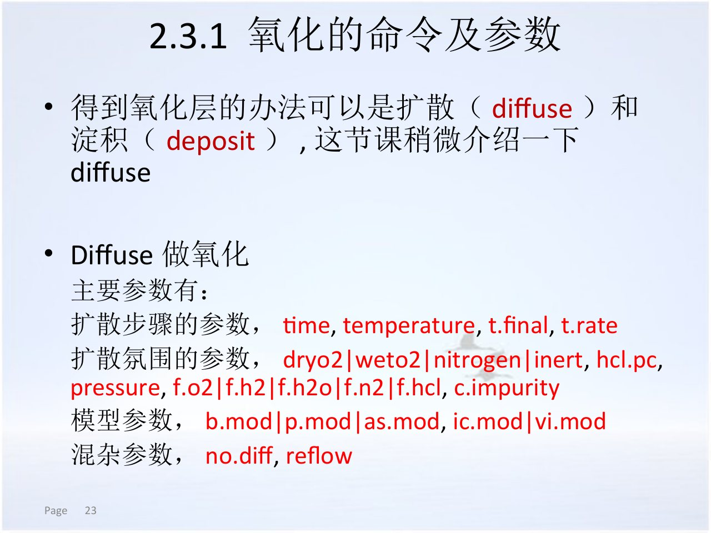
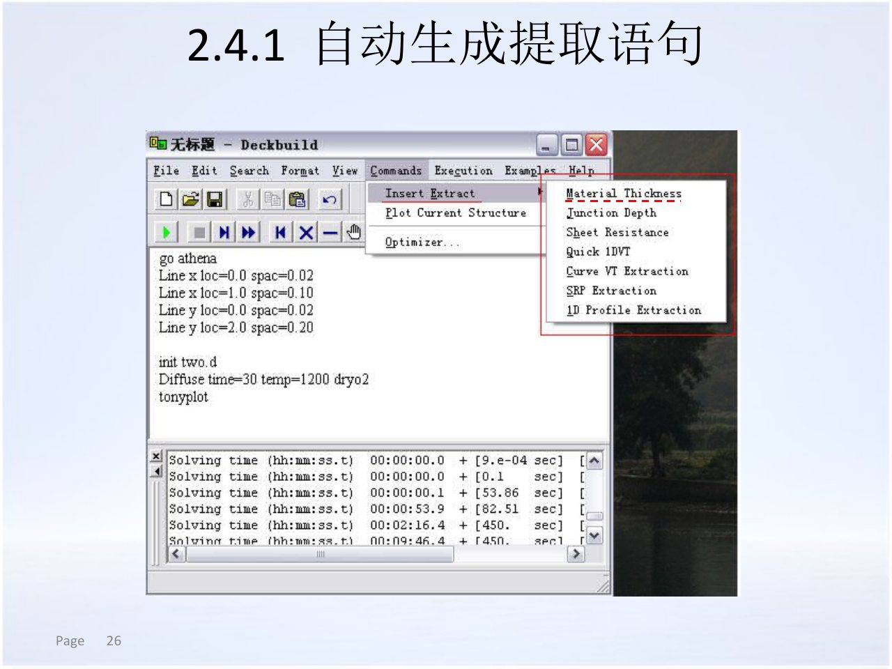

<!-- _class: lead -->

# 工艺仿真模块与流程

## 从 ATHENA 输入到可检查的功率器件二维结构

<!-- 讲师备注：开场说明本章不是软件按钮培训，而是建立“输入命令、结构状态、输出证据”三者的对应关系。 -->

---

# 本章学习目标

1. 说明 ATHENA 各模块分别解决哪类工艺问题。
2. 画出网格、初始化、工艺步骤、提取、结构操作和显示的主流程。
3. 解释为什么工艺顺序、网格和输出文件共同决定结果可信度。
4. 把流程映射到外延、场氧、注入、退火、终端和钝化构成的功率器件工艺链。

<!-- 讲师备注：四条目标分别对应模块认知、流程认知、证据意识和功率器件迁移，本章末尾会逐条回收。 -->

---

# 三节课沿着“状态如何演化”展开

| 时段 | 本节主线 | 课堂产出 |
| --- | --- | --- |
| 第1节 | ATHENA 模块与工艺仿真对象 | 能说清每个模块的输入与输出 |
| 第2节 | 网格、初始化与工艺推进 | 能读懂最小二维工艺输入 |
| 第3节 | 提取、可视化与可信度 | 能用证据判断结构是否可信 |

<p class="small-note">每节 45 分钟；本节内容按 21 个讲解页组织。</p>

<!-- 讲师备注：先展示三节路线，让学生知道后面每个模块介绍都会回到流程和证据，而不是停留在软件清单。 -->

---

<!-- _class: lead -->

# 第1节：工艺仿真器解决什么问题

## 从物理工艺描述到后续器件仿真的二维结构

<!-- 讲师备注：第1节先确认工艺仿真的定位，再区分 ATHENA 内部模块，最后落到一个可执行的二维工艺输入结构。 -->

---

# 工艺仿真预测“工艺之后器件长什么样”

<div class="icon-grid">
<div><h3>几何</h3><p>膜层厚度、开口、台阶与界面位置。</p></div>
<div><h3>组分</h3><p>材料区域和杂质在二维结构中的分布。</p></div>
<div><h3>电学起点</h3><p>为器件仿真提供结深、掺杂和几何边界。</p></div>
</div>

<p class="small-note">工艺仿真的产物不是一张示意图，而是可由 ATLAS 等器件仿真器继续读取的结构。</p>

<!-- 讲师备注：强调工艺与器件仿真的接口是结构文件，结构中的材料、掺杂、电极和网格都会影响后续计算。 -->

---

# 工艺仿真与器件仿真回答不同问题

| 问题 | 工艺仿真 | 器件仿真 |
| --- | --- | --- |
| 结构从哪里来 | 工艺步骤如何改变材料与掺杂 | 使用给定结构求解器件方程 |
| 核心变量 | 温度、时间、剂量、能量、膜厚、掩膜 | 偏置、温度、端口条件 |
| 典型输出 | 二维结构、结深、膜厚、剖面 | 电流、电容、电场、击穿与瞬态响应 |

<!-- 讲师备注：把两类仿真的边界说清楚，避免把“结构错误”误判成“器件模型不收敛”。 -->

---

# DeckBuild 组织输入、运行和结果查看

<ul class="check-list">
<li>输入窗口保存带顺序的 ATHENA 语句。</li>
<li>运行窗口回显步骤、警告和错误。</li>
<li>TonyPlot 读取结构或数据并生成可视结果。</li>
</ul>

<div class="icon-callout">

<p>DeckBuild 是集成环境，真正执行工艺计算的是 `go athena` 启动的 ATHENA 模块。</p>
</div>

<!-- 讲师备注：让学生区分环境与求解器；界面按钮只是组织命令，物理结果仍由被调用的模块产生。 -->

---

# 真实输入窗口把命令历史和运行反馈放在一起

<div class="split">
<div>
<h3>观察顺序</h3>
<ul>
<li>上方是工艺命令。</li>
<li>中部显示运行控制。</li>
<li>下方返回求解日志。</li>
</ul>
<p class="small-note">图中旧版界面用于识别信息层级，不作为当前版本按钮位置依据。</p>
</div>
<figure>

<figcaption>DeckBuild 将工艺输入与实时输出放在同一工作窗口</figcaption>
</figure>
</div>

<!-- 讲师备注：示意学生读图时先看输入区，再看状态栏与输出区；不要仅凭窗口中的示例参数照抄。 -->

---

# ATHENA 的输入与输出构成闭环

<div class="process-flow">
<span>输入命令</span>
<span>模块求值</span>
<span>结构更新</span>
<span>提取与显示</span>
<span>结构文件</span>
</div>

- 输入必须显式记录初始状态、工艺历史和模型选择。
- 输出既包括二维结构，也包括日志、提取量和可视化图像。
- 只有输入、输出和版本信息一起保存，结果才可复现。

<!-- 讲师备注：把闭环中的每一步讲成“可追溯”的一部分，尤其提醒模型和版本会影响数值结果。 -->

---

# SSuprem4 承担 ATHENA 的核心二维工艺计算

<div class="slide-grid">
<div><h3>注入与扩散</h3><p>解析或经验注入、杂质扩散、点缺陷与热过程。</p></div>
<div><h3>热氧化</h3><p>氧化剂输运、界面推进以及氧化增强扩散。</p></div>
<div><h3>外延与硅化物</h3><p>外延生长、硅化物形成及界面演化。</p></div>
<div><h3>掩膜与结构</h3><p>掩膜影响、淀积、刻蚀结构操作和输出。</p></div>
</div>

<!-- 讲师备注：SSuprem4 是本章的主求解器；后续命令示例多数会落到它或它调用的专用模型中。 -->

---

# 离子注入模块按精度和计算成本分层

<div class="icon-grid">
<div><h3>Analytical</h3><p>用矩模型快速给出常见掺杂剖面。</p></div>
<div><h3>SVDP</h3><p>用深度依赖矩表描述多层和屏蔽氧化层影响。</p></div>
<div><h3>Monte Carlo</h3><p>显式追踪离子碰撞、散射和损伤。</p></div>
</div>

<!-- 讲师备注：模型不是越复杂越好；应先问有没有匹配的矩表或截面数据，以及研究问题是否需要显式损伤。 -->

---

# MC Implant 用统计碰撞换取更细的物理描述

<ul>
<li>适合研究沟道、表面反射、多层屏蔽和晶格损伤。</li>
<li>需要足够的粒子统计量，结果天然带有随机误差。</li>
<li>计算成本高于解析模型，参数和随机种子也必须记录。</li>
</ul>

<div class="emphasis-box">若只关心常规结深与剂量，先验证解析模型是否已足够；若研究损伤或复杂形貌，再考虑 Monte Carlo。</div>

<!-- 讲师备注：这里强调模型选择的可辩护性，并提醒在结果比较中区分物理差异和统计噪声。 -->

---

# 热过程模块把氧化、扩散和硅化物联系起来

<div class="icon-callout">

<p>氧化会移动界面并改变杂质边界条件；扩散会重分布掺杂；硅化物会消耗硅并改变界面结构。</p>
</div>

- 热预算不能只记成一个温度。
- 升降温、气氛、压力和模型假设都可改变最终结构。
- 功率器件的场氧、栅氧和退火必须分别定义并分别检查。

<!-- 讲师备注：不要将一次 diffuse 语句理解为单一物理效应；它可能同时耦合氧化、杂质扩散与界面运动。 -->

---

# ELITE 处理二维淀积、刻蚀与表面形貌

<div class="slide-grid">
<div><h3>物理形貌</h3><p>考虑速率、方向和局部遮蔽的膜层演化。</p></div>
<div><h3>各向异性</h3><p>区分等向刻蚀、定向刻蚀和混合机制。</p></div>
<div><h3>台阶覆盖</h3><p>检查膜层在侧壁、拐角和开口处的连续性。</p></div>
<div><h3>结构输出</h3><p>把更新后的边界交给后续注入或热过程。</p></div>
</div>

<!-- 讲师备注：功率器件中的厚场氧、钝化层和终端台阶都依赖二维形貌，不能只用水平厚度描述。 -->

---

# Optolith 把掩膜、光学系统和光刻胶模型串起来

- 掩膜和版图描述开口位置与特征尺寸。
- 光源、投影和滤波描述成像条件。
- 曝光、烘烤和显影把光强分布转成光刻胶形貌。
- 工艺仿真关注最终开口；器件仿真再使用该开口形成的结构。

<p class="small-note">本章只建立流程位置，具体光刻参数留到第5章。</p>

<!-- 讲师备注：如果成像条件变化，最终掩膜窗口可能偏离版图；不能把版图开口直接等同于光刻胶开口。 -->

---

# ATHENA 的二维工作流与三维模块必须分开理解

<div class="split">
<div>
<h3>本课程主线</h3>
<ul>
<li>ATHENA/SSuprem4 的二维结构演化。</li>
<li>二维掩膜、网格和功率器件截面。</li>
<li>结果可直接进入二维器件仿真。</li>
</ul>
</div>
<div>
<h3>三维扩展</h3>
<ul>
<li>VICTORY PROCESS 面向三维工艺结构。</li>
<li>维度、网格和边界条件需要重新设计。</li>
<li>不能把二维网格预算直接外推到三维。</li>
</ul>
</div>
</div>

<!-- 讲师备注：明确课程主线是二维 ATHENA；三维工具只做定位，不把两套命令和网格假设混为一谈。 -->

---

# 课程范围内可仿真的工艺覆盖完整结构链

<div class="icon-strip">


</div>

- 注入、扩散、氧化、外延与硅化物改变材料或掺杂。
- 淀积、刻蚀、抛光与光刻改变几何或掩膜。
- 同一器件往往交替经历掺杂步骤和几何步骤。

<!-- 讲师备注：用图标带复习步骤族；课堂提问可让学生任选一个功率器件结构，指出它需要哪些步骤族。 -->

---

# 模块选择由“物理问题”和“结构维度”共同决定

<div class="icon-grid">
<div><h3>先问物理</h3><p>是掺杂扩散、表面形貌还是光学成像？</p></div>
<div><h3>再问维度</h3><p>二维截面是否足以代表目标结构？</p></div>
<div><h3>最后问证据</h3><p>是否有可用的模型参数、矩表或实验数据？</p></div>
</div>

<!-- 讲师备注：把模块选择三问写在黑板上：物理、维度、证据；后续遇到任何命令都可用这三问检查。 -->

---

# 一个最小工艺输入必须按状态顺序组织

```text
go athena
line x loc=0.0 spac=0.05
line x loc=2.0 spac=0.20
line y loc=0.0 spac=0.01
line y loc=2.0 spac=0.20
init silicon c.boron=1e15 two.d
diffuse time=30 temp=1000 dryo2
extract name="Tox" thickness oxide mat.occno=1 x.val=0
structure outfile=after_ox.str
tonyplot after_ox.str
```

<p class="small-note">示例只表达顺序；参数和模型必须由具体工艺与校准证据给出。</p>

<!-- 讲师备注：逐行讲“声明网格、声明初态、推进状态、量化状态、保存状态、显示状态”，不讨论示例数值是否适用于某条真实产线。 -->

---

# 每条工艺语句都消费一个状态并产生一个新状态

<div class="process-flow">
<span>初始材料</span>
<span>氧化后界面</span>
<span>注入后分布</span>
<span>退火后剖面</span>
<span>终端后结构</span>
</div>

- 当前结构是下一步的输入，不是从原始衬底重新开始。
- 掩膜、膜层和表面形貌会改变后续注入与扩散。
- 中间结构保存点应选在关键物理变化之后。

<!-- 讲师备注：用“状态机”类比可帮助学生理解顺序错误为何会污染整条工艺链。 -->

---

# 功率器件的工艺变量直接决定器件设计空间

<div class="slide-grid">
<div><h3>漂移区</h3><p>外延厚度和掺杂影响耐压与导通电阻。</p></div>
<div><h3>绝缘层</h3><p>场氧和栅氧承担不同电场与可靠性职责。</p></div>
<div><h3>结与终端</h3><p>注入窗口、剂量和退火决定边缘电场分布。</p></div>
<div><h3>表面</h3><p>钝化和界面状态影响漏电与长期稳定性。</p></div>
</div>

<!-- 讲师备注：从器件指标倒推工艺变量；这里只讲设计关系，不给出未经校准的耐压或掺杂数字。 -->

---

# 基础功率器件工艺链体现“几何与掺杂交替”

<div class="process-flow">
<span>衬底/外延</span>
<span>场氧与有源区</span>
<span>阱/终端注入</span>
<span>退火与栅结构</span>
<span>钝化与接触</span>
</div>

- 外延先建立漂移区背景。
- 场氧和有源区开口改变后续注入路径。
- 注入后的热过程同时影响结深和已有氧化层。
- 最终结构必须保留终端区和主器件区。

<!-- 讲师备注：这是本章的概念主链，具体器件可能在步骤数量和顺序上不同；第5章会展开每一步的参数含义。 -->

---

# 顺序改变会改变界面、掩膜和杂质边界

<div class="icon-callout">

<p>先刻蚀再注入，注入只经过开口；先注入再刻蚀，被去除材料中的杂质也会一并消失。</p>
</div>

<ul>
<li>先氧化后注入，屏蔽氧化层会改变有效注入深度。</li>
<li>退火与氧化顺序不同，杂质再分布和界面推进不同。</li>
<li>保存点位置不同，后续结构操作的基线也不同。</li>
</ul>

<!-- 讲师备注：用三个“先后题”训练学生检查命令顺序，并指出这些差异远大于单纯调一个默认参数。 -->

---

# 可执行骨架必须包含六类语句

<div class="icon-grid">
<div><h3>网格</h3><p>`line` 定义空间离散。</p></div>
<div><h3>初态</h3><p>`init` 定义材料与背景。</p></div>
<div><h3>工艺</h3><p>热、注入、薄膜和光刻步骤。</p></div>
<div><h3>提取</h3><p>`extract` 量化结构。</p></div>
<div><h3>保存</h3><p>`structure` 留下结构状态。</p></div>
<div><h3>显示</h3><p>TonyPlot 检查与导出。</p></div>
</div>

<!-- 讲师备注：把骨架当作检查表；如果一份输入缺少保存或提取，即使运行成功也很难形成可验证证据。 -->

---

# 运行成功不等于结构正确

- 求解器可能完成计算，但网格过粗、掩膜偏位或材料缺失仍会产生错误结构。
- 日志中的警告需要和 TonyPlot、切线和提取量一起判断。
- 后续器件仿真出现异常时，应回溯到最早发生结构偏差的工艺步骤。

<!-- 讲师备注：建立“语法正确、数值收敛、结构可信”三层标准，避免只凭绿色运行状态宣告成功。 -->

---

# 第1节检查点：能否为每个模块说出证据

<div class="icon-callout">

<p>任选“注入、氧化、刻蚀、光刻”之一，说明由哪个模块计算、需要什么输入，以及应保存什么输出证据。</p>
</div>

<p>合格回答必须同时包含<strong>物理过程、软件模块、输出对象</strong>，不能只列一个命令名称。</p>

<!-- 讲师备注：随机点名四类工艺，用一分钟口述检查学生是否建立了模块与证据的映射。 -->

---

<!-- _class: lead -->

# 第2节：网格、初始化与工艺推进

## 让命令在正确的空间与材料状态上执行

<!-- 讲师备注：第2节进入可执行流程，重点是网格和初始化为何不是“准备动作”，而是后续所有计算的约束。 -->

---

# 工艺流程通常包含六个连续阶段

<div class="process-flow">
<span>建立网格</span>
<span>初始化</span>
<span>执行工艺</span>
<span>提取特性</span>
<span>结构操作</span>
<span>TonyPlot 显示</span>
</div>

<p class="small-note">实际输入可以循环多个“工艺—提取—保存”组合，但每一步都必须能追溯到当前结构。</p>

<!-- 讲师备注：这是本节示例给出的主流程；强调阶段之间不是一次性瀑布，而可能在工艺链中多次重复。 -->

---

# 网格是结构状态的一部分

<ul>
<li>网格线承载材料区域、界面和未知量。</li>
<li>淀积和刻蚀会改变局部网格需求。</li>
<li>结区、表面和高梯度区若分辨不足，提取量会失真。</li>
</ul>

<p class="small-note">保存结构时应连同网格一起思考，而不是只检查彩色材料边界。</p>

<!-- 讲师备注：后续器件仿真的收敛和精度会继承工艺结构网格，因此这里强调网格与结构状态同源。 -->

---

# `line` 命令用位置与间距建立非均匀网格

<div class="split">
<div>
<h3>读图要点</h3>
<ul>
<li>`loc` 指定坐标位置。</li>
<li>`spac` 指定该位置附近的网格间距。</li>
<li>多个控制点之间的间距由网格生成器过渡。</li>
</ul>
</div>
<figure>

<figcaption>课程原图：位置控制点与局部 spacing 共同约束网格</figcaption>
</figure>
</div>

<!-- 讲师备注：用图中 x1、x2、y1、y2 解释控制点，不必追求所有过渡网格完全解析；重点是“物理梯度决定控制点”。 -->

---

# 均匀网格适合验证，非均匀网格适合真实结区

| 方案 | 优点 | 风险 |
| --- | --- | --- |
| 全局均匀 | 设置简单、易于收敛实验 | 计算量大，仍可能遗漏局部梯度 |
| 界面加密 | 用局部 `spac` 提高表面和结区分辨率 | 过渡过陡可能产生畸形单元 |
| 工艺后释放 | 用 `relax` 调整不再需要的细网格 | 释放过度会丢失关键界面信息 |

<!-- 讲师备注：示例同时给出均匀与非均匀例子；这里讲选择逻辑，让学生比较精度、成本和网格质量。 -->

---

# 网格加密应服从物理梯度而不是均匀铺满

<div class="icon-grid">
<div><h3>表面与界面</h3><p>氧化、注入和沟道区域需要局部分辨率。</p></div>
<div><h3>结与终端</h3><p>曲率和横向梯度要求横向、纵向同时考虑。</p></div>
<div><h3>大块衬底</h3><p>远离关键区的区域可用较粗网格。</p></div>
</div>

<!-- 讲师备注：提醒学生不要只加密纵向；功率器件终端和栅角往往是二维或三维梯度集中的位置。 -->

---

# 网格预算必须用收敛实验而不是固定数字证明

- 旧版课程材料给出过约 20,000 网格点的示例上限，但真实限制取决于版本、模块和机器配置。
- 网格数量增加不一定更准，单元质量差也会导致失败。
- 应比较粗细两套网格下的结深、膜厚、剖面和后续器件结果。

<div class="icon-callout">

<p>可信的说法是“该结构在当前网格下已收敛”，而不是“网格越密越好”。</p>
</div>

<!-- 讲师备注：避免把旧材料的 20,000 点数当作通用常数；强调版本相关和网格收敛证据。 -->

---

# 淀积和刻蚀会改变后续网格控制参数

<div class="icon-strip">


</div>

- 新膜层需要足够分层以表达材料界面。
- `dy`、`ydy`、`div` 等参数控制新增层的网格划分。
- 刻蚀掉材料并不自动保证剩余网格适合新几何。
- 复杂台阶应在每一步保存结构并检查网格密度。

<!-- 讲师备注：此处建立“拓扑变化后重新检查网格”的习惯；详细命令在第5章淀积与刻蚀部分展开。 -->

---

# `relax` 用空间范围释放不必要的细网格

```text
relax x.max=0.5 y.min=0.1 dir.x
```

<ul>
<li>通过材料或坐标范围限制可释放区域。</li>
<li>`dir.x`、`dir.y` 指定允许调整的方向。</li>
<li>释放后必须检查界面、结区和后续注入是否仍被分辨。</li>
</ul>

<!-- 讲师备注：说明 relax 不是简单“减网格”，而是在保持关键物理区域可控的前提下降低计算量。 -->

---

# `init` 声明材料系统、空间维度和初始杂质

<div class="icon-callout">

<p>初始化语句建立后续所有工艺步骤共同使用的起点；起点错误不能由后续默认模型自动修复。</p>
</div>

- 选择衬底材料、晶向和背景掺杂。
- 声明一维或二维仿真维度。
- 可从已有结构文件继续，而不是重新建衬底。

<!-- 讲师备注：把 init 讲成“状态声明”而非形式化开头，要求学生每次解释材料、维度、掺杂与来源。 -->

---

# 初始化示例应能回答四个问题

| 问题 | 示例中的对应信息 |
| --- | --- |
| 从什么材料开始 | `silicon`、`gaas` 等材料名 |
| 晶向是什么 | `orientation=100` 等 |
| 背景浓度或电阻率是多少 | `c.boron`、`resistivity` |
| 结构是几维、来自哪里 | `two.d` 或 `infile=...` |

<p class="small-note">示例用于说明参数类别；具体晶向、掺杂和电阻率来自器件设计。</p>

<!-- 讲师备注：不要让学生背某条初始化语句，而是训练他们从任何 init 语句中抽取四类状态信息。 -->

---

# 从已有结构开始必须验证“导入状态”没有丢失

<ul>
<li>确认 `infile` 指向的 `.str` 文件确实包含目标材料、掺杂、电极和掩膜。</li>
<li>检查导入后维度、坐标翻转和网格是否符合后续命令。</li>
<li>保存导入后的基线结构，避免后续差异无法归因。</li>
</ul>

<!-- 讲师备注：导入结构是最容易被忽略的断点；提醒学生在任何工艺链分叉前建立明确的基线。 -->

---

# 衬底参数必须与功率器件的背景设计一致

<div class="slide-grid">
<div><h3>材料</h3><p>决定可用模型、界面与后续工艺兼容性。</p></div>
<div><h3>晶向</h3><p>影响注入沟道、氧化速率和模型参数选择。</p></div>
<div><h3>背景掺杂</h3><p>建立漂移区或衬底的初始电学背景。</p></div>
<div><h3>电阻率</h3><p>可替代直接掺杂，但换算假设必须记录。</p></div>
</div>

<!-- 讲师备注：材料、晶向、掺杂和电阻率是相互关联的设计输入，不能把默认衬底当成无关背景。 -->

---

# 氧化可由热扩散过程或直接淀积得到

<div class="split">
<div>
<h3>两种路径</h3>
<ul>
<li>`diffuse`：热氧化，并与杂质扩散耦合。</li>
<li>`deposit`：增加指定材料膜层，不消耗衬底。</li>
<li>课程重点是热氧化的物理耦合。</li>
</ul>
</div>
<figure>

<figcaption>课程原图：热氧化语句同时包含热预算、气氛与模型选择</figcaption>
</figure>
</div>

<!-- 讲师备注：先区分热氧化和淀积氧化，再指出图中参数按“步骤、气氛、模型、混合效应”分组阅读。 -->

---

# 热氧化会推进界面并改变杂质边界

<div class="process-flow">
<span>氧化剂输运</span>
<span>界面反应</span>
<span>Si/SiO2 推进</span>
<span>杂质再分布</span>
<span>结构更新</span>
</div>

- 氧化层厚度不是唯一结果，硅消耗和界面位移同样重要。
- 氧化增强或延缓扩散会改变已有掺杂剖面。
- 功率器件中，厚场氧与薄栅氧需要不同的工艺历史。

<!-- 讲师备注：用移动边界说明为什么仅在后处理中画一层氧化膜不等于热氧化仿真。 -->

---

# 提取量应紧跟在产生它的结构步骤之后

<div class="split">
<div>
<h3>可复用原则</h3>
<ul>
<li>提取对象要命名。</li>
<li>提取位置和材料序号要明确。</li>
<li>每条关键步骤后都可提取、保存、绘图。</li>
</ul>
<p class="small-note">DeckBuild 菜单可生成提取语句，但语句仍需人工核对。</p>
</div>
<figure>

<figcaption>课程原图：DeckBuild 提供材料厚度等提取语句入口</figcaption>
</figure>
</div>

<!-- 讲师备注：菜单只帮助写语法，不替学生定义“要证明什么”；提取位置选错会产生看似精确的无效数字。 -->

---

# 功率器件优先提取五类结构量

<div class="icon-grid">
<div><h3>膜厚</h3><p>场氧、栅氧、外延层和钝化层。</p></div>
<div><h3>结深</h3><p>主结与终端结的纵向、横向位置。</p></div>
<div><h3>掺杂剖面</h3><p>表面浓度、峰值和纵向衰减。</p></div>
<div><h3>薄层电阻</h3><p>为后续电学模型提供工艺相关量。</p></div>
<div><h3>开口尺寸</h3><p>掩膜窗口、间距和台阶形貌。</p></div>
<div><h3>运行状态</h3><p>警告、错误与模型选择。</p></div>
</div>

<!-- 讲师备注：将提取量和功率器件设计变量对应起来，避免只提取一个氧化层厚度就宣布结构正确。 -->

---

# 结构操作负责保存、导入、镜像与翻转

- `structure outfile=...` 在关键节点留下可复用结构。
- `infile` 从结构文件继续计算。
- 镜像和翻转用于构造对称或完整截面。
- 操作后先确认坐标方向、电极和材料区域仍一致。

<!-- 讲师备注：结构操作会改变解释坐标；对功率器件的左右对称终端区尤其要检查镜像后的主结位置。 -->

---

# TonyPlot 是结构证据的查看器，而不是结果装饰器

<div class="split">
<div>
<h3>检查顺序</h3>
<ol>
<li>材料边界是否连续。</li>
<li>电极与掩膜窗口是否对应。</li>
<li>网格与掺杂颜色是否匹配预期。</li>
</ol>
</div>
<figure>

<figcaption>TonyPlot 可显示 ATHENA 结构和后续器件数据</figcaption>
</figure>
</div>

<!-- 讲师备注：区分结构浏览和定量验证；看到漂亮彩色图不代表结构数值已经正确。 -->

---

# Cutline 把二维图转成可比较的定量剖面

<div class="split reverse">
<figure>

<figcaption>TonyPlot 切线把二维结构转成一维定量剖面</figcaption>
</figure>
<div>
<h3>切线的三要素</h3>
<ul>
<li>切割位置必须固定。</li>
<li>材料与杂质类型必须标出。</li>
<li>同一工艺比较应使用同一坐标。</li>
</ul>
</div>
</div>

<!-- 讲师备注：展示切线与二维结构的一一对应关系；后续结果比较尽量使用相同 cutline，而不是只比较截图。 -->

---

# 第2节检查点：读一条工艺路径

<div class="icon-callout">

<p>给出一条“网格—初始化—氧化—注入—退火—保存”路径，指出每一步消费的前一状态、产生的新状态和一个验收证据。</p>
</div>

<p>检查重点是顺序与接口，而不是命令拼写速度。</p>

<!-- 讲师备注：可让学生两人一组，一人在纸上画状态转换，另一人指出缺失的提取或保存节点。 -->

---

<!-- _class: lead -->

# 第3节：结果可信度与完整工艺链

## 用提取量、切线和文件集证明结构可以继续使用

<!-- 讲师备注：第3节从“能跑通”走向“能验收”，并把通用流程映射到功率器件的外延、终端和钝化。 -->

---

# 工艺结果必须被当作可审计的证据对象

<div class="icon-callout">

<p>一条可信结果至少要绑定：输入命令、模型与版本、结构文件、提取量和可视化检查。</p>
</div>

- 截图无法替代原生结构文件。
- 日志中的警告不能因最终图像正常而删除。
- 结构量必须能在同一坐标与同一单位下复现。

<!-- 讲师备注：引入“证据对象”概念，为后续器件仿真、参数校准和报告建立最低交付标准。 -->

---

# 最小文件集应覆盖输入、状态、数值和图像

| 文件或对象 | 主要用途 |
| --- | --- |
| 工艺输入 | 复现完整步骤和模型选择 |
| `.str` 结构文件 | 继续工艺或进入器件仿真 |
| 运行日志 | 追踪警告、错误和求解状态 |
| 提取数据 | 定量比较膜厚、结深和电阻 |
| TonyPlot 图 | 人工检查结构、网格与剖面 |

<!-- 讲师备注：强调每类文件回答不同问题；缺少结构文件时，单凭提取表无法重建器件。 -->

---

# 输入文件应显式表达工艺意图

<ul>
<li>用注释把步骤对应到外延、场氧、终端或钝化。</li>
<li>为关键结构使用有意义的文件名。</li>
<li>记录模型开关、参数来源和单位约定。</li>
<li>把可复用的衬底条件与可调工艺参数分开。</li>
</ul>

<p class="small-note">可读性直接影响后续校准与审阅，而不是只影响“代码美观”。</p>

<!-- 讲师备注：说明可读性是工程要求；后续参数校准常需要定位某一工艺步骤并只改有限的参数。 -->

---

# 结构文件必须保存四类后续仿真信息

<div class="slide-grid">
<div><h3>材料区域</h3><p>决定介电常数、迁移率与复合模型的选择。</p></div>
<div><h3>掺杂分布</h3><p>决定结位置和器件方程中的固定电荷。</p></div>
<div><h3>几何边界</h3><p>决定电极、界面和终端形貌。</p></div>
<div><h3>网格</h3><p>决定后续器件求解的离散质量。</p></div>
</div>

<!-- 讲师备注：如果任一信息缺失或错误，后续器件仿真可能表现为不收敛、击穿异常或电流路径错误。 -->

---

# 日志应按“警告类型”而不是只看末尾判断

<div class="process-flow">
<span>命令解析</span>
<span>材料/网格</span>
<span>模型适用性</span>
<span>数值收敛</span>
<span>输出写入</span>
</div>

- 解析错误阻止步骤执行。
- 网格和材料警告可能悄悄改变结构。
- 收敛警告要求检查步长、模型和局部梯度。
- 输出警告可能导致文件缺失或被覆盖。

<!-- 讲师备注：训练学生从最早异常开始排查，而不是只搜索最后一行 ERROR。 -->

---

# 二维结构验收要同时检查四层信息

<div class="icon-grid">
<div><h3>几何</h3><p>膜层、开口、台阶和终端区是否连续。</p></div>
<div><h3>材料</h3><p>区域编号与材料边界是否符合语句。</p></div>
<div><h3>结</h3><p>结线位置和方向是否符合注入、退火。</p></div>
<div><h3>网格</h3><p>高梯度区是否有足够分辨率。</p></div>
</div>

<!-- 讲师备注：把彩色结构图拆成四个检查层；可以让学生轮流指出图中最值得怀疑的区域。 -->

---

# 一维切线用于比较“位置—浓度”而不是比较截图

<div class="icon-strip">


</div>

- 固定横向位置，比较纵向掺杂剖面。
- 对横向终端，可固定纵向位置比较横向扩散。
- 同一设计点的比较必须使用相同切线和坐标范围。

<p class="small-note">截图缩放会改变视觉斜率；数值切线才适合判断结深与梯度。</p>

<!-- 讲师备注：强调一维切线是可重复的定量视图，也是第5章参数校准最常用的结构输出。 -->

---

# 掺杂剖面至少要通过三项物理直觉检查

<div class="slide-grid">
<div><h3>方向</h3><p>注入峰、表面耗尽和衬底背景是否符合步骤顺序。</p></div>
<div><h3>量级</h3><p>峰值与背景之差能否形成可辨认的结。</p></div>
<div><h3>平滑性</h3><p>热过程是否造成合理的扩散与界面再分布。</p></div>
<div><h3>网格独立性</h3><p>剖面峰位与结深是否随网格变化显著。</p></div>
</div>

<!-- 讲师备注：不要求学生在课堂上判断具体迁移率模型，但必须能看出剖面方向或量级明显不合理。 -->

---

# 氧化层厚度要结合材料与截面位置提取

- 热氧化厚度应在目标材料区域内提取。
- 切割点靠近结构边缘时，警告可能表示读数不代表平面区域。
- 场氧与栅氧要分开提取，不能用全局最大厚度代替设计值。
- 提取结果应同时保留角度单位与数值。

<p class="small-note">本节示例中曾用 `extract` 得到具体氧化层厚度；该数字只属于对应示例条件，不能直接迁移。</p>

<!-- 讲师备注：示例展示过具体 Tox 结果，但课堂不把示例数值当设计常量；强调条件绑定和提取位置有效性。 -->

---

# 结深与薄层电阻必须绑定到设计区域

| 提取量 | 主要依赖 | 常见误用 |
| --- | --- | --- |
| 纵向结深 | 注入能量、剂量、热预算、背景浓度 | 在终端边缘读取主结 |
| 横向结深 | 掩膜窗口、倾角、扩散、曲率 | 用中心切线代替边缘 |
| 薄层电阻 | 掺杂剖面、激活假设、几何区域 | 忽略材料与区域范围 |

<!-- 讲师备注：指出结深和薄层电阻不是全器件唯一值；必须说明提取坐标、杂质类型和区域。 -->

---

# 网格收敛是结构可信度的最低门槛

<div class="icon-callout">

<p>至少比较一次粗细网格：若结深、膜厚和关键剖面仍落在可接受误差内，才可以讨论模型差异。</p>
</div>

<ol>
<li>保持工艺输入和模型不变。</li>
<li>只提高关键区域分辨率。</li>
<li>比较同一提取语句和同一 cutline。</li>
<li>记录计算成本与结果误差。</li>
</ol>

<!-- 讲师备注：把网格收敛做成受控实验；不能一边加密网格一边修改工艺参数，否则无法归因。 -->

---

# 时间步与模型选择也会制造“假的结构差异”

- 快速热过程和界面反应可能需要更细的时间步。
- 高级扩散模型需要完整、匹配的模型参数。
- 不同注入模型对沟道和多层屏蔽的描述能力不同。
- 模型切换必须记录，并通过实验或独立数据验证。

<p class="small-note">数值收敛、网格收敛和模型校准是三个不同问题。</p>

<!-- 讲师备注：区分三类不确定性，避免把所有差异归因于参数，或把所有不收敛归因于网格。 -->

---

# 完整功率器件工艺链需要分区管理证据

<div class="process-flow">
<span>外延背景</span>
<span>场氧隔离</span>
<span>主结/阱</span>
<span>终端注入</span>
<span>退火钝化</span>
</div>

<ul>
<li>外延层决定漂移区背景与厚度。</li>
<li>场氧和有源区定义表面几何。</li>
<li>主结与终端需要不同的注入窗口和剂量。</li>
<li>最终退火要在激活、扩散和已有膜层之间权衡。</li>
</ul>

<!-- 讲师备注：把工艺链视为多目标问题；任何单步调参都要检查对主结、终端和表面区域的其他影响。 -->

---

# 场氧与栅氧服务于不同电学目标

<div class="split">
<div>
<h3>厚场氧</h3>
<ul>
<li>隔离相邻区域和降低寄生耦合。</li>
<li>关注厚度、台阶覆盖与热预算。</li>
</ul>
<h3>薄栅氧</h3>
<ul>
<li>控制栅极耦合与阈值相关行为。</li>
<li>关注厚度均匀性、界面与可靠性。</li>
</ul>
</div>
<div class="icon-callout">

<p>两者可能共享热氧化模型，却不能共享同一个厚度目标或同一条验收阈值。</p>
</div>
</div>

<!-- 讲师备注：用“大目标不同、小目标分别验收”解释为什么同一氧化模块需要两条工艺路径和两套提取语句。 -->

---

# 终端注入的核心是窗口、剂量与热预算的联合

<div class="process-flow">
<span>掩膜窗口</span>
<span>注入剂量/能量</span>
<span>退火扩散</span>
<span>结面平滑</span>
<span>边缘电场调制</span>
</div>

- 窗口过宽或过窄都会改变终端区的电荷平衡。
- 剂量和退火共同决定结的横向延伸。
- 二维曲率意味着中心切线不能代表边缘结深。
- 最终判断要把结构交给器件仿真检查电场分布。

<!-- 讲师备注：讲结构设计逻辑而不指定 guard ring 或 JTE 的数值；强调终端验证必须回到二维结构和电场。 -->

---

# 终端形貌要检查窗口、间距、曲率和材料覆盖

<div class="icon-grid">
<div><h3>窗口</h3><p>刻蚀或显影后的实际开口是否与版图一致。</p></div>
<div><h3>间距</h3><p>多个终端环或场板之间的位置关系。</p></div>
<div><h3>曲率</h3><p>结面和台阶拐角是否出现异常尖角。</p></div>
<div><h3>覆盖</h3><p>介质与钝化层是否连续覆盖关键界面。</p></div>
</div>

<!-- 讲师备注：把“看起来像终端”升级为四个可检查几何量，为后续器件仿真的边缘电场分析准备结构。 -->

---

# 钝化和表面条件也是工艺结果的一部分

<ul>
<li>钝化层厚度与覆盖会影响表面电荷和电场边界。</li>
<li>接触孔和金属开口必须与有源区、终端区对齐。</li>
<li>界面质量不能由二维彩色截面单独证明。</li>
<li>工艺结构应保留材料名称，方便后续界面模型识别。</li>
</ul>

<!-- 讲师备注：说明二维结构图的能力边界；表面态和可靠性需要实验或更专门模型，不能凭空从截图中读出。 -->

---

# 每个功率器件结论都应有追踪矩阵

<p>把每个设计问题绑定到工艺、结构和后续验证。</p>

| 设计问题 | 工艺步骤 | 结构证据 | 后续验证 |
| --- | --- | --- | --- |
| 漂移区是否成立 | 外延 | 厚度与背景掺杂 | 耐压、导通电阻 |
| 主结是否形成 | 注入与退火 | 结深与剖面 | 反向特性 |
| 终端是否连续 | 终端注入、退火 | 窗口、结面与间距 | 边缘电场 |
| 表面是否受控 | 氧化、钝化 | 膜层覆盖与界面 | 漏电与可靠性 |

<!-- 讲师备注：追踪矩阵把工艺、结构和器件验证连起来；没有后续验证目标的工艺截图只是未使用证据。 -->

---

# 常见失败模式通常能回溯到流程边界

| 现象 | 优先检查 |
| --- | --- |
| 结深明显偏浅 | 注入能量、屏蔽层、网格、退火是否生效 |
| 氧化后掺杂异常 | 氧化与扩散耦合、边界条件、提取位置 |
| 终端形貌缺口 | 掩膜窗口、刻蚀方向、材料选择 |
| 后续器件仿真失败 | 结构网格、材料区域、电极和文件完整性 |

<!-- 讲师备注：用“现象—最早可能状态”表训练排查顺序；不先猜器件模型，而是先回到结构证据。 -->

---

# 一份工艺仿真报告应让别人能够重做

<div class="icon-callout">

<p>报告至少说明目标、结构基线、步骤与顺序、模型与版本、验收提取量、异常处理和最终结构去向。</p>
</div>

- 图表标题必须写出材料、区域和工艺阶段。
- 数值必须给出单位、坐标和提取语句含义。
- 结论应区分“结构已经验证”和“器件性能尚待验证”。

<!-- 讲师备注：这是本章的核心交付要求；把“可重做”作为判断报告是否合格的标准。 -->

---

# 第3节检查点：给结构做一次证据审计

<div class="icon-grid">
<div><h3>输入可读</h3><p>步骤、单位、模型与注释完整。</p></div>
<div><h3>输出可复用</h3><p>结构、日志、提取量和图均在。</p></div>
<div><h3>结论可辩护</h3><p>通过网格、切线、物理趋势与区域检查。</p></div>
</div>

<p>若任一项缺失，应先补证据，不进入参数校准或器件仿真的结论阶段。</p>

<!-- 讲师备注：以审计表收束第3节，要求学生用“输入可读、输出可复用、结论可辩护”三问评价自己的结构。 -->

---

# 本章小结

1. ATHENA 通过多个模块覆盖注入、热过程、薄膜、刻蚀与光刻。
2. 工艺流程是结构状态的连续演化，网格和初始化决定所有后续计算。
3. 提取、结构保存和 TonyPlot 切线共同构成结构证据。
4. 功率器件要分别验收外延、氧化、主结、终端和钝化，并用网格收敛排除数值假象。

<!-- 讲师备注：按四条目标回收本章；下一章将把每个工艺步骤的参数、模型和校准方法展开。 -->

---

# 课堂任务与检查点

<div class="split">
<div>
<h3>纸面任务</h3>
<ol>
<li>选择一个功率器件截面。</li>
<li>写出六阶段流程中的关键结构状态。</li>
<li>为每个状态指定一个提取量和一个图像检查。</li>
</ol>
</div>
<div>
<h3>提交标准</h3>
<ul>
<li>能说明步骤顺序为何不能交换。</li>
<li>能指出至少一个网格风险。</li>
<li>能说明最终 `.str` 将交给谁使用。</li>
</ul>
</div>
</div>

<!-- 讲师备注：这是纯理论课的任务，不要求现场运行软件；下一节课前可用一页流程图检验学生是否真正掌握状态演化。 -->

---

# 本章参考文献

<ol class="reference-list">
<li>SILVACO INTERNATIONAL. <em>ATHENA User's Manual</em>[Z]. Santa Clara, CA: Silvaco International, n.d.</li>
<li>SILVACO INTERNATIONAL. <em>Silvaco TCAD Process Simulation Modules and Flow</em>[Z]. Silvaco TCAD Training Materials, n.d.</li>
<li>SILVACO INTERNATIONAL. <em>SSuprem4 Process Simulation Software</em>[Z]. Silvaco International, n.d.</li>
<li>SILVACO INTERNATIONAL. <em>VICTORY PROCESS: Full Physical 3D Semiconductor Simulator</em>[Z]. Silvaco International, 2012.</li>
<li>SILVACO INTERNATIONAL. <em>VICTORY CELL: 3D Process Simulator for Large Structures</em>[Z]. Silvaco International, 2009.</li>
</ol>

<!-- 讲师备注：文献页保留模块手册和课程示例的对应关系；课堂上提醒学生以所用版本手册和当前软件版本的模型库为准。 -->
