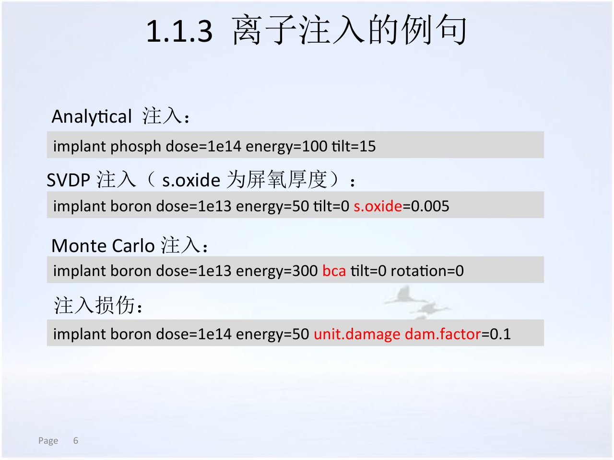
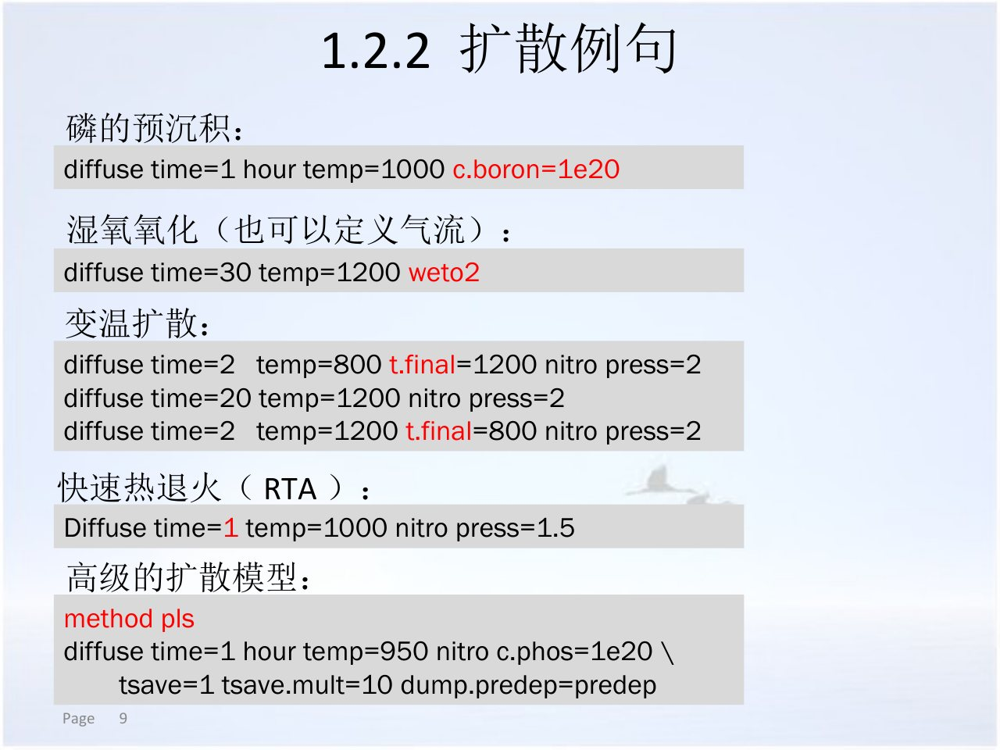
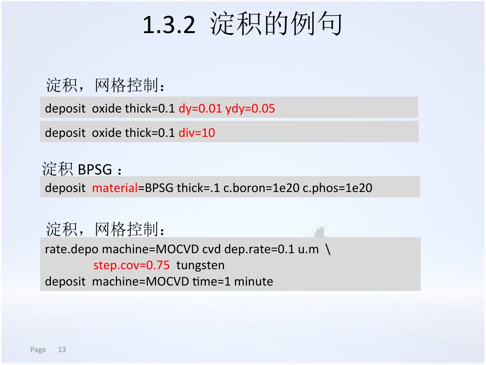
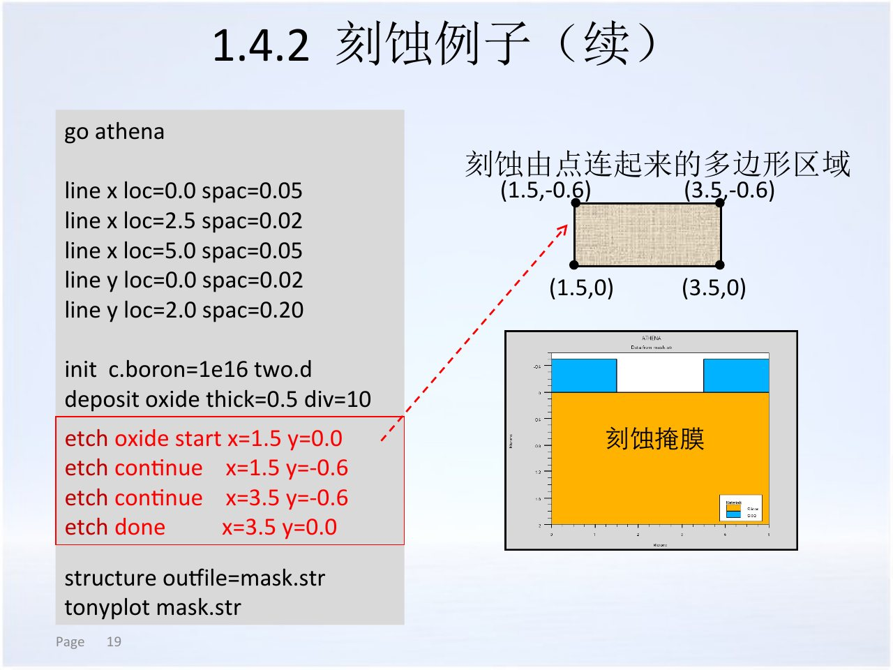
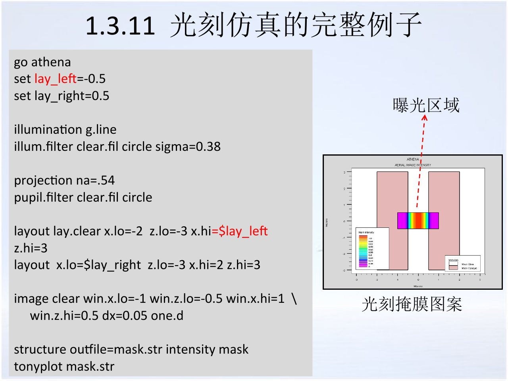
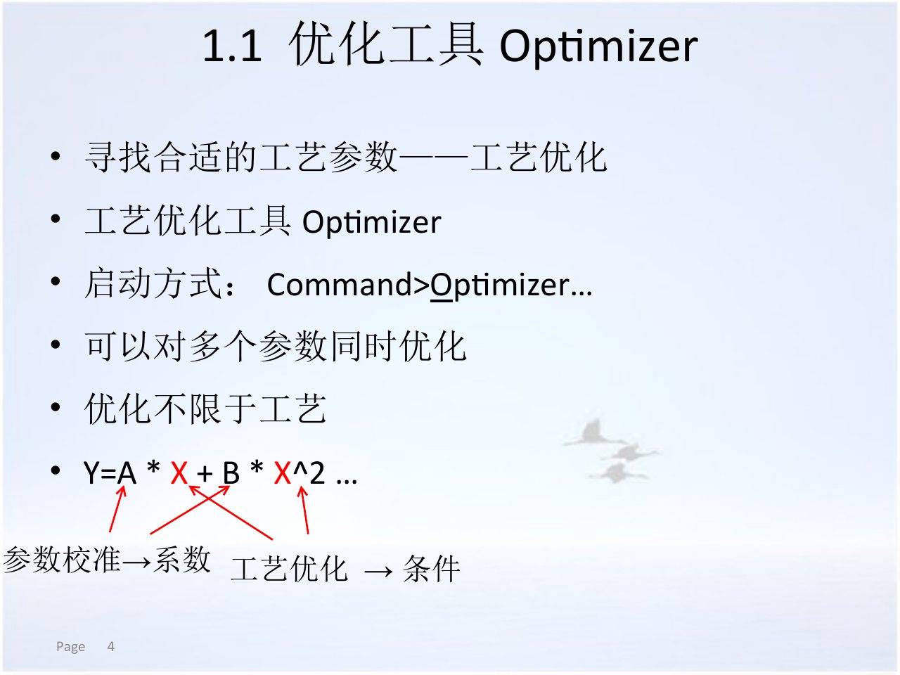
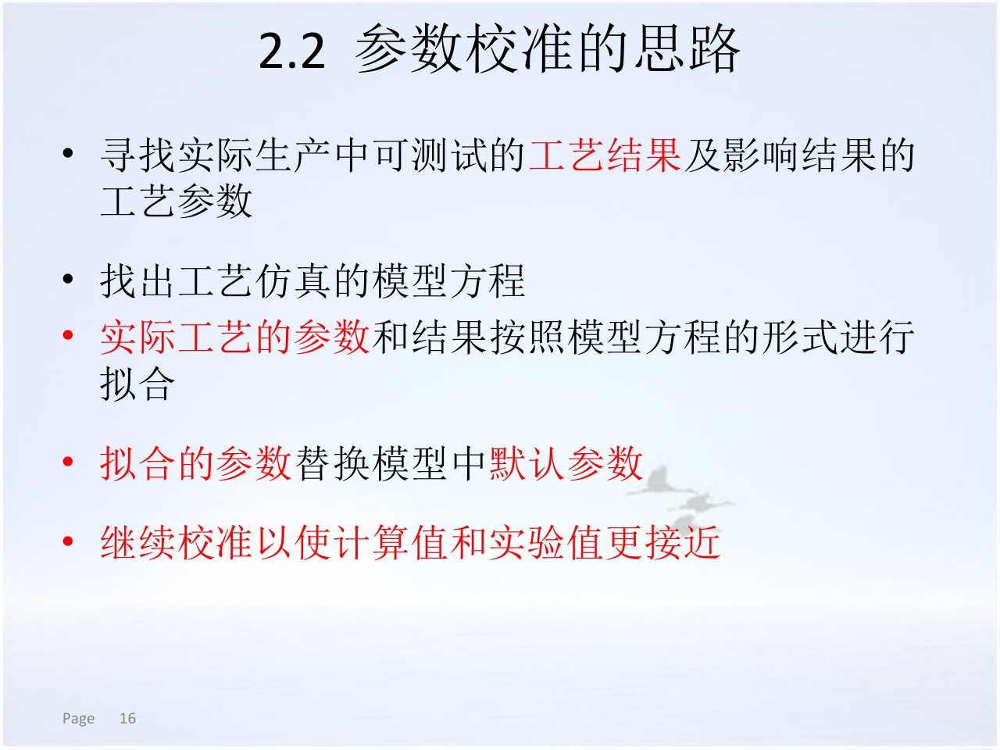
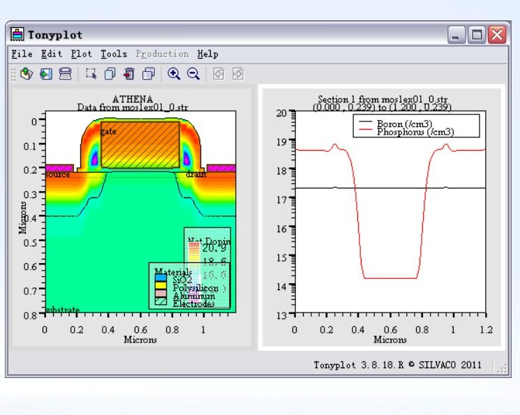
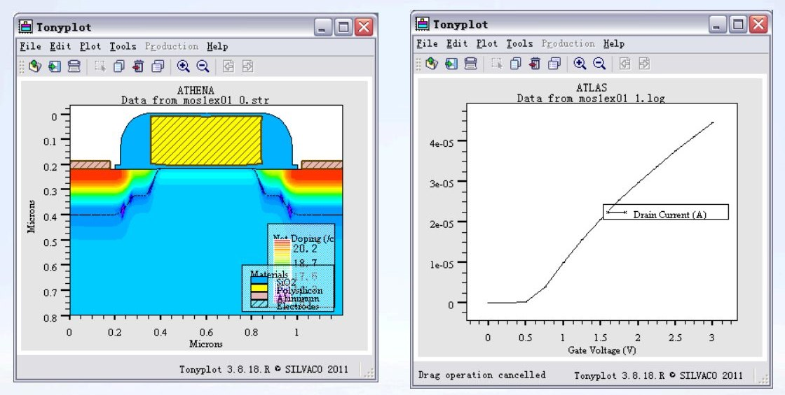

<!-- _class: lead -->

# 关键工艺步骤

## 从注入与热过程，到薄膜、光刻、优化和校准

<!-- 讲师备注：开场明确本章的三段结构：先讲掺杂与热过程，再讲几何与光刻，最后讲优化和校准。 -->

---

# 本章学习目标

1. 解释注入、扩散、氧化、淀积、刻蚀、外延和光刻的核心参数。
2. 判断每个参数首先改变的是材料、几何还是后续热历史。
3. 说明 Optimizer、VWF 和参数校准各自解决什么问题。
4. 为功率器件的工艺结果设计可测量、可留出验证的校准方案。

<!-- 讲师备注：四条目标分别对应参数物理、结构结果、工具定位和证据设计；本章不以记忆命令表为终点。 -->

---

# 三节课程从“参数”走向“可信参数”

| 时段 | 本节主线 | 关键问题 |
| --- | --- | --- |
| 第1节 | 注入、扩散与热预算 | 掺杂剖面如何形成并进入器件？ |
| 第2节 | 薄膜、刻蚀、外延与光刻 | 几何和掩膜如何改变后续工艺？ |
| 第3节 | 优化、DOE 与校准 | 怎样得到可验证的模型参数？ |

<p class="small-note">每节 45 分钟；本节内容按 21 个讲解页组织。</p>

<!-- 讲师备注：先建立三节之间的因果方向：参数先改变结构，结构再影响器件，优化不能替代物理判断。 -->

---

<!-- _class: lead -->

# 第1节：注入、扩散与热预算

## 掺杂剖面如何从工艺条件进入器件结构

<!-- 讲师备注：第1节聚焦掺杂与热过程，所有命令都围绕“注入初始分布—热过程再分布—结深验收”展开。 -->

---

# 工艺参数先改变结构，再改变器件指标

<div class="icon-grid">
<div><h3>工艺条件</h3><p>剂量、能量、温度、时间、膜厚与窗口。</p></div>
<div><h3>结构结果</h3><p>掺杂剖面、结深、膜层厚度与几何形貌。</p></div>
<div><h3>器件响应</h3><p>阈值、导通电阻、耐压、漏电和开关行为。</p></div>
</div>

<!-- 讲师备注：功率器件优化必须说明“改了哪一层结构”，否则参数搜索会变成缺少物理意义的数值拟合。 -->

---

# 工艺设计要同时追踪四类中间量

| 中间量 | 典型来源 | 对功率器件的意义 |
| --- | --- | --- |
| 掺杂分布 | 注入、扩散、外延 | 决定结与漂移区背景 |
| 热历史 | 氧化、退火、淀积温度 | 决定激活、扩散和界面演化 |
| 膜层几何 | 氧化、淀积、刻蚀、抛光 | 决定掩膜、隔离和表面形貌 |
| 图形开口 | 光刻、刻蚀、掩膜 | 决定注入和接触的横向边界 |

<!-- 讲师备注：这四类中间量贯穿全章；后续每个命令都要落回其中至少一类，避免只记语法。 -->

---

# `implant` 语句是一组可解释的物理输入

<ul class="check-list">
<li>杂质种类决定电活性类型与可用模型。</li>
<li>`dose` 描述单位面积进入的离子数。</li>
<li>`energy` 控制离子进入材料的深度尺度。</li>
<li>`tilt` 与 `rotation` 描述入射几何。</li>
</ul>

<div class="icon-callout">

<p>模型关键字决定剖面算法；角度、屏蔽层和损伤描述必须与剂量、能量一起记录。</p>
</div>

<!-- 讲师备注：把 implant 语句拆成“种类、剂量、能量、几何、模型”五组，强调参数之间有耦合。 -->

---

# 杂质种类决定可形成的结与模型选择

- 硼通常作为受主，磷、砷等可作为施主；材料系统和工艺条件会影响可用扩散模型。
- 不同杂质的质量、扩散行为和固溶度不同。
- 功率器件的主结、源区、终端和接触区可能使用不同杂质。
- 同一条命令中的杂质名必须与后续提取和器件掺杂声明一致。

<p class="small-note">不要在结构里形成一种杂质，却在提取时按另一种杂质判断结深。</p>

<!-- 讲师备注：只讲杂质类型与结类型的基本关系；具体扩散系数和激活率不在这里给固定数字。 -->

---

# 剂量控制“有多少”，但不完全独立于能量和损伤

<div class="split">
<div>
<h3>一阶理解</h3>
<ul>
<li>剂量提高通常增加掺入总量。</li>
<li>背景浓度不变时，结深和表面浓度可能同时变化。</li>
<li>剂量还会影响损伤程度和后续激活。</li>
</ul>
</div>
<div class="icon-callout">

<p>剂量、能量和损伤并非完全独立；高剂量可能改变层结构，使“同一剖面模型”失效。</p>
</div>
</div>

<!-- 讲师备注：先建立剂量的一阶趋势，再提醒模型边界；实际设计要由剖面测量和退火结果验证。 -->

---

# 能量主要移动离子射程和峰位

<div class="process-flow">
<span>低能量</span>
<span>浅峰位</span>
<span>高能量</span>
<span>更深分布</span>
<span>退火后剖面</span>
</div>

- 能量提高通常使注入峰向材料内部移动，但屏蔽层和材料会改变实际射程。
- 表面附近的浓度对低能注入和屏蔽层厚度特别敏感。
- 只看峰位不够，还要检查尾部、沟道和损伤。
- 能量单位与模型默认单位必须锁定。

<!-- 讲师备注：用“峰位—尾部—表面”三段读剖面；尤其提醒功率终端浅注入对屏蔽层变化很敏感。 -->

---

# `tilt` 与 `rotation` 共同定义晶格入射几何

<div class="split">
<div>
<h3>角度含义</h3>
<ul>
<li>`tilt`：入射方向相对表面法线的倾斜。</li>
<li>`rotation`：绕表面法线旋转后选择晶向。</li>
<li>倾角用于降低轴向沟道，也可能引入横向投影。</li>
</ul>
</div>
<div class="slide-grid">
<div><h3>剖面效应</h3><p>峰位、尾部与横向分布可能变化。</p></div>
<div><h3>结构效应</h3><p>高台阶和侧壁会造成局部遮蔽或非均匀注入。</p></div>
</div>
</div>

<!-- 讲师备注：示例给出 tilt 和 rotation 的几何定义；强调二维截面下倾角仍可能产生被忽略的第三维分量。 -->

---

# 沟道效应说明“为什么同一能量会有不同尾部”

<div class="icon-callout">

<p>沿开放晶向运动的离子可与晶格列弱碰撞，形成比随机方向更深的尾部。</p>
</div>

- 倾角、晶向、表面氧化层和晶格损伤都能改变沟道强度。
- `s.oxide` 等屏蔽氧化层参数用于表达表面层对注入的影响。
- 沟道显著的剖面不能只用一个对称高斯峰来描述。
- 若研究精确尾部，应比较解析模型、SVDP 或 Monte Carlo 结果。

<!-- 讲师备注：沟道效应把“能量—深度”的单因果简化打破，说明模型层级的必要性；不在此给出具体沟道长度。 -->

---

# Analytical 模型用矩参数换取速度

- 以射程、标准差和高阶矩等参数描述深度分布。
- 适合快速扫描剂量、能量或退火条件。
- 常见解析分布不能自动包含所有晶格沟道和复杂多层效应。
- 参数表必须与离子、材料和能量范围匹配。

<p class="small-note">快速模型的价值在于设计探索，而不是跳过模型适用范围检查。</p>

<!-- 讲师备注：将解析模型定位为设计扫描工具；若它无法拟合关键尾部，应升级模型而不是无限调矩参数。 -->

---

# SVDP 用更丰富的矩信息处理多层注入

<ul>
<li>可表达深度依赖的横向分布和屏蔽氧化层影响。</li>
<li>示例用 `s.oxide` 明确屏蔽层厚度对注入结果的作用。</li>
<li>比纯解析模型提供更细的剖面，但仍依赖数据表与适用范围。</li>
<li>适合需要重复计算、又不足以承担完整 Monte Carlo 的场景。</li>
</ul>

<div class="emphasis-box">模型名称不能替代参数来源；必须知道矩表对应什么离子、材料和能量范围。</div>

<!-- 讲师备注：SVDP 的课堂定位是“更细的统计矩模型”；强调 s.oxide 这类几何输入为何必须和实验条件一起记录。 -->

---

# Monte Carlo 显式追踪碰撞与统计路径

<div class="icon-grid">
<div><h3>碰撞</h3><p>追踪离子与原子的散射路径。</p></div>
<div><h3>晶向</h3><p>更自然地表征沟道和表面反射。</p></div>
<div><h3>损伤</h3><p>累积晶格损伤并交给后续热过程。</p></div>
</div>

<p class="small-note">`bca` 是课程示例中的 Monte Carlo 关键字；粒子数和随机设置决定统计噪声与成本。</p>

<!-- 讲师备注：说明 Monte Carlo 的物理优势与统计代价；重复运行不一致时先检查粒子数和随机设置。 -->

---

# 注入损伤必须作为独立结构状态保留

<div class="icon-callout">

<p>剂量、能量与碰撞模型产生晶格损伤；退火不仅扩散杂质，也会尝试恢复晶格并激活杂质。</p>
</div>

- `unit.damage`、`dam.factor` 等关键字用于把损伤纳入模型。
- 无损伤输出的注入模型不能支持损伤恢复研究。
- 损伤状态与后续热预算必须成对记录。
- 只报告最终掺杂、不报告损伤模型，会使校准不可复现。

<!-- 讲师备注：说明示例中注入损伤示例的定位；损伤是后续退火模型的输入，不是可忽略的运行元数据。 -->

---

# 注入示例揭示四种模型入口

<div class="split">
<div>
<h3>读图任务</h3>
<ol>
<li>识别 Analytical 与 Monte Carlo 示例差异。</li>
<li>找出 SVDP 的 `s.oxide`。</li>
<li>指出损伤关键字。</li>
</ol>
</div>
<figure>

<figcaption>课程原图：不同注入模型与损伤模型的命令入口</figcaption>
</figure>
</div>

<!-- 讲师备注：用课程原图让学生按模型分组读命令；图中数值只作为语法示例，不作为功率器件推荐值。 -->

---

# 结深由注入剖面与背景浓度共同决定

<div class="process-flow">
<span>掺杂剖面</span>
<span>背景浓度</span>
<span>结面相交</span>
<span>结深提取</span>
<span>器件验证</span>
</div>

- 同一注入剖面放在不同背景浓度上，会得到不同结深。
- 提取时必须指明杂质类型、材料区域和切割位置。
- 注入后与退火后的结深应分别记录。
- 二维终端区还要关注横向结深和曲率。

<!-- 讲师备注：纠正“能量直接等于结深”的误解；结深是分布与背景相交的结果，热过程还会继续移动它。 -->

---

# `diffuse` 是多物理过程的共享入口

<div class="slide-grid">
<div><h3>温度历史</h3><p>温度、时间、升降温速率和分段步骤。</p></div>
<div><h3>气氛</h3><p>干氧、湿氧、氮气或惰性氛围。</p></div>
<div><h3>杂质再分布</h3><p>已有注入或外延掺杂的扩散与激活。</p></div>
<div><h3>界面演化</h3><p>氧化推进、界面边界条件与应力效应。</p></div>
</div>

<!-- 讲师备注：同一个 diffuse 命令可能同时执行热氧化和杂质扩散；读语句时必须先确定实际开启的物理过程。 -->

---

# 热预算由时间和温度历史共同定义

<div class="icon-callout">

<p>温度越高、持续时间越长，扩散和界面反应通常越显著；升降温过程也属于热历史。</p>
</div>

- 单点温度不能代表完整炉管过程。
- 分段扩散可表达升温、保温与降温。
- 快速热处理用较短的高温阶段降低总热预算。
- 热预算影响的不只是结深，还包括氧化层和损伤恢复。

<!-- 讲师备注：强调热历史是时间的积分而不是温度快照；功率器件终端和主结可能对热预算有不同容忍度。 -->

---

# 气氛、压力和流量会改变氧化与边界条件

<div class="icon-strip">


</div>

- 干氧、湿氧、氮气和惰性气氛对应不同化学环境。
- 压力和气体流量会进入氧化或扩散模型。
- 杂质气氛可用于预沉积，但必须与目标杂质类型一致。
- 所有气体条件都应写入可复现输入。

<p class="small-note">课程示例中出现的 `c.boron` 与“磷预沉积”文字不一致；实际输入应以杂质类型自洽为准。</p>

<!-- 讲师备注：主动指出示例中的文字与命令不一致之处，训练学生不要盲抄示例，并强调输入内部一致性。 -->

---

# RTA 用短时高温改变热历史形状

<div class="split">
<div>
<h3>炉管退火</h3>
<ul>
<li>升温、保温和降温都可设置。</li>
<li>适合较长扩散和氧化过程。</li>
</ul>
<h3>快速热退火</h3>
<ul>
<li>缩短高温停留时间。</li>
<li>关注升温速率、峰值温度和实际温度曲线。</li>
</ul>
</div>
<div class="icon-callout">

<p>相同峰值温度不等于相同结果；时间轴和升降温速率必须同时比较。</p>
</div>
</div>

<!-- 讲师备注：RTA 的价值在热历史形状，不只是“温度更高”；参数校准应包含实际温度轨迹而非一个名义温度。 -->

---

# 氧化与扩散耦合会同时改变结深和界面

<div class="process-flow">
<span>氧化剂进入</span>
<span>界面反应</span>
<span>硅被消耗</span>
<span>杂质再分布</span>
<span>器件表面结构</span>
</div>

- 氧化增强或延缓扩散可能改变已有掺杂剖面。
- 场氧生长会消耗表面硅并移动注入边界。
- 栅氧热预算也可能影响已形成的源漏或终端区域。
- 功率器件必须把氧化步骤放进完整热历史评估。

<!-- 讲师备注：不要把氧化只当“加一层膜”；热氧化与已有掺杂和界面耦合，会影响器件结构。 -->

---

# 扩散示例适合按“热历史类型”阅读

<div class="split reverse">
<figure>

<figcaption>课程原图：不同热历史与高级扩散模型入口</figcaption>
</figure>
<div>
<h3>四类热历史</h3>
<ul>
<li>恒温扩散或预沉积。</li>
<li>湿氧等反应气氛。</li>
<li>分段变温过程。</li>
<li>快速热退火与高级模型。</li>
</ul>
</div>
</div>

<!-- 讲师备注：按热历史分组读图，不逐字朗读命令；指出预沉积示例中的杂质字段需要做一致性核对。 -->

---

# 第1节检查点：判断剖面变化方向

<div class="icon-callout">

<p>对“能量升高、剂量升高、增加退火时间、增加屏蔽氧化层”四项变化，分别预测峰位、总量、扩散长度和进入硅的剂量如何变化。</p>
</div>

<p>回答时必须说明假设条件，并指出至少一个可能失效的情形。</p>

<!-- 讲师备注：用方向性预测检查物理直觉；不合格答案通常只给“变大/变小”而忽略背景、损伤和模型范围。 -->

---

<!-- _class: lead -->

# 第2节：薄膜、图形与表面工程

## 几何如何约束后续注入、热过程和终端结构

<!-- 讲师备注：第2节从掺杂转向几何与表面，主线是膜层、刻蚀、外延、抛光与光刻如何改变结构边界。 -->

---

# `deposit` 语句控制材料、厚度与新增网格

<ul class="check-list">
<li>材料名决定膜层属性与后续掩膜作用。</li>
<li>`thick` 给出目标膜厚。</li>
<li>`dy`、`ydy`、`div` 控制新增材料的网格。</li>
<li>速率模型可描述设备相关的时间演化。</li>
</ul>

<!-- 讲师备注：把淀积参数按材料、厚度、网格、设备速率四组理解；新增膜层会同时改变材料和网格状态。 -->

---

# 厚度可由直接厚度或速率乘时间得到

<div class="split">
<div>
<h3>直接厚度</h3>
<ul>
<li>`thick` 目标清晰，适合结构探索。</li>
<li>仍要检查实际生成区域和覆盖。</li>
</ul>
<h3>设备速率</h3>
<ul>
<li>`rate.depo` 给出机器相关速率模型。</li>
<li>最终厚度依赖时间和局部覆盖。</li>
</ul>
</div>
<div class="icon-callout">

<p>速率模型越细，越需要设备、材料和覆盖率参数证据；没有证据的机器参数只是另一种默认值。</p>
</div>
</div>

<!-- 讲师备注：直接厚度适合表达设计目标，速率模型适合表达工艺时间；两者不能在同一结论里混用而未说明。 -->

---

# 膜层材料与掺杂会影响后续工艺路径

- 氧化物、氮化物、多晶硅、BPSG 和金属承担不同结构角色。
- 介质层可作为注入屏蔽、隔离层或钝化层。
- 某些淀积材料可同时指定掺杂组分。
- 材料区域必须能被后续刻蚀、提取和器件仿真识别。

<p class="small-note">沉积了正确的几何，却选错材料名称，后续刻蚀与器件边界仍会出错。</p>

<!-- 讲师备注：强调材料名称不是标签，而是模型和结构选择；示例中的 BPSG 掺杂示例可在这一页讨论。 -->

---

# 新增膜层的网格要能表达厚度和界面

<div class="process-flow">
<span>衬底表面</span>
<span>新增膜层</span>
<span>厚度方向分层</span>
<span>侧壁覆盖</span>
<span>后续工艺网格</span>
</div>

- 厚度方向需要足够分层以表达梯度和界面。
- `dy`、`ydy` 影响局部厚度方向的网格分配。
- `div` 给出固定分层思路，但需检查实际局部厚度。
- 非平面衬底上不能只根据中心厚度估计网格。

<!-- 讲师备注：网格控制必须与结构形貌一起看；功率器件的厚场氧和台阶侧壁是高风险区域。 -->

---

# 淀积示例把“厚度”和“覆盖”分开表达

<div class="split">
<div>
<h3>读图观察</h3>
<ul>
<li>普通氧化物淀积。</li>
<li>BPSG 材料与掺杂。</li>
<li>设备速率与阶梯覆盖。</li>
</ul>
</div>
<figure>

<figcaption>课程原图：直接膜厚、材料掺杂与机器速率三种入口</figcaption>
</figure>
</div>

<!-- 讲师备注：图中 MOCVD 示例用于识别模型入口，不代表所有功率器件都采用该设备；重点是比较三类参数组织方式。 -->

---

# 设备模型把“工艺时间”连接到“局部生成率”

<div class="icon-grid">
<div><h3>机器</h3><p>同一材料在不同设备中可有不同速率模型。</p></div>
<div><h3>表面</h3><p>台阶、沟槽和侧壁的局部到达条件不同。</p></div>
<div><h3>时间</h3><p>厚度与形貌随工艺时间共同演化。</p></div>
</div>

<!-- 讲师备注：机器模型不应被当作通用物理常数；示例中的 step.cov 等参数提醒覆盖与形貌建模的必要性。 -->

---

# 刻蚀与淀积都会把二维结构变成新的几何边界

<div class="split">
<div>
<h3>几何变化</h3>
<ul>
<li>开口、台阶、侧壁角和剩余膜厚。</li>
<li>材料区域可能被分割或删除。</li>
<li>表面坐标影响后续注入与扩散边界。</li>
</ul>
</div>
<div class="icon-callout">

<p>只记录刻蚀时间不记录方向性和局部速率，就无法解释最终侧壁形貌。</p>
</div>
</div>

<!-- 讲师备注：把几何变化与掺杂变化并列为结构状态；终端和场氧边缘的二维形貌对电场尤其重要。 -->

---

# `etch` 语法先选材料，再选空间操作和速率模型

<div class="icon-grid">
<div><h3>蚀刻谁</h3><p>用材料名或结构区域限定目标。</p></div>
<div><h3>蚀刻哪里</h3><p>按厚度、左右区域或多边形边界操作。</p></div>
<div><h3>怎样蚀刻</h3><p>各向同性、定向、等离子体或 Monte Carlo。</p></div>
</div>

<!-- 讲师备注：刻蚀命令的三种信息必须同时明确；否则相同材料去除量可能得到完全不同的侧壁。 -->

---

# 各向同性刻蚀主要受局部暴露和速率控制

- 每个暴露方向具有相近的蚀刻倾向。
- 掩膜边缘会出现侧向侵蚀。
- 时间与速率决定去除尺度，但局部几何会改变遮蔽。
- 适合表达湿法刻蚀的一阶行为，不自动包含所有化学细节。

<div class="emphasis-box">“厚材料去掉多少”不等于“横向也去掉多少”；各向同性必须单独检查侧向尺寸。</div>

<!-- 讲师备注：示例把 isotropic 描述为一个方向一致的速率；用掩膜开口图说明侧蚀为何影响终端窗口。 -->

---

# 定向刻蚀需要同时记录垂直与侧向分量

<div class="split">
<div>
<h3>关键量</h3>
<ul>
<li>垂直刻蚀速率。</li>
<li>侧向刻蚀比例。</li>
<li>掩膜选择比与剩余厚度。</li>
<li>离子方向或设备参数。</li>
</ul>
</div>
<div class="process-flow">
<span>掩膜</span>
<span>定向去除</span>
<span>侧壁形成</span>
<span>结构检查</span>
</div>
</div>

<!-- 讲师备注：RIE 和等离子体模型不能只给一个总厚度；方向性是后续掩膜窗口与侧壁角的来源。 -->

---

# 等离子体与 Monte Carlo 刻蚀增加物理细节和成本

- 等离子体模型可包含气体、压力、粒子能量和通量等参数。
- Monte Carlo 刻蚀可描述粒子输运、反射和再淀积等效应的统计行为。
- 这些模型需要更多设备标定数据和计算资源。
- 对复杂高深宽比结构，简化各向同性模型通常不足。

<p class="small-note">模型层级的选择应由几何复杂度、可用参数和验证目标共同决定。</p>

<!-- 讲师备注：结合示例中的 plasma、MCETCH 命令说明模型升级路径；不列出缺少上下文的大段设备参数。 -->

---

# 刻蚀示例把命令、掩膜窗口和二维结果放在一起

<div class="split reverse">
<figure>

<figcaption>课程原图：多边形刻蚀、掩膜窗口和最终二维结构</figcaption>
</figure>
<div>
<h3>验证三件事</h3>
<ol>
<li>多边形坐标是否闭合成预期区域。</li>
<li>去除材料是否只来自目标层。</li>
<li>掩膜边缘与后续注入窗口是否一致。</li>
</ol>
</div>
</div>

<!-- 讲师备注：读图时先追踪坐标，再看材料颜色，最后把开口位置与后续工艺联系起来；不要只看最终形状是否“像掩膜”。 -->

---

# 刻蚀后的掩膜窗口会直接约束功率器件终端

<div class="process-flow">
<span>版图开口</span>
<span>刻蚀偏移</span>
<span>终端注入窗口</span>
<span>结面与间距</span>
<span>边缘电场</span>
</div>

- 侧蚀会改变实际注入边界。
- 掩膜剩余厚度不足会造成非预期穿透。
- 功率终端常包含多个环或多个窗口，局部误差会累积。
- 保存结构时应保留材料名称与边界坐标。

<!-- 讲师备注：将几何误差传到器件指标，帮助学生理解“刻蚀偏差不是制造细节而是设计变量”。 -->

---

# `epitaxy` 建立功率器件的漂移区初始结构

<div class="slide-grid">
<div><h3>材料</h3><p>课程中的外延示例是硅外延。</p></div>
<div><h3>厚度</h3><p>可由目标厚度或生长速率与时间定义。</p></div>
<div><h3>掺杂</h3><p>外延层背景浓度可与衬底不同。</p></div>
<div><h3>网格</h3><p>新增外延层需要独立厚度与界面分辨率。</p></div>
</div>

<!-- 讲师备注：把外延与掺杂和网格绑定；外延层是后续主结、终端和击穿设计所依赖的背景结构。 -->

---

# 外延层厚度和掺杂共同定义耐压与导通的设计空间

<div class="icon-strip">


</div>

<ul>
<li>漂移区通常需要足够厚度和低背景浓度来承受反向电压。</li>
<li>漂移区越厚、掺杂越低，导通电阻往往越不利。</li>
<li>外延厚度与掺杂不能只靠器件指标猜测，要结合工艺能力和实验。</li>
<li>外延结构与后续注入共同决定实际结深和终端电荷。</li>
</ul>

<!-- 讲师备注：讲通用 tradeoff，不给具体耐压与掺杂数字；强调最终要通过器件仿真和实验数据验证。 -->

---

# 外延与淀积相似但物理含义不同

| 对比项 | 外延 | 一般淀积 |
| --- | --- | --- |
| 主要目的 | 形成有明确背景掺杂的晶体层 | 增加介质、半导体或金属膜 |
| 结构角色 | 常成为漂移区或器件有源层 | 常作为掩膜、隔离、钝化或接触层 |
| 掺杂 | 通常显式定义背景浓度 | 可选，取决于材料和工艺 |
| 后续影响 | 决定器件电学背景 | 决定几何和工艺屏蔽 |

<!-- 讲师备注：两者都可能增加材料，但外延改变器件电学基底；不能用“多一层膜”概括功率外延。 -->

---

# 抛光把“去除材料”变成表面平坦化问题

<div class="icon-callout">

<p>CMP 类模型关注去除速率、形貌高度、特征长度和机械化学参数的耦合，而不是单一水平刻蚀深度。</p>
</div>

- `rate.polish` 可定义机器相关模型。
- 抛光时间把速率转成去除量。
- 局部高度差与版图密度会影响平坦化结果。
- 抛光后要检查剩余膜厚、表面高度和后续光刻焦深。

<!-- 讲师备注：示例以 CMP 为例说明 polish；强调表面高度和版图依赖，避免把抛光当成均匀减薄。 -->

---

# 光学光刻是一条从光源到光刻胶形貌的链路

<div class="process-flow">
<span>光源</span>
<span>掩膜/版图</span>
<span>投影系统</span>
<span>曝光</span>
<span>烘烤/显影</span>
</div>

- 光源和照明决定入射光的波长、方向与强度分布。
- 掩膜和版图定义不透光与透光区域。
- 投影孔径与滤波决定成像分辨率和光强分布。
- 曝光、烘烤和显影把光强转成最终胶形貌。

<!-- 讲师备注：先建立完整链路，再逐段展开；最终开口是光学、材料和显影共同结果，不是版图的直接副本。 -->

---

# `layout` 和 MaskViews 描述版图的几何开口

<div class="slide-grid">
<div><h3>矩形</h3><p>有源区、注入阻挡和接触窗口的基础形状。</p></div>
<div><h3>圆与环</h3><p>课程示例支持圆形和环形的版图定义。</p></div>
<div><h3>三角形</h3><p>用于构造非矩形开口或特殊测试图形。</p></div>
<div><h3>MaskViews</h3><p>可辅助编辑和组织掩膜结构。</p></div>
</div>

<!-- 讲师备注：示例给出 lay.clear、circle、ringwidth、triangle 等入口；课堂上重点是版图坐标和层次，而不是死记全部语法。 -->

---

# 照明、滤波和投影共同决定成像质量

<ul>
<li><code>illumination</code> 定义光源类型、入射方向与强度。</li>
<li>照明滤波可改变光源形状和部分相干特性。</li>
<li><code>projection</code> 的数值孔径影响分辨能力与焦深。</li>
<li><code>pupil.filter</code> 定义光瞳滤波和相位、透过率。</li>
</ul>

<p class="small-note">不能把“版图线宽”直接当成“光刻胶线宽”；成像系统会引入邻近效应与边缘模糊。</p>

<!-- 讲师备注：解释 optics 参数为什么属于结构证据；若缺少光照和滤波参数，显影后的开口无法复现。 -->

---

# 曝光、烘烤和显影把光强转成最终胶形貌

<div class="split">
<div>
<h3>三段过程</h3>
<ol>
<li>`expose` 把光强写入光刻胶。</li>
<li>`bake` 改变胶内反应与流动。</li>
<li>`develop` 去除可溶区域。</li>
</ol>
<p class="small-note">剂量、反射次数、烘烤温度/时间和显影模型都要记录。</p>
</div>
<figure>

<figcaption>课程原图：版图与光学参数最终形成显影后的开口结构</figcaption>
</figure>
</div>

<!-- 讲师备注：用右侧光强图说明版图到胶形貌的中间状态；显影结果应与刻蚀或注入窗口再对照。 -->

---

<!-- _class: lead -->

# 第3节：优化、校准与可信度

## 从单次仿真走向有边界、有验证的参数证据

<!-- 讲师备注：第3节区分“寻找工艺条件”和“校准模型参数”，再用独立数据检验，避免把优化结果误称为物理预测。 -->

---

# 工艺优化与参数校准改变的是不同对象

<div class="icon-callout">

<p>工艺优化寻找满足目标的工艺条件；参数校准寻找能重现实验结果的模型系数。</p>
</div>

| 对象 | 优化 | 校准 |
| --- | --- | --- |
| 可调量 | 温度、时间、剂量、膜厚等工艺条件 | 模型系数、速率参数、扩散参数 |
| 目标 | 设计指标或结构量 | 实测曲线或剖面 |
| 成果 | 一组候选工艺窗口 | 更可信的模型参数 |

<!-- 讲师备注：这是第3节最关键的边界；二者可以共用搜索算法，但输入变量和证据对象不同。 -->

---

# Optimizer 把参数、目标和执行结果连成闭环

<div class="process-flow">
<span>选参数</span>
<span>设范围</span>
<span>定义目标</span>
<span>运行仿真</span>
<span>评估/迭代</span>
</div>

- 示例用 Parameter、Targets、Results 三类操作组织优化。
- 参数可来自工艺步骤，也可来自提取语句所关联的结构量。
- 目标必须由可重复的 `extract` 或输出量定义。
- 若仿真本身不可复现，优化器只会更快地产生不可信结果。

<!-- 讲师备注：把 Optimizer 讲成实验控制器；先保证单次仿真可复现，再讨论优化效率和算法。 -->

---

# 待优化参数必须有物理范围和离散策略

<div class="icon-grid">
<div><h3>上下限</h3><p>由设备能力、物理约束和设计规范给出。</p></div>
<div><h3>精度</h3><p>步长过粗会跳过窄工艺窗口。</p></div>
<div><h3>相关性</h3><p>同时优化高度相关参数会降低可辨识性。</p></div>
</div>

<p class="small-note">没有物理依据的上下限，会把“搜索范围”伪装成“工艺窗口”。</p>

<!-- 讲师备注：强调范围本身是技术判断；可让学生讨论温度与时间的相关性如何造成多解。 -->

---

# 目标函数要区分“必须满足”和“尽量满足”

<ul>
<li>必须满足：结深、膜厚、窗口尺寸、击穿裕量等硬约束。</li>
<li>尽量满足：曲线误差、片内均匀性和工艺时间等软目标。</li>
<li>目标应使用同一单位、同一坐标和同一提取定义。</li>
<li>多目标冲突时，需要说明权重来源或保留帕累托候选。</li>
</ul>

<div class="emphasis-box">一个最优数值不能替代对权衡关系的解释。</div>

<!-- 讲师备注：把目标函数设计提高到工程决策层；后续功率器件校准会再次使用这一区分。 -->

---

# 停止条件必须同时考虑误差、预算和物理合理性

<div class="process-flow">
<span>误差达标</span>
<span>预算耗尽</span>
<span>参数越界</span>
<span>结果稳定</span>
<span>人工复核</span>
</div>

- 达到误差阈值不等于模型普遍有效。
- 搜索次数耗尽时应报告未收敛，而不是选一个“最好看”的点。
- 参数贴边往往提示范围或模型结构有问题。
- 多组结果接近时，应检查平台区与敏感度。

<!-- 讲师备注：示例提到误差范围和寻找次数；这里补充物理复核，防止数学最优但工艺不可实现。 -->

---

# Optimizer 擅长扫描，但不擅长自动解释模型缺陷

<div class="slide-grid">
<div><h3>优势</h3><p>批量评估、自动迭代、快速找到满足单目标的参数组合。</p></div>
<div><h3>局限</h3><p>扫描可控性有限，可能只返回一组局部最优结果。</p></div>
<div><h3>风险</h3><p>模型边界错误时，优化会放大不可信参数。</p></div>
<div><h3>补足</h3><p>配合 DOE、敏感性分析、独立数据和多目标检查。</p></div>
</div>

<!-- 讲师备注：这里引用示例对 Optimizer 优缺点的判断，并补充“算法无法修复错误模型”的工程原则。 -->

---

# Optimizer 示例要把变量、目标和验证连起来

<div class="split">
<div>
<h3>读图任务</h3>
<ol>
<li>哪个参数被扫描？</li>
<li>目标来自哪个提取结果？</li>
<li>达到目标后还缺什么验证？</li>
</ol>
<p class="small-note">界面状态会随版本变化，课堂只讨论信息结构。</p>
</div>
<figure>

<figcaption>课程原图：优化联系工艺条件、提取目标与参数系数</figcaption>
</figure>
</div>

<!-- 讲师备注：不教具体菜单路径，防止版本差异；要求学生说出参数、目标、停止条件和缺失的独立验证。 -->

---

# VWF 用 DOE 组织多个工艺条件

<div class="icon-grid">
<div><h3>实验设计</h3><p>系统安排多个输入变量的组合。</p></div>
<div><h3>节点展开</h3><p>把不同条件组织成可批量运行的计算节点。</p></div>
<div><h3>响应汇总</h3><p>把工艺结构量整理成可比的数据表。</p></div>
</div>

<p class="small-note">本节只讨论工艺 DOE 和响应分析，不延伸到其他仿真域。</p>

<!-- 讲师备注：明确限定 VWF 在本课程中的范围；课程材料提到 Box-Behnken 等 DOE 方法，但这里重点是实验设计思想。 -->

---

# DOE 之后要看趋势、敏感度和异常，而不只看最优行

- 主效应回答哪些参数最显著。
- 交互作用回答参数是否必须协同变化。
- 异常点可能来自运行失败、网格变化或模型分支。
- 最优条件应在原始结构中复核，而不是只保留统计摘要。

<div class="icon-callout">

<p>SPAYN 一类后处理工具可用于回归、相关、直方图与散点分析；结果仍需回到物理结构解释。</p>
</div>

<!-- 讲师备注：把统计输出与结构证据绑定；不允许只展示一张收敛曲线就宣称工艺窗口稳定。 -->

---

# 校准存在，因为模型默认值与真实设备不可能完全相同

<div class="icon-strip">


</div>

- 设备型号、状态和维护历史不同。
- 操作条件与实际温度、流量、压力存在偏差。
- 默认模型来自理论、经验数据库或某类工艺条件。
- 仿真与实验偏差必须用可追溯数据解释。

<p class="small-note">偏差不是自动等于模型错误；测量误差和工艺漂移也要进入分析。</p>

<!-- 讲师备注：用示例的“设备类型、设备状态、人员操作”三类来源，补充测量不确定度，建立完整偏差观。 -->

---

# 参数校准从可测量结果反推有限模型系数

<div class="process-flow">
<span>选观测量</span>
<span>选敏感参数</span>
<span>拟合系数</span>
<span>替换默认值</span>
<span>独立验证</span>
</div>

<ul>
<li>观测量和模型参数之间必须有明确物理联系。</li>
<li>一次只校准可辨识的有限参数。</li>
<li>参数替换后要重跑整条工艺链，而不只是单步。</li>
<li>独立数据集用于验证，不能参与同一轮拟合。</li>
</ul>

<!-- 讲师备注：示例给出“观测结果—模型方程—拟合—替换—继续校准”的思路；这里补充独立验证作为硬门槛。 -->

---

# 薄氧化校准用“时间—厚度”曲线反推速率参数

<div class="split">
<div>
<h3>课程示例对象</h3>
<ul>
<li>薄干氧模型参数。</li>
<li>不同氧化时间对应的厚度。</li>
<li>实验曲线与仿真曲线的差异。</li>
<li>四个 `thinox.*` 速率/厚度相关系数。</li>
</ul>
</div>
<div class="icon-callout">

<p>校准的目标不是让单条曲线视觉重合，而是找到有物理范围、能解释趋势的一组系数。</p>
</div>
</div>

<!-- 讲师备注：薄氧化是适合课堂的最小校准例；不抄默认系数，重点说明数据点覆盖和时间趋势比单点匹配更重要。 -->

---

# 校准通过“参数配方”进入后续输入

```text
oxide silicon dryo2 orient=111 \
  thinox.0=x1 thinox.e=x2 \
  thinox.l=x3 thinox.p=x4
```

<ul>
<li>校准结果要写回明确的模型语句。</li>
<li>每个系数都要记录来源、单位和适用温度/晶向范围。</li>
<li>重新运行结构后，比较同一条提取语句。</li>
<li>校准参数不是永久全局真值，换设备或工艺窗口要重新验证。</li>
</ul>

<!-- 讲师备注：示例以 thinox 参数替换为例；示例中的 x1 到 x4 表示拟合结果，不提供具体数值。 -->

---

# 校准示例要同时展示曲线和输入条件

<div class="split reverse">
<figure>

<figcaption>课程原图：从可测结果和模型方程到参数替换</figcaption>
</figure>
<div>
<h3>避免三类误读</h3>
<ul>
<li>只展示拟合曲线，不展示实验点。</li>
<li>只展示最优参数，不展示参数范围。</li>
<li>只展示校准集，不展示独立验证。</li>
</ul>
</div>
</div>

<!-- 讲师备注：用源图的流程说明校准证据至少包括数据、模型、拟合参数和更新后的仿真结果。 -->

---

# 校准数据集必须覆盖工艺窗口边界

<div class="icon-strip">


</div>

- 数据点覆盖低、中、高目标范围，而不集中在单一条件。
- 训练集与验证集按工艺条件或批次分开。
- 温度、时间、气体、晶向和版图条件必须随数据记录。
- 缺失区间应标记外推风险，不能假装已校准。

<p class="small-note">曲线内部插值可信，不等于曲线外部外推可信。</p>

<!-- 讲师备注：强调数据覆盖和适用域；功率器件工艺窗口往往跨越多条条件，不能用单一氧化时间代表全部。 -->

---

# 参数可辨识性决定“拟合唯一”是否真实

<div class="slide-grid">
<div><h3>相关性</h3><p>温度和时间的效应可能互相补偿。</p></div>
<div><h3>敏感性</h3><p>目标对参数不敏感时，拟合会放大噪声。</p></div>
<div><h3>参数上限</h3><p>多个参数同时贴边说明模型或范围可能错误。</p></div>
<div><h3>结构误差</h3><p>膜厚、网格和提取窗口错误会伪装成模型偏差。</p></div>
</div>

<!-- 讲师备注：解释为什么“误差很小”仍可能不是好校准；需要检查参数相关性和目标敏感性。 -->

---

# 独立验证应使用未参与拟合的观测

<div class="split">
<div>
<h3>可作验证的量</h3>
<ul>
<li>不同时间的氧化层厚度。</li>
<li>不同位置的结深或薄层电阻。</li>
<li>另一批温度或版图窗口下的剖面。</li>
<li>后续器件特性，作为结构校准后的独立检查。</li>
</ul>
</div>
<figure>

<figcaption>同一工艺比较可使用固定 cutline 生成独立验证剖面</figcaption>
</figure>
</div>

<!-- 讲师备注：校准集和验证集必须在数据划分上真正分开；切线的价值和限制要与二维结构一起解释。 -->

---

# 敏感度分析把“最佳点”扩展为可解释的工艺窗口

<div class="icon-callout">

<p>若参数小扰动就让目标越过规格，则最佳点很脆弱；若目标对参数不敏感，则校准证据不足。</p>
</div>

- 单参数扫描可显示局部斜率。
- 多参数 DOE 可显示交互作用。
- 参数扰动应保持物理可实现范围。
- 工艺窗口报告应包含中心条件、边界和失效机理。

<!-- 讲师备注：将最优点转化为窗口；功率器件制造更关心可生产范围而不是孤立的一行最优参数。 -->

---

# 功率器件校准要分层选择观测量

<div class="process-flow">
<span>膜厚</span>
<span>结深/剖面</span>
<span>薄层电阻</span>
<span>终端几何</span>
<span>器件特性</span>
</div>

<ul>
<li>氧化层厚度和膜层结构先固定热氧化与淀积参数。</li>
<li>SIMS、SRP 或电学提取剖面帮助约束掺杂分布。</li>
<li>终端窗口与间距约束光刻、刻蚀和横向扩散。</li>
<li>器件特性只作最终验证，不应用来掩盖基础结构偏差。</li>
</ul>

<!-- 讲师备注：讲“分层校准”原则：先结构、后器件；若结构证据不足，直接拟合器件曲线会产生大量补偿参数。 -->

---

# 校准后的结构才能交给器件仿真继续使用

<div class="split">
<div>
<h3>交付前检查</h3>
<ul>
<li>模型参数有来源和适用域。</li>
<li>关键结构量通过独立验证。</li>
<li>网格与材料在最终结构中完整。</li>
<li>器件仿真输入与工艺版本一致。</li>
</ul>
</div>
<figure>

<figcaption>结构先经 TonyPlot 与提取量验收，再进入器件仿真</figcaption>
</figure>
</div>

<!-- 讲师备注：强调工艺到器件的版本一致性；不要让器件仿真读取未与校准结构绑定的旧文件。 -->

---

# 第3节检查点：给出一份可辩护的校准方案

<div class="icon-grid">
<div><h3>数据</h3><p>训练集、验证集和适用域清楚。</p></div>
<div><h3>参数</h3><p>范围有依据，源头和版本可追溯。</p></div>
<div><h3>验证</h3><p>结构量先行，独立器件结果复核。</p></div>
</div>

<p>抽查标准：能说明“为什么选这些参数”，而不只是“优化器给出了这些数”。</p>

<!-- 讲师备注：让学生用三项检查表互评方案；若不能说出参数敏感性和验证数据，方案不通过。 -->

---

# 本章小结

1. 注入由杂质、剂量、能量、角度、屏蔽层和损伤模型共同描述。
2. 扩散和氧化通过热历史耦合杂质再分布与界面推进。
3. 淀积、刻蚀、外延、抛光和光刻分别改变膜层、几何、背景与掩膜。
4. 优化寻找工艺条件，校准约束模型参数；两者都需要边界、独立验证和结构证据。

<!-- 讲师备注：按三节路线回收：参数物理、几何约束和可信校准；下一部分将进入器件仿真。 -->

---

# 课堂任务与检查点

<div class="split">
<div>
<h3>纸面任务</h3>
<ol>
<li>选择一种功率器件的终端工艺。</li>
<li>写出两个注入参数和一个热预算参数。</li>
<li>为每个参数指定敏感的结构观测量。</li>
<li>设计一组训练数据和一组独立验证数据。</li>
</ol>
</div>
<div>
<h3>验收标准</h3>
<ul>
<li>参数变化方向有物理依据。</li>
<li>结构量可由提取或切线获得。</li>
<li>验证数据没有参与拟合。</li>
<li>结论没有超出工艺窗口。</li>
</ul>
</div>
</div>

<!-- 讲师备注：这是纯理论课堂任务，不要求现场运行；重点是让学生设计证据链，而不是给出一个漂亮的优化数值。 -->

---

# 本章参考文献

<ol class="reference-list">
<li>SILVACO INTERNATIONAL. <em>ATHENA User's Manual</em>[Z]. Santa Clara, CA: Silvaco International, n.d.</li>
<li>SILVACO INTERNATIONAL. <em>SSuprem4 Process Simulation Software</em>[Z]. Silvaco International, n.d.</li>
<li>SILVACO INTERNATIONAL. <em>Advances in Ion Implantation Modeling for Doping of Semiconductors</em>[Z]. Silvaco International, n.d.</li>
<li>SILVACO INTERNATIONAL. <em>Advanced Diffusion Model for Dopants in Silicon</em>[Z]. Silvaco International, n.d.</li>
<li>SILVACO INTERNATIONAL. <em>ELITE 2D Topography: Advanced 2D Deposition and Etch Simulator</em>[Z]. Silvaco International, n.d.</li>
<li>SILVACO INTERNATIONAL. <em>Optolith 2D Lithography Simulator</em>[Z]. Silvaco International, n.d.</li>
<li>SILVACO INTERNATIONAL. <em>VWF: Automated Design of Experiments and Optimization Framework</em>[Z]. Silvaco International, 2012.</li>
</ol>

<!-- 讲师备注：提醒学生以课程示例和所用软件版本手册交叉核对；示例数值不是生产配方。 -->
