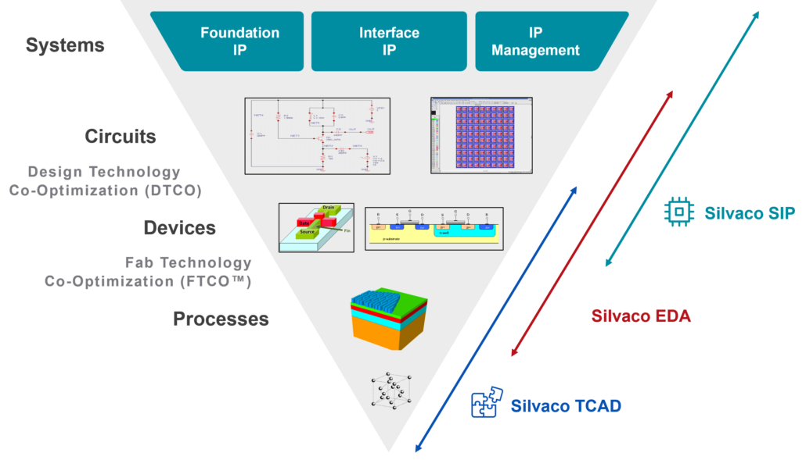
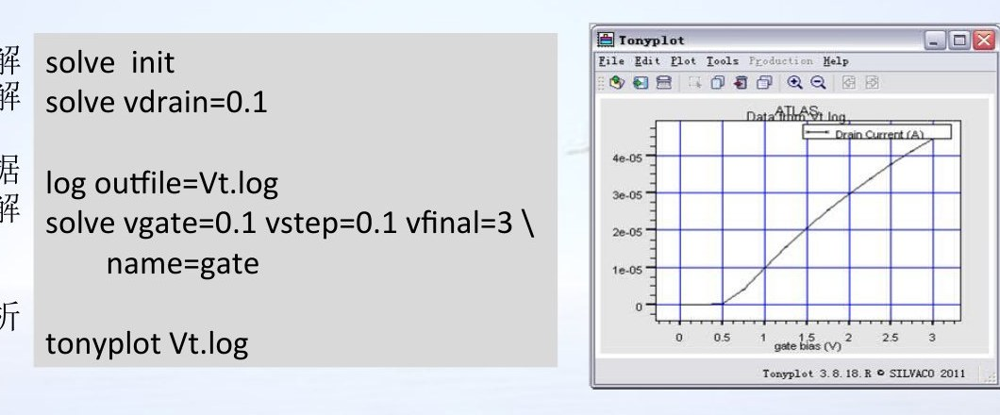

<!-- _class: lead -->

# 器件仿真模块与流程

## 从输入合同到功率器件的可复现电学结果

课程组 · 微电子器件建模与仿真

<!-- 讲师备注：本章用三个 45 分钟小节建立 ATLAS 器件仿真的输入、求解和结果证据链。 -->

---

# 本章学习目标

<h3>识别对象</h3>
说明 ATLAS 能求解哪些器件级问题。

<h3>复述流程</h3>
按结构、模型、数值和结果组织命令。

<h3>解释结果</h3>
把端特性和内部场分布对应起来。

<h3>检查证据</h3>
判断一条功率器件结论是否可复核。

<h3>提取指标</h3>
定义耐压、漏电和导通指标的判据。

<h3>保存数据</h3>
保留结构、日志、导出数据和说明。

<!-- 讲师备注：目标落在可观察能力上，课堂结束时学生应能独立复述并检查一条器件仿真链。 -->

---

# 三节主线从“能算”推进到“能证明”

第1节 输入合同
第2节 求解流程
第3节 结果证据

- 第1节回答“告诉求解器什么”。
- 第2节回答“按什么顺序求解”。
- 第3节回答“如何把曲线变成结论”。

<!-- 讲师备注：先给出整章地图，后面每个小节都回到这三个问题，避免把软件命令当作孤立知识点。 -->

---

<!-- _class: lead -->

# 第1节

## 器件仿真对象、模块与输入合同

<!-- 讲师备注：第1节用约 45 分钟说明 ATLAS 的定位、能力边界，以及一次仿真必须提交的五类输入。 -->

---

# ATLAS 求解结构在外加条件下的响应

器件仿真把结构、物理定律和外部激励放在同一个可计算问题中。

<h3>器件是什么</h3>
区域、材料、电极、掺杂和网格构成可计算结构。

<h3>受到什么作用</h3>
电压、电流、温度和时间波形定义外部条件。

<h3>遵循什么物理</h3>
输运、复合、统计、碰撞电离和热模型给出约束。

<h3>输出什么</h3>
端电流与内部电势、载流子、电场、温度等空间量。

<!-- 讲师备注：强调器件仿真不是画结构，而是求解一个带边界条件和材料定律的偏微分问题。 -->

---

# ATLAS 位于工艺与端特性之间

工艺历史
器件结构
偏压与温度
数值求解
端特性与场

- 工艺仿真给出几何和掺杂的来路。
- 器件仿真把结构转换为电学响应。
- 结果分析再把响应解释为设计指标。

<!-- 讲师备注：这条链是功率器件 TCAD 的基本因果链，缺少结构来路或结果文件都会削弱结论。 -->

---

# 一次器件仿真由五类输入共同定义

<h3>结构</h3>
网格、区域、电极和掺杂。

<h3>材料</h3>
能带、介电常数、迁移率和寿命。

<h3>模型</h3>
输运、复合、隧穿和碰撞电离。

<h3>数值条件</h3>
迭代方法、初值、步长和收敛限。

<h3>外部激励</h3>
电极偏压、电流、温度和扫描路径。

<h3>输出约定</h3>
日志列、结构保存点和导出格式。

<!-- 讲师备注：把五类输入称为“合同”，因为任何一类改变都可能改变最终曲线和结论。 -->

---

# 输出必须同时覆盖端特性和内部场

<h3>端特性</h3>
<ul>
<li>正向 I-V、反向漏电和击穿拐点</li>
<li>转移特性、输出特性和 C-V</li>
<li>瞬态电流与温度响应</li>
</ul>
<h3>内部量</h3>
<ul>
<li>电势、电场和电流密度</li>
<li>载流子浓度与碰撞电离率</li>
<li>晶格温度和热流</li>
</ul>

只看一条 I-V 可以判断“发生了什么”，空间分布才帮助回答“为什么发生”。

<!-- 讲师备注：功率器件结论通常需要端特性定位工作点，再用内部量解释机制。 -->

---

# 功率器件关注同一套求解能力

<table>
<tr><th>器件</th><th>核心结构</th><th>首要输出</th></tr>
<tr><td>PiN 二极管</td><td>PN 结与漂移区</td><td>正向压降、反向耐压</td></tr>
<tr><td>肖特基/JBS</td><td>势垒与保护环</td><td>漏电、势垒和表面电场</td></tr>
<tr><td>功率 MOSFET</td><td>沟道、漂移区和终端</td><td>阈值、导通电阻和击穿</td></tr>
<tr><td>IGBT</td><td>MOS 栅与双极输运</td><td>饱和压降、击穿和热效应</td></tr>
</table>

<!-- 讲师备注：器件类型不同，但 ATLAS 输入合同的层次不变，变化集中在几何、材料、模型和指标选择。 -->

---

# 模块清单不能替代适用性判断

<ul>
<li>S-Pisces：二维硅器件基础求解。</li>
<li>Devices3D：需要三维效应时使用。</li>
<li>Blaze：先进材料与异质结构。</li>
<li>Giga：非等温与热效应。</li>
<li>Quantum：量子限制修正。</li>
</ul>

课程聚焦低年级可验证的功率器件电热分析。

<figure>

<figcaption>工具模块服务于不同物理问题，不是越多越好</figcaption>
</figure>

<!-- 讲师备注：本节示例 列出大量模块，本课只保留与功率器件结构、输运、击穿和热分析直接相关的部分。 -->

---

# 功率器件问题的共同矛盾是耐压与损耗

功率器件设计不是单独追求更高耐压，而是在耐压、损耗、漏电和热约束之间取舍。

<h3>耐压</h3>
漂移区、终端和表面电场决定能承受多高电压。

<h3>导通损耗</h3>
漂移区电阻、接触和沟道影响正向压降。

<h3>关断漏电</h3>
势垒、隧穿、界面和碰撞电离共同作用。

<h3>热约束</h3>
电流拥挤和自加热改变安全工作区。

<!-- 讲师备注：这四类矛盾决定模型选择和结果指标，后续读任何功率器件论文都应先问它们。 -->

---

# 课程边界：只讨论器件级电热响应

<h3>本课聚焦</h3>
<ul>
<li>功率器件结构与网格</li>
<li>材料和物理模型</li>
<li>DC、AC、瞬态和热响应</li>
<li>击穿与空间场分析</li>
</ul>
<h3>证据目标</h3>
<ul>
<li>端口曲线与内部场一致</li>
<li>参数和模型可追溯</li>
<li>结论包含温度与适用范围</li>
</ul>

课堂集中讨论功率器件的结构、模型和器件级证据链。

<!-- 讲师备注：课堂集中讨论功率器件级电热响应，确保有限时间用于结构、模型和证据链。 -->

---

# 结构声明先形成闭合的数据模型

<h3>MESH</h3>
确定离散位置和局部密度。

<h3>REGION</h3>
把空间划分为材料区域。

<h3>ELECTRODE</h3>
定义电压或电流边界。

<h3>DOPING</h3>
定义施主、受主和分布形状。

<h3>几何闭合</h3>
区域不重叠，也不留未定义空洞。

<h3>结构保存</h3>
保存可复核的初始 `.str` 文件。

<!-- 讲师备注：结构层是最容易隐藏错误的一层，命令能执行不代表区域、电极和掺杂在空间上正确。 -->

---

# 结构来源决定可追溯性

<h3>ATHENA</h3>
保留工艺历史和二维掺杂分布。

<h3>DevEdit</h3>
适合复杂几何、局部修复和三维结构。

<h3>ATLAS</h3>
适合参数化、教学示例和简单结构。

- 结构来源必须进入结果记录。
- 直接描述结构时，应说明它并非真实工艺结果。
- 从文件读入时，要保留原文件版本和生成命令。

<!-- 讲师备注：可追溯性不是行政要求，而是复现曲线时判断“结构是否同一件东西”的唯一依据。 -->

---

# 结构声明要形成闭合几何合同

<pre><code>mesh space.mult=1.0
x.mesh loc=0.0 spac=0.5
x.mesh loc=10.0 spac=0.5
y.mesh loc=0.0 spac=0.1
y.mesh loc=5.0 spac=0.1
region num=1 silicon
electrode name=anode top
electrode name=cathode bottom
doping n.type conc=5e13 uniform
doping p.type conc=1e19 junc=1 gauss
save outf=power_diode_0.str</code></pre>

检查顺序：网格包住区域，区域指定材料，电极落在边界，掺杂指定极性和分布。

<!-- 讲师备注：用结构代码把五个声明连起来，提醒学生不要只检查单条命令的语法。 -->

---

# 最小二极管结构可直接用 ATLAS 描述

<h3>这段代码回答什么</h3>
<ul>
<li>器件宽度和厚度</li>
<li>N 型背景浓度</li>
<li>P 型高斯结和结深</li>
<li>阳极、阴极和保存文件</li>
</ul>

它适合讲流程，不等同于真实功率二极管工艺。

<figure>

<figcaption>命令、掺杂显示和结构图应相互对应</figcaption>
</figure>

<!-- 讲师备注：先读命令再看图，确认每一个可见区域和边界都来自明确声明。 -->

---

# 结构截图先核对坐标、层次和边界

<!-- 讲师备注：截图不是装饰，至少要读出横向尺寸、纵向层次、电极位置、材料颜色和掺杂量级。 -->

---

# 掺杂剖面必须与掺杂命令相互印证

<h3>核对项目</h3>
<ul>
<li>表面浓度是否符合命令</li>
<li>结深是否落在预期位置</li>
<li>对数坐标是否覆盖多个数量级</li>
<li>截线位置是否穿过目标区域</li>
<li>净掺杂符号是否正确</li>
</ul>

<figure>

<figcaption>4H-SiC 结构中不同位置的一维净掺杂剖面对比</figcaption>
</figure>

<!-- 讲师备注：一维截线能快速发现结深、极性和浓度量级错误，比只看二维颜色更可靠。 -->

---

# 材料参数是物理模型的边界条件

<pre><code>material material=4H-SiC permitti=9.66 eg300=2.99 \
  edb=0.1 gcb=2 eab=0.2 gvb=4 \
  nsrhn=3e17 nsrhp=3e17 \
  taun0=5e-10 taup0=1e-10</code></pre>

材料参数不是通用常数表。材料、温区、掺杂和模型版本都应在结果说明中交代。

<!-- 讲师备注：示例保留本节示例 中 4H-SiC 的关键参数，但不能把演示数值当作任何实际工艺的最终标定值。 -->

---

# MODELS 的选择由工作区决定

<h3>低场与高场</h3>
判断沟道、漂移区和结边缘是否需要不同迁移率模型。

<h3>复合</h3>
SRH、Auger 和表面复合影响漏电与存储电荷。

<h3>碰撞电离</h3>
击穿分析必须让高场与电离参数相容。

<h3>热学</h3>
大电流和电流拥挤问题需要晶格温度。

<!-- 讲师备注：模型选择的第一步是辨认器件工作区，而不是把所有模型一次性打开。 -->

---

# 数值方法要服务于模型和偏压路径

初始猜测
非线性迭代
线性求解
步长控制
收敛判据

<ul>
<li>Gummel 适合部分弱耦合问题，Newton 和 Block-Newton 用于强耦合。</li>
<li>高场、碰撞电离和晶格温度会显著增强耦合。</li>
<li>收敛失败可能是数值问题，也可能是物理输入错误。</li>
</ul>

<!-- 讲师备注：数值层不是“黑盒开关”，迭代策略必须与模型耦合强度及扫描难度匹配。 -->

---

# 求解顺序从零偏初始解开始

<pre><code>solve init
solve vdrain=0.1
log outf=power_diode.log
solve vanode=0 vstep=0.1 \
  vfinal=1.0 name=anode
save outf=power_diode_1.str</code></pre>

<h3>三条纪律</h3>
<ol>
<li>先建立所有电极已知的初始状态。</li>
<li>再逐步施加非零偏压。</li>
<li>扫描前打开日志，结束后保存结构和日志。</li>
</ol>

<!-- 讲师备注：零偏初始解让后续每个扫描点都有连续的前一状态，这是可重复求解的起点。 -->

---

# 日志在扫描前打开，数据才可复核

<h3>日志应回答</h3>
<ul>
<li>扫描哪个电极</li>
<li>起止电压和步长</li>
<li>记录哪些端电流</li>
<li>是否出现警告或回退</li>
<li>曲线数据位于哪一列</li>
</ul>

<figure>

<figcaption>求解命令与 TonyPlot 曲线必须能一一对应</figcaption>
</figure>

<!-- 讲师备注：日志是曲线的原始证据；截图可以辅助阅读，但不能代替可导出的数据列。 -->

---

# 第1节检查点：输入合同能回答五个问题

结构来自哪里？材料是否适用？模型为什么选它？数值路径能否收敛？输出将证明哪一个指标？

<h3>结构证据</h3>
命令或上游文件、结构截图、区域与电极说明。

<h3>物理证据</h3>
材料参数来源、模型组合和适用工作区。

<h3>数值证据</h3>
初始解、扫描路径、步长和收敛状态。

<h3>结果证据</h3>
日志、结构文件、导出数据和指标判据。

<!-- 讲师备注：请学生用这五个问题检查自己的输入文件，答不出来的部分就是下一节要补齐的流程节点。 -->

---

<!-- _class: lead -->

# 第2节

## 从结构声明到可收敛的偏压扫描

<!-- 讲师备注：第2节用约 45 分钟走完 ATLAS 器件仿真流程，重点解释每个命令层负责什么，以及错误如何沿链条传播。 -->

---

# 器件仿真流程是一条可回滚的链

结构描述
材料模型
数值方法
求解描述
结果分析

- 每一步都消费上游结果，并产生可检查的中间文件。
- 结构、模型和数值层都能制造“曲线异常”。
- 回滚时应逐层排除，而不是只改最后的 solve 命令。

<!-- 讲师备注：将流程理解为链而不是菜单，学生才能定位错误发生在哪一层。 -->

---

# MESH 决定空间离散的尺度和成本

<h3>全局控制</h3>
<code>mesh space.mult</code> 改变整体密度。

<h3>局部加密</h3>
<code>x.mesh</code>、<code>y.mesh</code> 控制位置与间距。

<h3>界面加密</h3>
结区、氧化层界面和高场边缘需要更细网格。

<h3>计算成本</h3>
网格越细不一定越准确，质量比数量更重要。

<!-- 讲师备注：本页强调 mesh 和局部 line 的位置与间隔，本页补充功率器件高场区需要局部加密的物理理由。 -->

---

# REGION 把网格组织为材料域

<pre><code>region num=1 x.min=0 x.max=10 \
  y.min=0 y.max=5 material=silicon
region num=2 x.min=0 x.max=10 \
  y.min=5 y.max=5.2 material=oxide</code></pre>

- 区域编号必须唯一，几何边界应闭合。
- 材料名称要与后续 <code>material</code> 和 <code>models</code> 命令一致。
- 相邻区域可以共享边界，但不能形成不可解释的重叠。
- 结构显示异常时，先检查区域覆盖，再检查网格。

<!-- 讲师备注：REGION 不是上色，而是给每个离散单元分配材料属性与后续物理模型作用域。 -->

---

# ELECTRODE 是电学边界而不是装饰

<h3>定义电极时同时确定</h3>
<ul>
<li>唯一名称</li>
<li>位置、长度和所在区域</li>
<li>欧姆、肖特基或电流边界</li>
<li>是否衬底、浮空、短接或开路</li>
</ul>

<figure>

<figcaption>电极名称、位置、长度和区域必须同时明确</figcaption>
</figure>

<!-- 讲师备注：电极名会进入 solve、log 和结果曲线，命名错误会把物理问题变成数据解释问题。 -->

---

# 电极定义必须与扫描方向一致

<h3>正向导通</h3>
阳极相对阴极加正偏，读取阳极或阴极电流。

<h3>反向阻断</h3>
明确反向电压范围、电流判据和终端边界。

<h3>栅极控制</h3>
先建立栅压，再扫描漏极或发射极条件。

<h3>热边界</h3>
热接触位置和温度不能被电极定义替代。

每个 solve 行都要能回答：哪个电极、什么变量、从何值到何值、用什么步长。

<!-- 讲师备注：电极和扫描路径是同一份合同的两面，电极接反会让“异常漏电”成为假问题。 -->

---

# DOPING 分布决定结与漂移区

<h3>Uniform</h3>
适合背景浓度和简化外延层。

<h3>Gaussian</h3>
用峰值、结深或特征长度描述分布。

<h3>Erfc</h3>
适合扩散或理想化结剖面。

<h3>文件导入</h3>
保留工艺仿真或测量得到的真实分布。

<!-- 讲师备注：功率器件的漂移区浓度和终端注入分布直接影响耐压、导通和电场形状。 -->

---

# 掺杂校验要看对数坐标和截线

<h3>至少做三次检查</h3>
<ol>
<li>看二维净掺杂分布的极性。</li>
<li>在结中心做一维截线。</li>
<li>比较表面、结深和背景浓度。</li>
</ol>

二维图中的颜色只能说明趋势，截线才能给出量级。

<figure>

<figcaption>掺杂剖面的计算值与测量值对比，可用于校准判断</figcaption>
</figure>

<!-- 讲师备注：本页强调掺杂分布可来自命令或文件，本页提醒用截线和已有数据核对，避免只凭颜色判断。 -->

---

# 第二层合同定义物理作用域

<h3>MATERIAL</h3>
为区域或材料设置参数。

<h3>MODELS</h3>
选择输运、复合、统计和热模型。

<h3>CONTACT</h3>
定义功函数、电阻、短接和电流边界。

<h3>INTERFACE</h3>
定义界面电荷和表面复合速度。

<!-- 讲师备注：这一层决定材料内部和边界上发生了什么，必须与结构层的区域和电极一一对应。 -->

---

# METHOD 把非线性方程交给迭代器

<pre><code>method gummel newton trap \
  itlimit=20 maxtrap=6</code></pre>

<table>
<tr><th>控制项</th><th>含义</th><th>风险</th></tr>
<tr><td>Gummel/Newton</td><td>非线性耦合策略</td><td>电流边界下不能随意使用 Gummel</td></tr>
<tr><td>itlimit</td><td>单步最大迭代数</td><td>过小会误判不收敛</td></tr>
<tr><td>maxtrap</td><td>步长回退次数</td><td>过大只是反复缩小步长</td></tr>
</table>

<!-- 讲师备注：本节示例 明确指出电流边界情形不能用 Gummel，并给出 trap 超限报错，本页将其放入参数解释。 -->

---

# 收敛失败先定位物理层，再调数值

<ol>
<li>检查区域是否重叠、是否有空洞。</li>
<li>检查电极是否落在正确边界上。</li>
<li>检查掺杂、材料和模型是否在同一区域生效。</li>
<li>检查网格是否覆盖结区与高场区。</li>
<li>最后才调整初值、步长、迭代次数和回退策略。</li>
</ol>

收敛不是物理正确性的证明，它只说明离散方程在当前路径上得到了数值解。

<!-- 讲师备注：这条顺序减少“改参数碰运气”，先排除不可收敛的输入，再优化数值策略。 -->

---

# SOLVE init 建立可重复的初始状态

<pre><code>solve init
solve vgate=0
solve vdrain=0.1
log outf=device.log</code></pre>

<ul>
<li>零偏解为后续扫描提供连续初值。</li>
<li>先固定非扫描电极，避免状态跳变。</li>
<li>复杂器件可分层加载结构或分阶段升温。</li>
<li>每个阶段都要能保存中间结构。</li>
</ul>

<!-- 讲师备注：solve init 不是形式步骤，它把结构、接触和模型带入一个已知电学状态。 -->

---

# 文件命令各有不同职责

<h3>LOG</h3>
记录端特性和扫描过程。

<h3>SAVE</h3>
保存空间解和结构快照。

<h3>LOAD</h3>
从已知结构或偏置继续求解。

<h3>EXTRACT</h3>
从解中计算指定指标。

<code>LOG</code> 不一定包含所有空间量；需要空间分布时应保存 <code>.str</code> 并明确输出变量。

<!-- 讲师备注：区分日志与结构文件，避免把截图当作唯一结果，或者用错误文件继续计算。 -->

---

# 二极管例子可从结构到偏压闭环

MESH
REGION
ELECTRODE
DOPING
MODEL
SOLVE

<pre><code>model bjt
method gummel newton
solve init
log outfile=diode_IV.log
solve vanode=0.05 vstep=0.05 vfinal=1 name=anode
save outf=diode_1.str</code></pre>

<!-- 讲师备注：本页使用基础二极管结构示例，重点不是 `bjt` 这个名字，而是结构、模型、初解、日志和扫描形成的闭环。 -->

---

# 正向 I-V 扫描必须有明确电极和步长

<h3>先写清指标</h3>
<ul>
<li>正向压降 <code>Vf</code></li>
<li>导通电阻或微分电阻</li>
<li>电流是否按面积归一化</li>
<li>温度是否保持恒定</li>
</ul>

曲线只有和“阳极电压、阴极电流、温度、面积”一起记录，才可用于功率器件比较。

<!-- 讲师备注：学生常只记扫描终点，忽略电极、面积和温度，导致两条看似相同的曲线不可比较。 -->

---

# TonyPlot 曲线要回溯到原始日志

<h3>读图顺序</h3>
<ol>
<li>确认文件名和曲线来源。</li>
<li>确认横纵轴变量与单位。</li>
<li>定位拐点、饱和和击穿。</li>
<li>回到日志核对数据点。</li>
</ol>

<figure>

<figcaption>多组功率二极管反向 I-V 曲线的 TonyPlot 叠加</figcaption>
</figure>

<!-- 讲师备注：这张图展示多个结构的叠加比较，读图时必须同时看保护环图例、电压范围和电流判据。 -->

---

# 从二极管迁移到功率二极管要改三件事

<h3>几何</h3>
加入漂移区、终端、场氧和保护环。

<h3>掺杂</h3>
用真实外延和终端分布替代均匀演示。

<h3>模型</h3>
加入碰撞电离、隧穿、复合和热效应。

<h3>输出</h3>
同时保存 I-V 与电场、电势、电流密度。

<!-- 讲师备注：功率化不是简单拉长器件，而是增加几何、物理和输出三个维度的复杂度。 -->

---

# 反向扫描把关注点转向漏电和击穿

<h3>漏电区</h3>
关注小电流量级、温度和隧穿模型。

<h3>增益区</h3>
碰撞电离开始增强，注意数值步长。

<h3>击穿判据</h3>
明确电流密度、电流绝对值或斜率条件。

<h3>击穿位置</h3>
用空间场和碰撞电离率确认薄弱区域。

反向扫描常用对数电流观察多个数量级，不能只用线性坐标判断“是否漏电”。

<!-- 讲师备注：功率器件耐压结论必须同时给出扫描范围、电流判据和判据所在结构位置。 -->

---

# Curvetrace 适合终端电流受控的击穿追踪

<pre><code>curvetrace contr.name=cathode \
  step.init=0.05 nextst.ratio=1.1 \
  mincur=1e-13 end.val=1e-3 \
  curr.cont</code></pre>
<ul>
<li>适合击穿、闩锁和热失控类强非线性路径。</li>
<li>仍需结构、模型和温度条件。</li>
<li>曲线回折不等于自动得到物理结论。</li>
</ul>

遇到强非线性时，先判断是电流控制策略问题，还是器件已进入新的物理区。

<!-- 讲师备注：本节示例 将 Curvetrace 与击穿、闩锁和二次击穿仿真联系，这里只保留器件级击穿，不讨论外部电路。 -->

---

# 结果文件链必须覆盖结构、日志和图像

输入 deck
初始 .str
中间 .str
.log
导出数据

- 输入 deck 记录所有命令和参数。
- 初始结构证明器件从何开始。
- 中间结构定位特定偏压下的空间状态。
- 日志提供端特性原始数据。
- 导出数据支持定量绘图与统计。

<!-- 讲师备注：文件链越完整，别人越容易复现；只有一个最终截图时，任何异常都无法回查。 -->

---

# 第2节检查点：复述一条命令链

从 <code>mesh</code> 开始，说出每一条命令改变了哪一层，并指出一个可能让曲线失真的错误。

<ol>
<li>结构层：区域、电极、掺杂是否闭合？</li>
<li>物理层：材料、模型和接触是否匹配？</li>
<li>数值层：初解、迭代和步长是否合理？</li>
<li>数据层：日志、结构和导出文件是否齐全？</li>
</ol>

<!-- 讲师备注：如果学生能沿这条链解释每个节点，下节就可以开始对曲线和空间分布做物理解释。 -->

---

<!-- _class: lead -->

# 第3节

## 特性提取、功率指标与可复核结果

<!-- 讲师备注：第3节用约 45 分钟把求解结果转换为功率器件指标，并要求每条结论都有条件、图、数据和机制。 -->

---

# 特性分析从测量问题开始

<h3>直流</h3>
I-V、转移、输出与击穿。

<h3>小信号</h3>
偏置相关 C-V 和频率响应。

<h3>瞬态</h3>
时间常数、开关波形与热响应。

<h3>空间分布</h3>
电势、电场、电流密度和温度。

<!-- 讲师备注：仿真扫描应模拟一个清晰的测量问题，先问“要测什么”，再决定电压、时间和输出变量。 -->

---

# DC 分析首先要固定坐标约定

曲线进入物理解释之前，先把端、方向、单位和归一化方式固定下来。

<h3>写清五个字段</h3>
<ul>
<li>扫描哪个电极</li>
<li>参考电极是谁</li>
<li>电流取哪个端</li>
<li>电流是总量还是密度</li>
<li>温度是否固定</li>
</ul>

<figure>

<figcaption>同一命令链可生成多组偏置下的直流曲线</figcaption>
</figure>

<!-- 讲师备注：本页使用直流特性示例，虽以 BJT 演示，读图纪律同样适用于功率二极管和 MOSFET。 -->

---

# 正向指标由 I-V 与面积共同定义

<h3>正向压降</h3>
在指定电流密度下读取阳极与阴极之间的电压。

<h3>导通电阻</h3>
用线性区斜率或指定工作点差分电阻表示。

<h3>电流密度</h3>
必须给出有源面积或周长归一化方式。

<h3>温度条件</h3>
自加热与恒温结果不能直接混用。

“某电压下电流很大”不是功率器件指标，必须固定电流密度、温度和面积。

<!-- 讲师备注：把指标写成可重复的测量定义，避免不同学生用不同归一化方式比较曲线。 -->

---

# 反向指标必须写明电流判据

<h3>三个量级</h3>
<ul>
<li>低偏漏电：势垒、隧穿、界面和复合</li>
<li>高偏增益：碰撞电离开始显著</li>
<li>击穿点：达到明确电流或斜率判据</li>
</ul>
<h3>三个条件</h3>
<ul>
<li>温度</li>
<li>终端结构</li>
<li>模型组合</li>
</ul>

同一曲线用不同电流判据可得到不同“击穿电压”，因此判据必须随结果一起报告。

<!-- 讲师备注：耐压不是曲线终点，课堂要求明确击穿判据并说明它对应哪一个端电流或电流密度。 -->

---

# C-V 反映耗尽与电容耦合

<pre><code>solve vgate=-5 vstep=0.1 \
  vfinal=5 name=gate \
  ac freq=1e6</code></pre>
<ul>
<li>记录直流偏置、频率和端对。</li>
<li>区分结电容、栅电容和寄生项。</li>
<li>不要扩展到 S 参数或光电响应。</li>
</ul>

<figure>

<figcaption>偏置与频率共同决定小信号结果</figcaption>
</figure>

<!-- 讲师备注：C-V 能检查耗尽层和界面模型，但频率与直流偏置必须一起记录，否则曲线不可复现。 -->

---

# 瞬态响应依赖激励与时间步长

<h3>初始状态</h3>
瞬态开始前器件处于哪个偏置和温度？

<h3>激励波形</h3>
上升时间、保持时间和幅值如何定义？

<h3>时间步长</h3>
步长是否小于最快物理时间常数？

<h3>终止条件</h3>
结果需要观察到恢复、稳定还是热平衡？

没有初始条件和时间步长的瞬态曲线，只能算一段无来源的波形。

<!-- 讲师备注：瞬态结果首先检查数值时间分辨率，再判断器件物理响应，避免把求解步长当成物理时间常数。 -->

---

# 热分析需要晶格温度与热接触

<pre><code>models arora consrh auger \
  bgn fldmob lat.temp
thermcontact num=1 y.min=0.6 \
  ext.temper=300</code></pre>
<ul>
<li><code>lat.temp</code> 启用晶格温度。</li>
<li><code>thermcontact</code> 给出散热边界。</li>
<li>热导率、热容和热源必须匹配材料。</li>
</ul>

<figure>

<figcaption>固定 300 K 与晶格加热条件下的击穿曲线差异</figcaption>
</figure>

<!-- 讲师备注：本节示例 的热学页强调 lat.temp 和 thermcontact，本页用击穿曲线说明热边界会改变强非线性结果。 -->

---

# 三维只在二维不能回答时启用

<h3>需要三维的典型理由</h3>
<ul>
<li>电流在第三维明显拥挤</li>
<li>终端拐角或局部接触主导</li>
<li>二维截线无法代表整体</li>
</ul>
<h3>代价</h3>
<ul>
<li>网格数量、内存和求解时间上升</li>
<li>结果解释需要更多切片与路径</li>
</ul>

<figure>

<figcaption>三维结果必须连同网格、材料和坐标一起检查</figcaption>
</figure>

<!-- 讲师备注：三维不是“更高级”的默认选项，只有在二维模型无法覆盖关键几何或电流路径时才使用。 -->

---

# 功率 JBS 案例提供完整证据链

- 左图说明结构和掺杂剖面。
- 右图比较不同保护环数量下的反向 I-V。
- 两图共同支持“终端影响耐压”的结论，但还需电场图确认机制。

<!-- 讲师备注：结果证据不能只有曲线；结构或掺杂图说明对象，曲线说明端行为，空间图说明原因。 -->

---

# 场分布图用于定位击穿前的薄弱区域

<h3>读电场图的顺序</h3>
<ol>
<li>确认偏压和文件名。</li>
<li>读色标单位与范围。</li>
<li>定位峰值和表面路径。</li>
<li>与结构中的终端、结和接触对应。</li>
</ol>

<figure>

<figcaption>反向偏压下电场在表面终端区域的重新分配</figcaption>
</figure>

<!-- 讲师备注：不要只说“红色区域电场高”，要说明峰值在哪一个结构位置，以及它与击穿路径的关系。 -->

---

# 电势图说明耐压如何分配

<h3>关键问题</h3>
<ul>
<li>电压主要降在漂移区还是终端？</li>
<li>等势线是否在表面拥挤？</li>
<li>保护环是否扩展了耗尽区？</li>
<li>偏压变化是否改变分配顺序？</li>
</ul>

<figure>

<figcaption>电势等值线显示反向电压在结构中的空间分配</figcaption>
</figure>

<!-- 讲师备注：电势图回答“电压降在哪里”，电场图回答“哪里最容易达到临界场”，两者必须联合解释。 -->

---

# 电流密度图用于识别局部拥挤

<h3>与电场图分开判断</h3>
<ul>
<li>电流拥挤影响热和可靠性。</li>
<li>电场峰值影响碰撞电离和击穿。</li>
<li>两者位置可能相同，也可能分离。</li>
<li>必须记录偏压和温度。</li>
</ul>

<figure>

<figcaption>高偏压下的导电电流密度路径与局部拥挤区域</figcaption>
</figure>

<!-- 讲师备注：功率器件的失效可能是电击穿，也可能是电流拥挤引起的热问题，因此场和电流密度不能混为一谈。 -->

---

# TonyPlot 截图不能替代原生数据

<h3>截图适合</h3>
展示趋势、空间形态和报告插图。

<h3>原生数据适合</h3>
重绘、定量提取、统计和复现。

<h3>输入 deck 适合</h3>
重跑结构和扫描路径。

<h3>Cutline 适合</h3>
把二维分布转为一维定量曲线。

<!-- 讲师备注：报告可以放截图，但答辩时必须能回到文件、数据列和可重跑命令。 -->

---

# 结构截线导出空间剖面

<h3>Cutline 的输入</h3>
<ul>
<li>起点和终点坐标</li>
<li>目标物理量</li>
<li>偏压和工作温度</li>
<li>导出格式与文件名</li>
</ul>

截线让“某处更高”变成可比较的一维数据。

<figure>

<figcaption>结果类型与分析入口，本页使用结果分析示例</figcaption>
</figure>

<!-- 讲师备注：一维截线应穿过关键结、表面或终端区域，不能只沿最方便的水平线导出。 -->

---

# 日志导出 CSV 前先确认列和单位

<h3>列名</h3>
确认电压、电流、温度和步骤是否都存在。

<h3>单位</h3>
A、A/um、A/cm² 等不能省略。

<h3>方向</h3>
明确扫描正负号和参考电极。

<h3>数据质量</h3>
检查重复点、回退点和缺失段。

导出后至少用一个独立工具重绘，确认曲线与 TonyPlot 中的趋势和数值范围一致。

<!-- 讲师备注：CSV 是定量分析入口，导出后要核对表头和数据行，而不是直接用于画图。 -->

---

# 收敛异常按结构、网格、模型、步长排查

<ol>
<li>结构层：区域重叠、空洞、电极悬空。</li>
<li>网格层：结区或高场区过粗、界面不连续。</li>
<li>模型层：材料参数错误或模型组合冲突。</li>
<li>步长层：首次偏压过大或扫描路径不连续。</li>
<li>验证层：缩小步长后结果是否稳定。</li>
</ol>

<!-- 讲师备注：排查顺序从错误根源到数值策略，避免把物理输入错误掩盖成“步长问题”。 -->

---

# 网格敏感性是可信度检查的一部分

<h3>至少比较两次</h3>
<ul>
<li>局部加密结区与表面</li>
<li>保持材料和模型不变</li>
<li>比较击穿电压、峰值电场和漏电</li>
<li>记录计算成本变化</li>
</ul>

<figure>

<figcaption>剖面量级和深度是网格与模型校准的共同参照</figcaption>
</figure>

<!-- 讲师备注：若加密后关键指标显著变化，当前网格不足以支撑定量结论；若变化小，才可讨论收敛。 -->

---

# 校准只约束可观测且敏感的模型参数

选观测量
找敏感参数
在范围内拟合
独立数据验证

- 校准不是让一条曲线“看着像”。
- 必须同时约束多个工作点或温度。
- 拟合参数需要有物理范围。
- 留出一组数据检验泛化能力。

<!-- 讲师备注：功率器件常用正向 I-V、反向漏电和击穿共同约束参数，只用一条曲线拟合不足以证明模型可信。 -->

---

# 结果页要写成条件、图、指标、机制

<h3>条件</h3>
结构、材料、模型、偏压和温度。

<h3>图</h3>
I-V、电场、电势或电流密度。

<h3>指标</h3>
用明确判据提取数值。

<h3>机制</h3>
用空间分布解释曲线为什么如此。

合格结论示例：在给定结构、模型和 300 K 条件下，当阴极电流达到某判据时发生击穿，峰值电场位于指定终端位置。

<!-- 讲师备注：这个模板把描述、数值和机制压在一页内，便于学生答辩，也便于教师检查结论边界。 -->

---

# 第3节检查点：完成一场证据答辩

用 90 秒说明一个功率器件结果：问题是什么，条件是什么，曲线说明什么，空间图解释什么，局限是什么。

<ol>
<li>展示结构或掺杂证据。</li>
<li>展示端特性并读出指标。</li>
<li>展示一张空间分布图。</li>
<li>说明模型、数值和适用范围。</li>
</ol>

<!-- 讲师备注：答辩不要求器件复杂，但要求每条陈述都能指回一个文件、图或明确判据。 -->

---

# 本章小结

- ATLAS 把结构、材料、模型、数值条件和外部激励转换为器件响应。
- 第1节建立输入合同，第2节完成从结构到偏压扫描的流程。
- 第3节把端特性、空间分布和文件证据组织成可复核结论。
- 功率器件分析重点始终是耐压、漏电、导通损耗和热约束。
- 本章聚焦功率器件级结构、模型与特性分析。

<!-- 讲师备注：回收三节主线，并再次明确课程边界，为第7章结构、模型和结果细节做铺垫。 -->

---

# 课堂任务与检查点

<h3>提交内容</h3>
<ol>
<li>一条二极管或功率二极管结构命令链。</li>
<li>一张结构或掺杂截图。</li>
<li>一条正向或反向 I-V 日志。</li>
<li>一个指标的判据和数值。</li>
<li>一段 90 秒证据说明。</li>
</ol>

通过标准：别人能根据提交文件复现曲线，并指出电极、模型、单位和击穿判据。

<!-- 讲师备注：任务只要求一条最小闭环，但必须完整；不以器件规模或曲线数量代替可复现性。 -->

---

# 本章参考文献

<ol class="reference-list">
<li>SILVACO INTERNATIONAL. <em>Silvaco TCAD Device Simulation Modules and Flow</em>[Z]. Silvaco TCAD Training Materials, n.d.</li>
<li>SILVACO INTERNATIONAL. <em>ATLAS User's Manual</em>[Z]. Santa Clara, CA: Silvaco International, n.d.</li>
<li>SILVACO INTERNATIONAL. <em>DevEdit User's Manual</em>[Z]. Santa Clara, CA: Silvaco International, n.d.</li>
<li>SILVACO INTERNATIONAL. <em>TCAD Workshop Using Silvaco TCAD Tools: Volume II</em>[Z]. Silvaco International, n.d.</li>
<li>SILVACO INTERNATIONAL. <em>Power Device Physics Revealed: TCAD for Power Device Technologies</em>[Z]. Silvaco International, 2010.</li>
</ol>

<!-- 讲师备注：来源覆盖器件流程、结构编辑、结果分析和功率器件案例；具体案例图只用于方法说明。 -->
