<!-- _class: lead -->

# 器件结构与物理模型

## 从网格、材料参数到功率器件特性与结果证据

课程组 · 微电子器件建模与仿真

<!-- 讲师备注：本章用三个 45 分钟小节讲清结构、模型和结果分析。 -->

---

# 本章学习目标

<h3>建结构</h3>
用 ATLAS 或 DevEdit 形成可计算结构。

<h3>定参数</h3>
说明材料参数的物理含义与来源。

<h3>选模型</h3>
按功率器件工作区选择物理模型。

<h3>设边界</h3>
正确描述接触和界面。

<h3>取特性</h3>
获取 DC、AC、瞬态和热响应。

<h3>验结果</h3>
用结构、日志和空间分布形成证据链。

<!-- 讲师备注：目标从“会写命令”提升到“能解释参数和模型为何适合当前功率器件问题”。 -->

---

# 三节主线连接结构、物理和证据

第1节 结构与网格
第2节 参数与模型
第3节 特性与结果

- 第1节回答：器件在空间上是什么？
- 第2节回答：内部遵循什么物理？
- 第3节回答：端特性和空间结果如何证明设计判断？

<!-- 讲师备注：先建立课程地图，后续每个结论都要求能回到这三层中的具体证据。 -->

---

<!-- _class: lead -->

# 第1节

## 器件结构生成、几何与网格

<!-- 讲师备注：第1节约 45 分钟，从 ATLAS 命令和 DevEdit 两条路径讲结构建模与网格质量控制。 -->

---

# 结构是一个带物理属性的数据模型

结构不是一张示意图，而是区域、材料、电极、掺杂和网格共同组成的数据对象。

<h3>几何</h3>
边界、面积、厚度、结深和终端形状。

<h3>材料</h3>
每个区域属于半导体、绝缘体或导体。

<h3>掺杂</h3>
施主、受主及空间分布决定结和漂移区。

<h3>离散</h3>
网格把连续结构变成有限个未知量。

<!-- 讲师备注：如果学生只能指着图说“这里有红色和蓝色”，说明还没有把结构理解为可计算数据。 -->

---

# 结构生成包含五个相互制约的层次

<h3>REGION</h3>
划定几何与材料域。

<h3>MATERIAL</h3>
赋予区域物性参数。

<h3>ELECTRODE</h3>
建立外部电学边界。

<h3>DOPING</h3>
形成 PN 结和漂移区。

<h3>MESH</h3>
决定空间分辨率和成本。

<h3>闭合检查</h3>
无重叠、无空洞、边界可追踪。

<!-- 讲师备注：五个层次彼此制约，改变区域或电极通常也要求重新检查网格和材料赋值。 -->

---

# 三种结构来源对应不同可追溯性

ATHENA 工艺结果
DevEdit 结构编辑
ATLAS 命令描述
统一 .str

- 工艺生成结构保留工艺历史与掺杂来路。
- DevEdit 适合复杂几何、局部修改和三维。
- ATLAS 命令描述适合参数化和教学示例。
- 无论来源如何，都应保存输入和结构文件。

<!-- 讲师备注：工具选择由几何复杂度和可复现要求决定，而不是由哪一个界面看起来更高级决定。 -->

---

# ATLAS 结构流程先定义空间再定义属性

MESH
REGION
ELECTRODE
DOPING
SAVE

<pre><code>mesh space.mult=1.0
region num=1 silicon
electrode name=anode top
electrode name=cathode bottom
doping n.type conc=5e13 uniform
save outf=device_0.str</code></pre>

<!-- 讲师备注：先形成空间和材料，再挂电极与掺杂；顺序错误会影响默认区域和边界解释。 -->

---

# MESH 同时控制全局与局部分辨率

<h3>三类命令</h3>
<ul>
<li><code>mesh</code>：整体缩放或读入结构网格。</li>
<li><code>x.mesh</code>：定义横向位置和间距。</li>
<li><code>y.mesh</code>：定义纵向位置和间距。</li>
<li><code>eliminate</code>：删除部分网格线以降成本。</li>
</ul>

功率器件的结区、栅氧界面、表面终端和高场边缘通常需要局部加密。

<!-- 讲师备注：全局密度决定总成本，局部 line 决定关键区域的解析能力，两者必须分开控制。 -->

---

# 网格质量由物理梯度而不是平均间距决定

<h3>结区</h3>
耗尽层和载流子梯度要求足够细的网格。

<h3>界面</h3>
材料界面和薄氧化层不能跨越少数单元。

<h3>高场区</h3>
终端拐角与结曲率附近要解析电场峰值。

<h3>体区</h3>
低梯度漂移区可以适当放粗。

网格加密的目标是解析物理梯度，不是让整张图看起来更密。

<!-- 讲师备注：用物理量梯度指导局部加密，可以在有限计算资源下保留击穿和漏电结果的可信度。 -->

---

# ELIMINATE 用于在已有网格上降低密度

<pre><code>eliminate columns x.min=0.2 x.max=1.4 \
  y.min=0.2 y.max=0.7</code></pre>

- 本节说明其基础行为是按区域隔一条删除一条网格线。
- 适合移除远离关键物理区域的过密网格。
- 不能跨越结区、薄层或高场区随意降密。
- 降密后必须比较关键指标与原始网格的差异。

<!-- 讲师备注：本节示例 明确指出 eliminate 的隔条删除行为，本页补充功率器件局部降密的验证要求。 -->

---

# REGION 必须形成不重叠、不留洞的材料域

<pre><code>region num=1 x.min=0 x.max=10 \
  y.min=0 y.max=5 material=silicon
region num=2 x.min=0 x.max=10 \
  y.min=5 y.max=5.2 material=oxide</code></pre>

<ul>
<li>区域编号用于后续材料、掺杂和截线引用。</li>
<li>共享边界是允许的，但区域体积不应不可解释地重叠。</li>
<li>材料域之外不能留下未定义空腔。</li>
<li>结构图异常时先核对 region 覆盖。</li>
</ul>

<!-- 讲师备注：区域定义是结构错误的高频来源，错误常在求解阶段才表现为“不收敛”。 -->

---

# 复杂功率结构更要显式核对材料域

<h3>外延层</h3>
器件耐压和漂移区的主体。

<h3>场氧</h3>
影响表面电场与终端耗尽。

<h3>钝化层</h3>
改变界面电荷与表面漏电路径。

<h3>金属/接触</h3>
定义电极、势垒和电流路径。

<!-- 讲师备注：功率器件的终端通常由多层介质和场板组成，材料域错一层就可能改变表面电场结论。 -->

---

# ELECTRODE 语法要同时指定名称和空间范围

<pre><code>electrode name=anode top
electrode name=cathode bottom
electrode name=gate x.min=0.25 length=0.5
electrode name=source y.min=0 left length=0.25
electrode name=drain y.min=0 right length=0.25</code></pre>

电极名称进入后续 <code>solve</code>、<code>contact</code> 和日志列，必须唯一且稳定。

<!-- 讲师备注：本节给出顶部、底部、区间、左端和右端电极形式，命名与位置必须一起检查。 -->

---

# 电极截图先看端点是否落在正确边界

<h3>四项核对</h3>
<ol>
<li>电极名称是否唯一。</li>
<li>覆盖区间与版图是否一致。</li>
<li>端点是否接触目标材料。</li>
<li>是否误把浮空金属当成电极。</li>
</ol>

<figure>
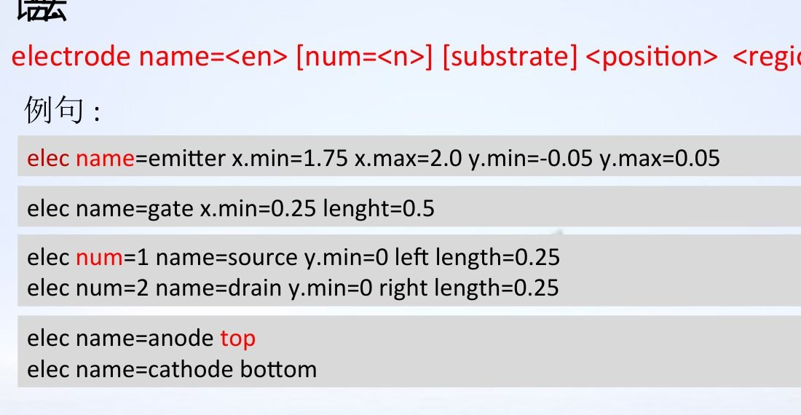
<figcaption>电极名称、长度、左右端与上下表面示例</figcaption>
</figure>

<!-- 讲师备注：接触边长会直接影响电流和电容，电极看起来“贴上了”不代表覆盖范围正确。 -->

---

# DOPING 支持均匀、解析和外部数据分布

<h3>Uniform</h3>
背景浓度、外延层和简化衬底。

<h3>Gaussian</h3>
峰值、结深或特征长度描述。

<h3>Erfc</h3>
扩散型或理想化剖面。

<h3>文件导入</h3>
保留工艺或测量得到的分布。

<!-- 讲师备注：掺杂命令既有分布类型，也有浓度、结深、特征长度和空间位置等参数组，必须与物理来路匹配。 -->

---

# 掺杂数据要与测量或工艺剖面区分来源

<h3>判断顺序</h3>
<ul>
<li>这条剖面来自命令、工艺仿真还是测量？</li>
<li>横轴深度和纵轴浓度单位是什么？</li>
<li>峰值、结深和尾部分布是否合理？</li>
<li>校准是否使用了独立数据？</li>
</ul>

<figure>
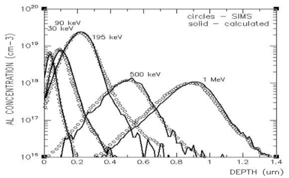
<figcaption>计算剖面与 SIMS 数据的深度和浓度对比</figcaption>
</figure>

<!-- 讲师备注：本节示例结构和参数生成都强调来源；有测量数据时，应明确哪些曲线是计算、哪些是实验。 -->

---

# 二极管结构例子可以逐条映射到图像

<pre><code>mesh
x.mesh loc=0.00 spac=0.05
x.mesh loc=0.10 spac=0.05
y.mesh loc=0.00 spac=0.20
y.mesh loc=1.00 spac=0.01
region number=1 x.min=0 x.max=0.1 \
  y.min=0 y.max=1 material=silicon
electrode name=anode top
electrode name=cathode bottom
doping uniform conc=1e18 n.type region=1
save outfile=diode_0.str</code></pre>

<figure>
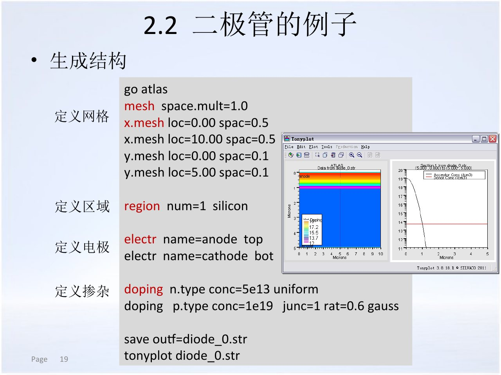
<figcaption>结构声明、材料区域和电极位置的对应关系</figcaption>
</figure>

<!-- 讲师备注：逐条对照代码和图，确认网格位置、区域边界、电极表面和掺杂显示都来自显式声明。 -->

---

# DevEdit 的流程是工作区、区域、网格、保存

Work area
Defining region
Impurity
Mesh creation
Save structure

- 工作区限定几何范围。
- 区域由材料、编号和多边形点集定义。
- 杂质按区域和空间范围赋值。
- 网格约束在结构完成后生成。
- 最后保存为 ATLAS 可读取的结构文件。

<!-- 讲师备注：DevEdit 适合手工构建复杂几何，但每一步都应保存并回到结构显示中核对。 -->

---

# DevEdit 区域和杂质要按区域编号组织

<pre><code>region reg=1 mat=silicon \
  points="0,0 1,0 1,1 0,1 0,0"
impurity id=1 region.id=1 imp=Donors \
  x1=0 x2=1 y1=0 y2=1 \
  peak.value=1e18 ref.value=1e12 \
  comb.func=Multiply</code></pre>

<ul>
<li>区域编号和杂质 <code>region.id</code> 必须一致。</li>
<li>点集应形成闭合多边形。</li>
<li>掺杂分布函数和空间边界要同时解释。</li>
</ul>

<!-- 讲师备注：本页用 id、region.id、峰值和参考浓度说明 DevEdit 的杂质定义，本页强调跨语句的一致性。 -->

---

# DevEdit 网格约束控制三角形质量和尺寸

<pre><code>base.mesh height=0.1 width=0.125
bound.cond max.slope=28 max.ratio=300
constr.mesh mat.type=semiconductor \
  max.angle=180 max.ratio=200 \
  max.height=1 max.width=1 \
  min.height=0.001 min.width=0.001</code></pre>

局部 <code>constr.mesh</code> 可在结区、表面和薄层附近规定更严格的高度和宽度。

<!-- 讲师备注：DevEdit 的网格不是自动生成后就结束，边界条件、三角形比例和局部约束共同决定结构质量。 -->

---

# ATLAS 与 DevEdit 应围绕可复现性选择

<h3>选择依据</h3>
<ul>
<li>结构是否参数化、批量变化？</li>
<li>是否需要复杂局部编辑或三维？</li>
<li>谁负责维护结构和命令？</li>
<li>能否从源文件重建同一个 <code>.str</code>？</li>
</ul>

<figure>
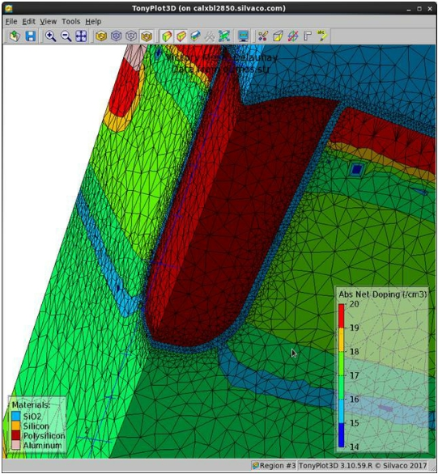
<figcaption>复杂几何需要三维编辑和网格检查，但计算成本更高</figcaption>
</figure>

<!-- 讲师备注：ATLAS 文本便于版本管理和重复生成，DevEdit 更适合复杂几何与三维，但必须保存独立结构来源。 -->

---

# 结构保存前要完成四类回归检查

<h3>几何连续</h3>
区域边界、外延层和终端没有意外裂缝。

<h3>掺杂合理</h3>
净掺杂极性、结深和背景浓度可解释。

<h3>电极覆盖</h3>
端点和接触长度符合版图或测试定义。

<h3>网格可用</h3>
关键梯度附近有足够分辨率。

保存结构时同步记录生成命令、来源版本和本次检查结论。

<!-- 讲师备注：结构保存不是流程终点，只有通过几何、掺杂、电极和网格四项回归检查，后续求解才有稳定对象。 -->

---

# 第1节检查点：结构验收清单

看到一张结构图时，能用两分钟回答：从哪里来、区域是否闭合、电极接触谁、掺杂是什么、网格为什么这样密。

<ol>
<li>保存命令或上游结构文件。</li>
<li>显示材料、净掺杂和电极。</li>
<li>在关键结区做一维截线。</li>
<li>标出局部网格加密区域。</li>
<li>记录已知局限与待校准参数。</li>
</ol>

<!-- 讲师备注：结构验收不通过时，不应进入材料模型和特性分析，否则后续结果没有稳定对象。 -->

---

<!-- _class: lead -->

# 第2节

## 材料参数、物理模型与接触界面

<!-- 讲师备注：第2节约 45 分钟解释材料参数、迁移率、复合、碰撞电离、隧穿、统计、热、接触和界面的选择逻辑。 -->

---

# 材料参数是器件物理的输入合同

同一材料名称不代表同一组数值，材料参数必须和温区、掺杂、晶型及来源一起记录。

<h3>介电</h3>
<code>permittivity</code> 影响电场和电容。

<h3>能带</h3>
<code>eg300</code>、<code>affinity</code> 影响势垒和统计。

<h3>迁移率</h3>
<code>mun0</code>、<code>mup0</code> 影响导通电阻。

<h3>寿命</h3>
<code>taun0</code>、<code>taup0</code> 影响复合。

<h3>饱和速度</h3>
<code>vsat</code> 影响高场输运。

<h3>来源</h3>
默认值、文献或独立测量。

<!-- 讲师备注：材料参数层把几何结构变成具体物理问题，参数来源应与模型选择一起说明。 -->

---

# 默认参数可以使用，但不能匿名使用

<h3>软件默认值</h3>
适合教学起步和快速检查，需记录软件版本。

<h3>文献数值</h3>
适合成熟材料，但必须确认温区、晶型和测试条件。

<h3>工艺提取</h3>
来自 SIMS、C-V 或其他测量，需说明反演方法。

<h3>拟合参数</h3>
用于匹配器件曲线，需保留独立验证集。

“ATLAS 的默认值”不是材料参数的物理出处，只是当前版本的软件状态。

<!-- 讲师备注：结果报告中要区分软件默认、文献选择和实验校准，不能让读者误以为所有参数都已验证。 -->

---

# 能带参数控制势垒、统计和界面行为

<h3>关键量</h3>
<ul>
<li><code>eg300</code>：300 K 禁带宽度。</li>
<li><code>affinity</code>：电子亲和势。</li>
<li><code>align</code>：异质界面带边不连续参数。</li>
<li><code>nc300</code>、<code>nv300</code>：有效状态密度。</li>
<li><code>d.tunnel</code>：肖特基隧穿相关距离。</li>
</ul>

<figure>
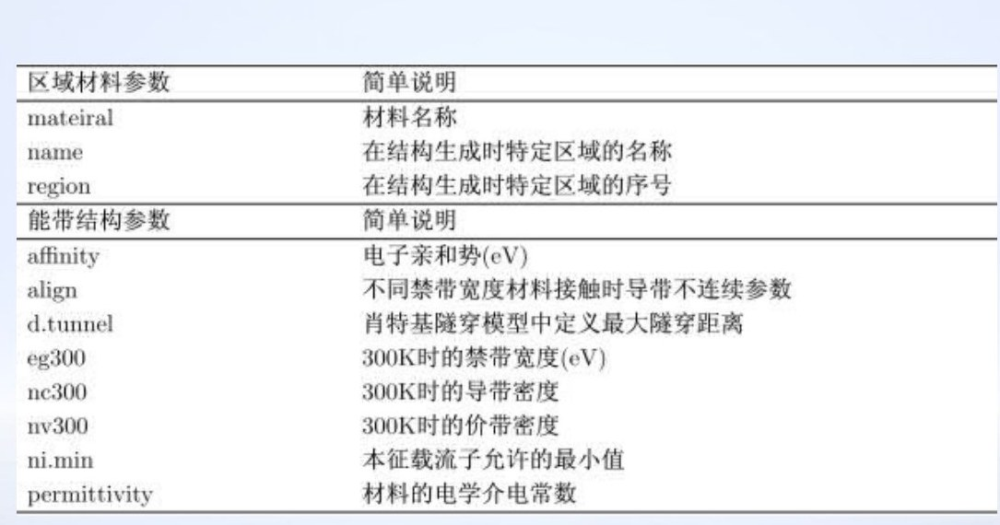
<figcaption>区域、能带和介电参数的项目示例</figcaption>
</figure>

<!-- 讲师备注：本节给出能带不连续和输出 con.band、val.band 的说明；功率异质结构分析必须检查这些量。 -->

---

# 功率材料参数要锁定晶型、温度和模型版本

<h3>Si</h3>
关注温度相关迁移率、Auger 和击穿参数。

<h3>4H-SiC</h3>
锁定晶型、各向异性和掺杂相关参数。

<h3>GaN</h3>
异质界面、极化与陷阱参数必须交代。

<h3>文献一致性</h3>
同一结果不要混用不兼容的数据源。

<!-- 讲师备注：功率材料对晶型、温度和场强非常敏感，材料名称相同但参数来源不同会改变击穿和漏电结论。 -->

---

# 材料命令可以按材料、区域或参数文件赋值

<pre><code>material material=4H-SiC permitti=9.66 \
  eg300=2.99 edb=0.1 gcb=2 \
  eab=0.2 gvb=4 nsrhn=3e17 nsrhp=3e17 \
  taun0=5e-10 taup0=1e-10 tc.a=100
material region=1 taun0=8e-10
material material=silicon f.taun="taun.lib"</code></pre>

<ul>
<li><code>material</code> 可按材料或区域覆盖参数。</li>
<li>参数文件适合复杂或复用的温度依赖关系。</li>
<li>覆盖顺序要记录，否则默认值与自定义值可能混淆。</li>
</ul>

<!-- 讲师备注：示例保留本节示例定义方式，具体数值仅作语法说明，不能代替实际材料标定。 -->

---

# 自定义材料需要类型、名称和参数三部分

user.group
user.material
material 参数
region 引用

<pre><code>material material=super_pebu \
  user.group=semiconductor \
  permittivity=13.2 eg300=1.44 \
  affinity=4.07 vsat=7.7e6
region num=2 user.material=super_pebu \
  y.max=0.5</code></pre>

<!-- 讲师备注：本节示例先定义半导体类别和自定义材料名，再在结构中引用；引用名必须完全一致。 -->

---

# C 解释器用于表达空间或掺杂相关参数

<h3>适用形式</h3>
<ul>
<li>少子寿命随位置变化。</li>
<li>材料参数随局部浓度变化。</li>
<li>经验关系难以用单一常数表示。</li>
</ul>
<pre><code>int taun(double x, double y, double temp,
         double nd, double na, double *taun) {
  *taun = (y >= 0.75 &amp;&amp; y &lt;= 0.85)
          ? 5e-8 : 2e-6;
  return 0;
}</code></pre>

自定义函数改变的是参数模型，必须记录编译版本、参数文件和适用区域。

<!-- 讲师备注：本节示例 用少子寿命函数说明 C 解释器；本页不展开软件安装，只强调自定义物理关系的可追溯性。 -->

---

# 复合模型决定漏电、存储电荷和温度行为

<h3>SRH</h3>
陷阱辅助复合，受寿命和缺陷能级影响。

<h3>Auger</h3>
高注入和高掺杂下不可忽略。

<h3>Surface</h3>
<code>s.n</code>、<code>s.p</code> 描述表面复合速度。

<h3>Trap</h3>
陷阱能级、密度和俘获截面影响动态行为。

<!-- 讲师备注：本节列出 SRH、Auger、表面和陷阱复合；本课排除光学复合，只保留功率器件电热相关部分。 -->

---

# 迁移率模型覆盖低场、高场和温度依赖

<ul>
<li><code>conmob</code>：浓度依赖迁移率。</li>
<li><code>analytic</code>、<code>arora</code>：浓度与温度依赖。</li>
<li><code>fldmob</code>：平行电场依赖。</li>
<li><code>cvt</code>、<code>yamaguchi</code>：集成表面/沟道模型。</li>
<li><code>tasch</code>、<code>watt</code>、<code>shirahata</code>：横向高场模型。</li>
</ul>

<figure>
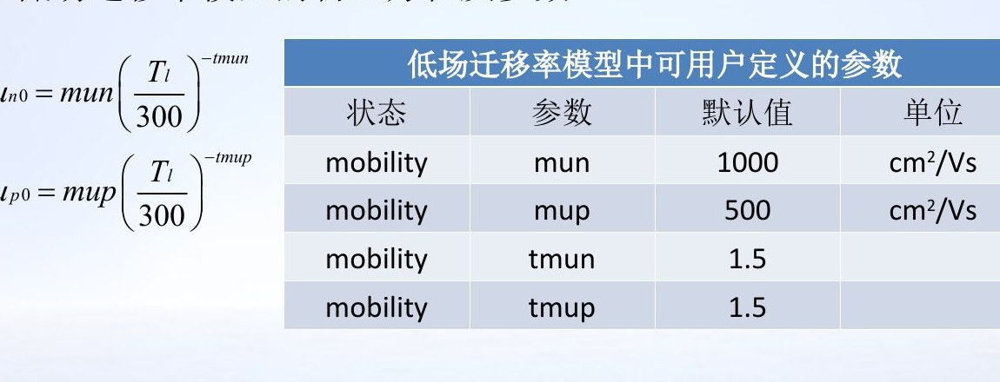
<figcaption>低场迁移率中的温度幂律和用户可定义参数</figcaption>
</figure>

<!-- 讲师备注：功率器件的漂移区、沟道和表面可能处于不同场强，不能用同一迁移率假设覆盖全部区域。 -->

---

# 碰撞电离模型是击穿分析的核心选择

<h3>Selberherr</h3>
<code>impact selb</code>，常用于通用击穿分析。

<h3>Grant/Crowell</h3>
不同场强范围和材料参数化选择。

<h3>Concannon/Valdinoci</h3>
特定材料和模型形式。

<h3>Toyabe</h3>
另一种电离系数表达。

不能用未校准的电离模型直接给出精确耐压数值；模型名称、参数和适用材料必须同时报告。

<!-- 讲师备注：本节示例 列出多种碰撞电离模型，课堂重点是理解模型选择影响击穿，而不是背诵全部命令名。 -->

---

# 隧穿模型解释肖特基与高场漏电

<h3>BTBT</h3>
<code>bbt.std</code>、<code>bbt.kl</code> 描述带间隧穿。

<h3>FN</h3>
福勒-诺德海姆隧穿用于强电场势垒。

<h3>BGN</h3>
重掺杂下必须同步考虑能带变窄。

<h3>热电子发射</h3>
肖特基界面的温度相关电流路径。

<!-- 讲师备注：功率肖特基和 JBS 的反向漏电常受势垒、隧穿和温度共同控制，不能只用理想热发射解释。 -->

---

# 载流子统计在重掺杂和高场下不能只靠默认值

<h3>Boltzmann 与 Fermi-Dirac</h3>
<ul>
<li>Boltzmann 是常用默认近似。</li>
<li>重掺杂时 Fermi-Dirac 更合适。</li>
<li><code>incomp</code>、<code>ioniz</code> 描述不完全离化。</li>
<li><code>bgn</code> 描述能带变窄。</li>
</ul>

统计模型会影响载流子密度、结内建电势和漏电，和复合、隧穿模型共同作用。

<!-- 讲师备注：本节把统计、不完全离化和能带变窄列为一组，重掺杂功率器件的源漏和接触区尤其要检查。 -->

---

# 晶格加热和能量平衡描述非等温输运

<h3>模型入口</h3>
<ul>
<li><code>lat.temp</code>：启用晶格温度。</li>
<li>能量平衡：载流子温度与晶格温度分离。</li>
<li><code>thermcontact</code>：设置外部热边界。</li>
<li>热导率、热容和热源需匹配材料。</li>
</ul>

大电流下的电流拥挤、热失控和击穿曲线回折，需要热模型参与解释。

<!-- 讲师备注：器件热分析至少需要晶格温度模型和热接触，这两个条件与电学接触是两个独立边界。 -->

---

# 模型组合要围绕器件工作区闭合

<table>
<tr><th>问题</th><th>可考虑的模型</th><th>检查点</th></tr>
<tr><td>MOS 沟道</td><td>SRH、CVT、BGN</td><td>栅氧和界面参数</td></tr>
<tr><td>功率二极管</td><td>SRH、场依赖迁移率、碰撞电离</td><td>漂移区与终端场</td></tr>
<tr><td>肖特基/JBS</td><td>热电子发射、隧穿、势垒</td><td>温度与反向漏电</td></tr>
<tr><td>大电流/热失效</td><td>Giga、晶格加热、热接触</td><td>热边界与电流拥挤</td></tr>
</table>

<!-- 讲师备注：本节给出 MOSFET、BJT/晶闸管和击穿推荐组合；本页按功率器件工作区重组，强调组合要有理由。 -->

---

# CONTACT 定义电极的物理与外部条件

<h3>肖特基</h3>
功函数、势垒和接触材料。

<h3>电流边界</h3>
<code>current</code> 将电极改为电流控制。

<h3>寄生参数</h3>
电阻、电容和电感。

<h3>连接状态</h3>
浮空、短接、公共电极或开路。

<!-- 讲师备注：接触不是简单接零，功函数、边界类型、寄生与连接关系都会改变端特性和内部解。 -->

---

# 接触命令要明确它改变的是哪一类边界

<pre><code>contact name=gate workfunction=4.8
contact name=anode workfunction=4.9 \
  barrier alpha=1e-7
contact name=drain current
contact name=source resistance=50 \
  capacitance=20e-12 inductance=1e-6
contact name=gate1 common=gate2 factor=0.1</code></pre>

<ul>
<li>功函数和电流边界不能混用。</li>
<li>短接与因子连接要能对应实际测试拓扑。</li>
<li>开路应通过删除、极大电阻或零电流边界明确表达。</li>
</ul>

<!-- 讲师备注：本节示例 给出肖特基、电流、寄生、短接和开路定义；本课只讨论器件端边界，不进入外部电路仿真。 -->

---

# INTERFACE 描述界面电荷与表面复合

<pre><code>interface y.max=0.1 qf=-1e11
interface x.min=-4 x.max=4 \
  y.min=-0.25 y.max=0.1 \
  qf=1e11 s.n=1e4 s.p=1e4</code></pre>

<h3><code>qf</code></h3>
界面固定电荷面密度。

<h3><code>s.n</code></h3>
电子表面复合速度。

<h3><code>s.p</code></h3>
空穴表面复合速度。

<h3>位置范围</h3>
界面命令只应作用于目标界面。

<!-- 讲师备注：功率器件的场氧、钝化和栅氧界面可能主导表面漏电，界面边界必须与材料结构精确对齐。 -->

---

# 模型耦合决定结果是否“物理一致”

迁移率
载流子密度
复合
碰撞电离
晶格温度

- 高场改变迁移率和碰撞电离。
- 碰撞电离改变载流子密度与电流。
- 电流改变焦耳热与晶格温度。
- 温度又反馈到迁移率、统计和电离参数。

<!-- 讲师备注：模型不是并列勾选项，功率器件强场和热效应会形成反馈，因此模型组合必须通过灵敏度检查。 -->

---

# 参数校准要服从物理边界和独立验证

<h3>选观测量</h3>
正向 I-V、反向漏电、击穿或 C-V。

<h3>找敏感参数</h3>
一次只改变少数有物理意义的量。

<h3>设范围</h3>
参数不得超出材料或文献合理区间。

<h3>独立验证</h3>
留出不同温度或偏置的数据检验。

<!-- 讲师备注：校准的目标是提高可预测性，不是把某一条测量曲线拟合得最像。 -->

---

# 第2节检查点：模型论证表

为每个模型写一行：解决什么物理、作用在哪个区域、关键参数从哪里来、关闭它会发生什么。

<table>
<tr><th>模型</th><th>作用区域</th><th>参数来源</th><th>关闭后的预期变化</th></tr>
<tr><td>碰撞电离</td><td>高场终端</td><td>材料文献/校准</td><td>无法形成可靠击穿</td></tr>
<tr><td>SRH</td><td>耗尽区/表面</td><td>寿命数据</td><td>漏电与存储电荷改变</td></tr>
<tr><td>晶格加热</td><td>大电流区</td><td>热参数/热边界</td><td>热失控趋势消失</td></tr>
</table>

<!-- 讲师备注：如果学生说不清关闭模型后的变化，说明模型还只是命令，不是经过理解的物理假设。 -->

---

<!-- _class: lead -->

# 第3节

## 特性获取、空间分布与结果证据

<!-- 讲师备注：第3节约 45 分钟讲 DC、AC、瞬态、热、Curvetrace 和三维结果，并完成从文件到结论的证据闭环。 -->

---

# 特性获取要复现一个明确的测量问题

先定义端对、激励和环境，再决定使用 DC、AC、瞬态、热或三维求解。

端对
激励
环境
输出变量
指标判据

- 没有端对，就不知道电流相对谁定义。
- 没有激励路径，就不知道曲线如何得到。
- 没有环境，就无法比较温度相关结果。

<!-- 讲师备注：仿真特性应模仿真实测量思路，但结果报告还要额外说明结构和模型，因为仿真条件比实验更透明。 -->

---

# DC 特性覆盖 I-V、转移、输出和击穿

<ul>
<li><code>solve init</code> 建立零偏状态。</li>
<li>固定非扫描电极，再扫描目标电极。</li>
<li>输出特性保留不同控制电极条件。</li>
<li>击穿曲线使用反向扫描或电流控制。</li>
</ul>

<figure>
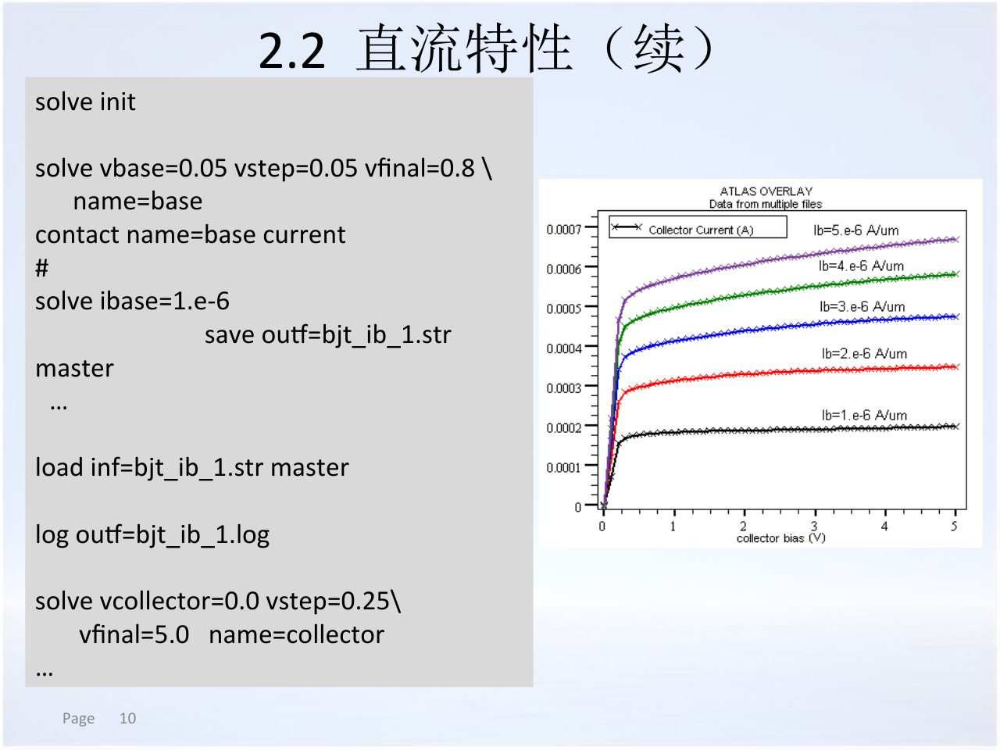
<figcaption>DC 命令、多个偏置条件和 TonyPlot 曲线结果</figcaption>
</figure>

<!-- 讲师备注：直流特性示例给出多组基极条件下的集电极扫描，方法可迁移到功率器件的栅压或温度分组。 -->

---

# 端电流必须和面积、方向、参考端一起记录

<h3>方向</h3>
电流正负号取决于端和偏压约定。

<h3>归一化</h3>
总量、每微米宽度或每平方厘米。

<h3>参考端</h3>
阴极、源极或衬底必须明确。

<h3>输出列</h3>
日志列名和单位要与图轴一致。

“电流达到 1e-3”没有面积和端信息时，无法比较不同功率器件。

<!-- 讲师备注：端特性分析的第一个质量门是坐标合同，不是曲线是否好看。 -->

---

# AC 小信号用于 C-V 和偏置相关响应

<pre><code>solve vgate=-5 vstep=0.1 \
  vfinal=5 name=gate \
  ac freq=1e6</code></pre>
<ul>
<li>记录直流偏置、频率和端对。</li>
<li>可扫描固定频率或改变频率。</li>
<li>本课不扩展到 S 参数和光电器件。</li>
</ul>

<figure>
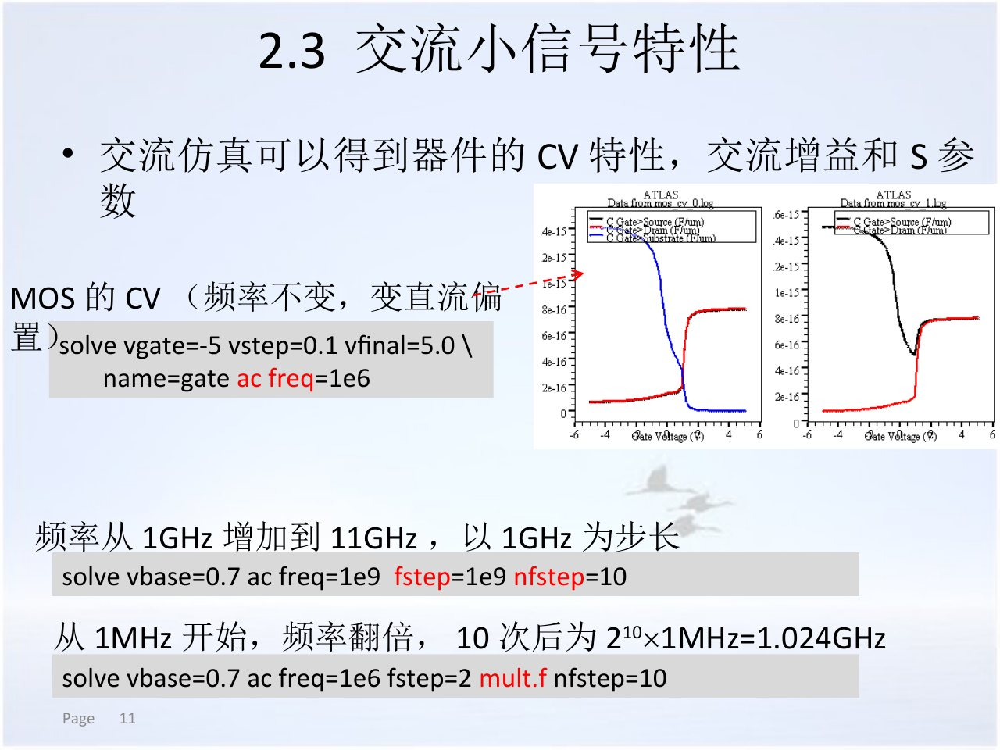
<figcaption>不同端对和频率下的 MOS C-V 响应</figcaption>
</figure>

<!-- 讲师备注：AC 结果要与偏置和频率绑定；功率器件的电容会包含结、栅、界面和寄生贡献。 -->

---

# 瞬态条件由初始状态、波形和时间步长共同定义

<pre><code>solve vgate=1.0 ramptime=1e-9 \
  tstep=0.1e-9 tstop=1e-8</code></pre>

<h3>初始状态</h3>
零偏、导通或高温平衡。

<h3>激励波形</h3>
上升、保持、下降和幅值。

<h3>时间步长</h3>
必须解析最快响应。

<h3>终止时间</h3>
覆盖稳定或恢复过程。

<!-- 讲师备注：本页用栅压斜坡示例说明 ramptime、tstep 和 tstop，功率器件还要记录初始温度和负载条件。 -->

---

# Curvetrace 处理强非线性击穿路径

<pre><code>curvetrace contr.name=collector \
  step.init=0.05 nextst.ratio=1.1 \
  mincur=1e-13 end.val=1e-3 \
  curr.cont
solve curvetrace</code></pre>
<ul>
<li>用于自动追踪复杂 I-V 路径。</li>
<li>可观察击穿、回折和热失控趋势。</li>
<li>不得据此扩展为电路或 MixedMode 结论。</li>
</ul>

回折段是否可信，要结合碰撞电离、晶格温度和电流密度空间分布判断。

<!-- 讲师备注：本节把 Curvetrace 与击穿、闩锁和二次击穿关联；本课只保留器件级耐压与热失控分析。 -->

---

# 热学特性至少需要热模型和热接触

<h3>热学设置</h3>
<ul>
<li><code>models lat.temp</code> 启用晶格加热。</li>
<li><code>thermcontact</code> 定义温度边界。</li>
<li>热源来自电流与场的焦耳项。</li>
<li>热导率、热容和几何需匹配。</li>
</ul>

<figure>
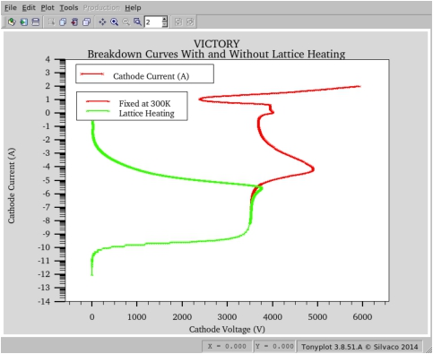
<figcaption>晶格加热会改变高场大电流段的击穿曲线形态</figcaption>
</figure>

<!-- 讲师备注：曲线在热参与后可能回折，不能把纯电学碰撞电离击穿与热失控混成一个判据。 -->

---

# 三维结果只在关键路径无法二维化时使用

<h3>适用理由</h3>
<ul>
<li>第三维存在电流拥挤。</li>
<li>终端拐角或局部接触主导。</li>
<li>二维截线无法代表整体。</li>
</ul>

三维流程可沿用二维语法，但需增加 Z 坐标、Z 区域范围与相应网格。

<figure>

<figcaption>三维结构的网格、材料和掺杂必须同时检查</figcaption>
</figure>

<!-- 讲师备注：本页指出三维语法可参照二维并增加 z 轴，真正的门槛是网格成本与结果解释。 -->

---

# 结果文件有三种核心角色

<h3>实时输出</h3>
命令、警告和收敛轨迹。

<h3><code>.str</code></h3>
几何、网格和空间解。

<h3><code>.log</code></h3>
端特性和扫描记录。

<h3>导出数据</h3>
CSV 或 TonyPlot User Data。

截图只是人眼入口，原生文件才是可复核证据。

<!-- 讲师备注：结果页必须区分实时信息、空间结构和端特性日志，不同文件回答不同问题。 -->

---

# TonyPlot 用于联合阅读曲线和结构

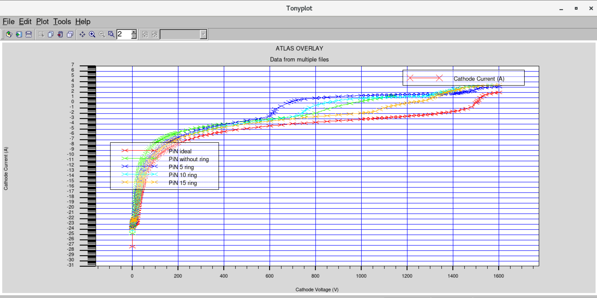

<ul>
<li>先读图例，确认不同曲线对应哪种结构。</li>
<li>再读坐标范围，确认是否覆盖漏电到击穿。</li>
<li>最后回到日志，提取击穿点或漏电流。</li>
</ul>

<!-- 讲师备注：多曲线叠加图非常适合比较终端方案，但图例、坐标和判据缺失时很容易误读。 -->

---

# 结构截线和导出数据把图像变成数值

<h3>两种导出</h3>
<ul>
<li>结构文件通过 Cutline 得到一维剖面。</li>
<li>日志文件通过 File → Export 导出曲线数据。</li>
</ul>
<h3>检查</h3>
<ul>
<li>坐标范围、单位与原始图一致。</li>
<li>截线穿过目标物理区域。</li>
<li>数据列与图例一一对应。</li>
</ul>

<figure>
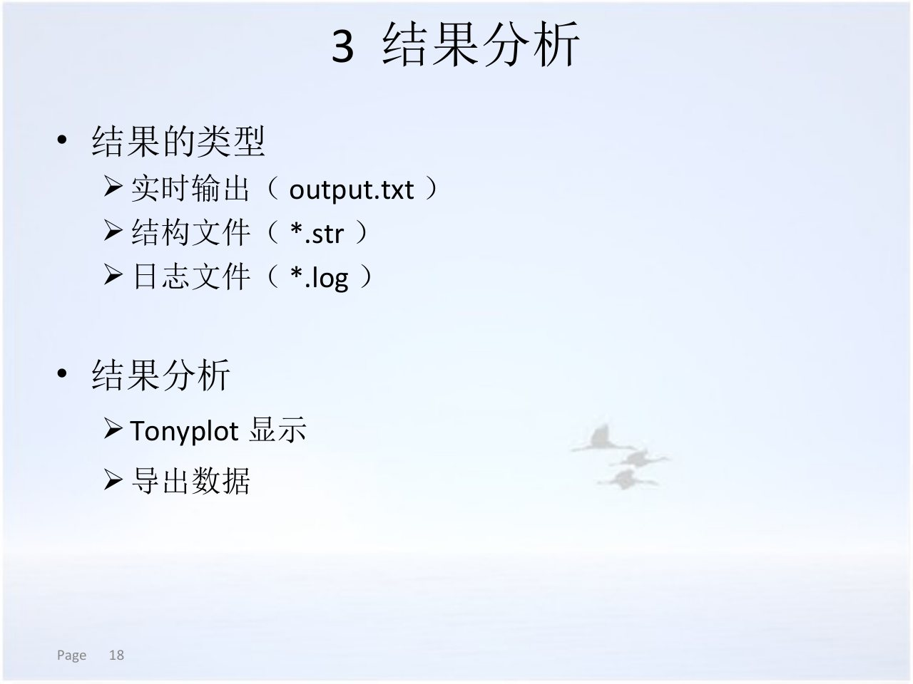
<figcaption>结果类型和导出入口，本页使用结果分析示例</figcaption>
</figure>

<!-- 讲师备注：本页介绍 TonyPlot 显示和导出数据，本页强调导出后仍需检查坐标和列语义。 -->

---

# CSV 导出适合重绘、统计和结果留档

<h3>格式</h3>
Comma Separated Values，便于脚本和表格处理。

<h3>路径</h3>
文件名应包含器件、偏压、温度和版本。

<h3>表头</h3>
确认变量名、单位与数据列顺序。

<h3>一致性</h3>
用独立绘图复核 TonyPlot 趋势。

导出文件是量化证据，但必须能从日志或结构文件追溯到具体求解条件。

<!-- 讲师备注：本节示例 给出 TonyPlot File → Export 和 CSV 格式流程，本课要求导出后做一次独立一致性检查。 -->

---

# 功率器件结果分析要按因果顺序推进

结构
模型
端特性
空间分布
指标与结论

<ol>
<li>确认结构和掺杂。</li>
<li>确认材料、模型和接触。</li>
<li>读取正向与反向 I-V。</li>
<li>定位最大电场和电流拥挤。</li>
<li>提取耐压、漏电、导通或其他指标。</li>
</ol>

<!-- 讲师备注：从端特性到空间分布再到指标，是解释因果的顺序；直接看彩色云图容易失去问题上下文。 -->

---

# 掺杂分布图说明器件的静态边界条件

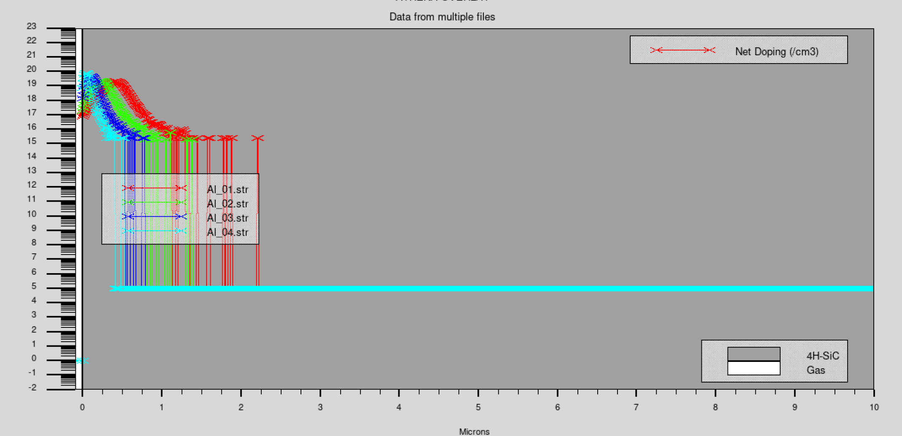

- 掺杂剖面定义漂移区和结的位置。
- I-V 曲线显示终端结构对反向特性的影响。
- 两张图必须对应同一批结构文件。

<!-- 讲师备注：如果结构图与曲线来自不同器件版本，再漂亮的对比也不能作为同一结论的证据。 -->

---

# 电场分布图用于判断终端是否先达到临界场

<h3>观察点</h3>
<ul>
<li>峰值位置在体内还是表面。</li>
<li>颜色分区与等势线是否合理。</li>
<li>偏压升高时峰值如何迁移。</li>
<li>是否靠近材料临界击穿场强。</li>
</ul>

<figure>
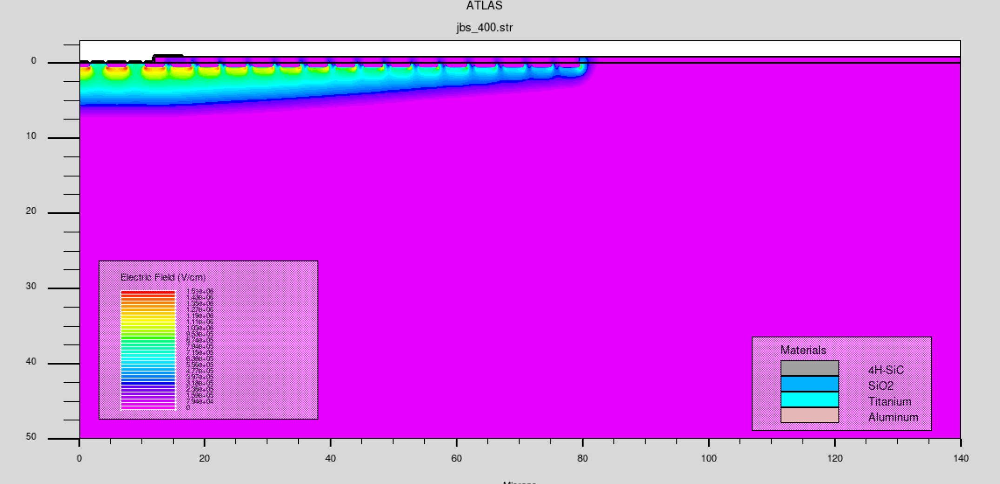
<figcaption>400 V 反向偏压下的表面电场和耗尽区形态</figcaption>
</figure>

<!-- 讲师备注：电场图要和电势图、I-V 拐点联合使用，不能仅凭某一点颜色判断器件已经击穿。 -->

---

# 电流密度图说明局部导通与失效风险

<h3>与耐压分析的区别</h3>
<ul>
<li>电流密度关注导通和局部拥挤。</li>
<li>高场关注雪崩和击穿。</li>
<li>热源由电流与场共同决定。</li>
<li>三个量必须使用同一工作点。</li>
</ul>

<figure>
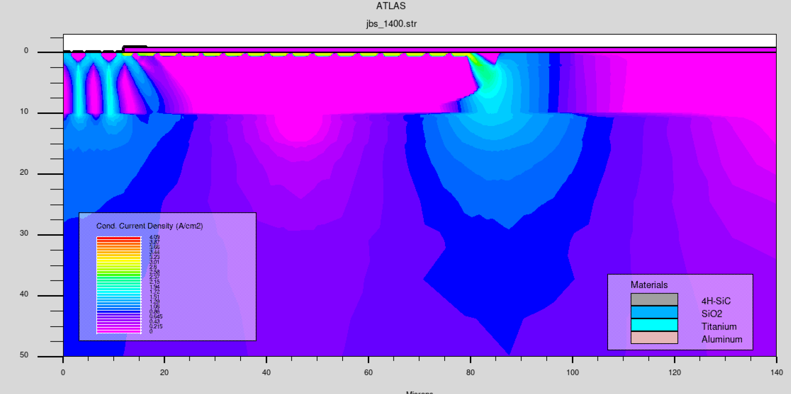
<figcaption>高反向偏压下的导电电流密度路径</figcaption>
</figure>

<!-- 讲师备注：功率器件的失效可能由电场驱动，也可能由电流拥挤和自加热驱动，结果页要写清是哪一种机制。 -->

---

# 热参与后的击穿曲线需要重新解释

<h3>联合证据</h3>
<ul>
<li>I-V 是否出现回折或迟滞。</li>
<li>晶格温度在哪里升高。</li>
<li>电流是否向局部路径收缩。</li>
<li>热接触位置是否改变结果。</li>
</ul>

<figure>

<figcaption>是否启用晶格加热会改变强非线性击穿段</figcaption>
</figure>

<!-- 讲师备注：本节把热学特性列为独立结果类别；本页强调热击穿和纯电击穿需要不同的证据组合。 -->

---

# 用证据矩阵约束每一条结论

<table>
<tr><th>结论</th><th>端证据</th><th>空间证据</th><th>条件</th></tr>
<tr><td>终端改善耐压</td><td>反向 I-V</td><td>电势/电场</td><td>结构、模型、温度</td></tr>
<tr><td>漏电来自势垒</td><td>温度相关 I-V</td><td>界面/电流路径</td><td>接触、隧穿参数</td></tr>
<tr><td>电流拥挤引发热风险</td><td>大电流 I-V</td><td>电流密度/温度</td><td>热边界、面积</td></tr>
</table>

<!-- 讲师备注：证据矩阵把“结论需要哪些文件”前置，学生可以据此检查自己的汇报是否缺证据。 -->

---

# 收敛和敏感性检查必须进入最终报告

<h3>网格</h3>
局部加密后关键指标是否稳定。

<h3>偏压步长</h3>
击穿点是否随步长明显移动。

<h3>模型</h3>
核心模型开关是否改变趋势。

<h3>独立验证</h3>
是否在另一温度或结构上成立。

<!-- 讲师备注：可信结果不仅有最低点，还要说明数值和模型不确定性；没有敏感性检查就只能写趋势性结论。 -->

---

# 结果页与第3节检查点

<h3>条件</h3>
结构、材料、模型、偏压、温度、面积。

<h3>图</h3>
端特性图与至少一张空间分布图。

<h3>指标</h3>
明确判据、数值和单位。

<h3>机制与局限</h3>
用空间分布解释原因，并写出验证边界。

用 90 秒完成“问题、条件、图、指标、机制、局限”的证据答辩。

<!-- 讲师备注：第3节结束时，学生应能用一张结果页回答“结果是什么、为什么、有多可信”。 -->

---

# 本章小结

- 结构、材料、模型、接触和界面共同定义器件仿真问题。
- ATLAS 适合参数化结构，DevEdit 适合复杂几何和三维编辑，两者都要保留来源。
- 迁移率、复合、碰撞电离、隧穿、统计和热模型必须按工作区组合。
- DC、AC、瞬态、热和三维结果需要不同的边界与时间/空间条件。
- 结果证据由结构、日志、导出数据和空间分布共同构成。

<!-- 讲师备注：回收结构、模型和结果三节，强调功率器件结论必须同时有物理机制和可复核数据。 -->

---

# 课堂任务与检查点

<h3>提交一张功率器件参数页</h3>
<ol>
<li>结构区域、电极和网格加密理由。</li>
<li>材料参数及其来源。</li>
<li>三个模型及各自作用区域。</li>
<li>一组 DC 和一组热或瞬态条件。</li>
<li>两个指标及其提取判据。</li>
</ol>

通过标准：每一项都能指回结构文件、模型命令、日志列或空间截图。

<!-- 讲师备注：任务以参数论证和证据闭环为主，不要求运行重型三维案例；重点是解释为什么这样建模。 -->

---

# 本章参考文献

<ol class="reference-list">
<li>SILVACO INTERNATIONAL. <em>Silvaco TCAD Device Structure Generation</em>[Z]. Silvaco TCAD Training Materials, n.d.</li>
<li>SILVACO INTERNATIONAL. <em>Material Parameters and Physical Models in Silvaco TCAD</em>[Z]. Silvaco TCAD Training Materials, n.d.</li>
<li>SILVACO INTERNATIONAL. <em>Device Characteristics Extraction and Result Analysis</em>[Z]. Silvaco TCAD Training Materials, n.d.</li>
<li>SILVACO INTERNATIONAL. <em>ATLAS User's Manual</em>[Z]. Santa Clara, CA: Silvaco International, n.d.</li>
<li>SILVACO INTERNATIONAL. <em>DevEdit User's Manual</em>[Z]. Santa Clara, CA: Silvaco International, n.d.</li>
<li>SILVACO INTERNATIONAL. <em>Model Development Using the C-Interpreter</em>[Z]. Silvaco International, n.d.</li>
<li>SILVACO INTERNATIONAL. <em>Power Device Physics Revealed: TCAD for Power Device Technologies</em>[Z]. Silvaco International, 2010.</li>
</ol>

<!-- 讲师备注：参考文献覆盖结构生成、材料参数、物理模型、特性获取和功率器件案例，结果图仅用于方法说明。 -->
