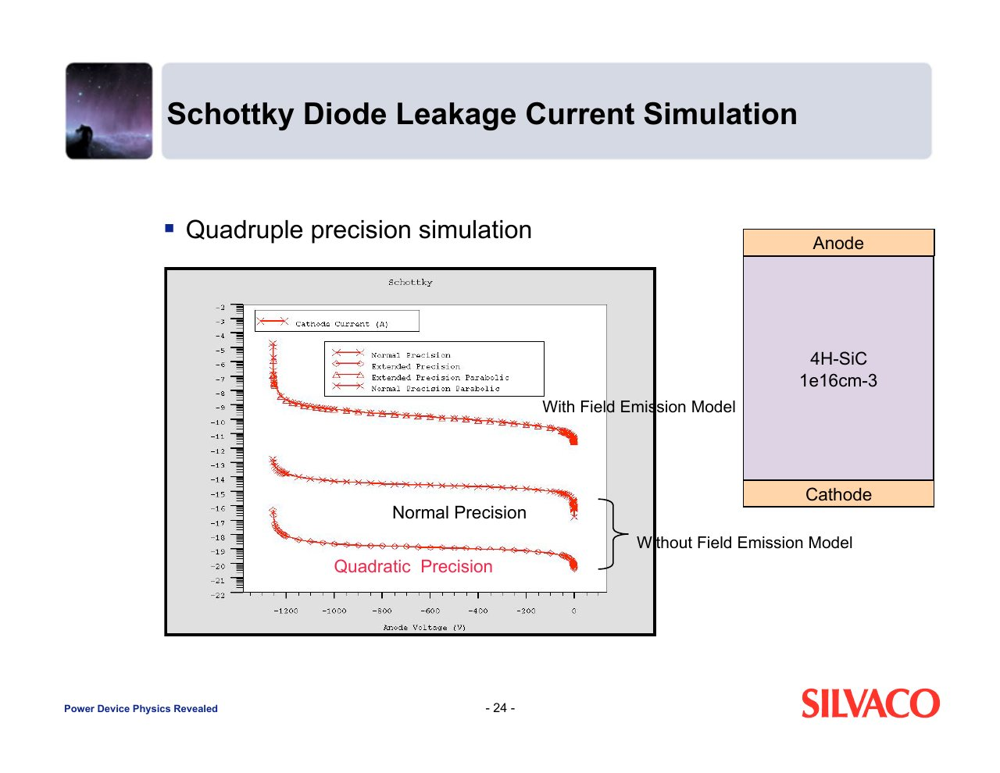
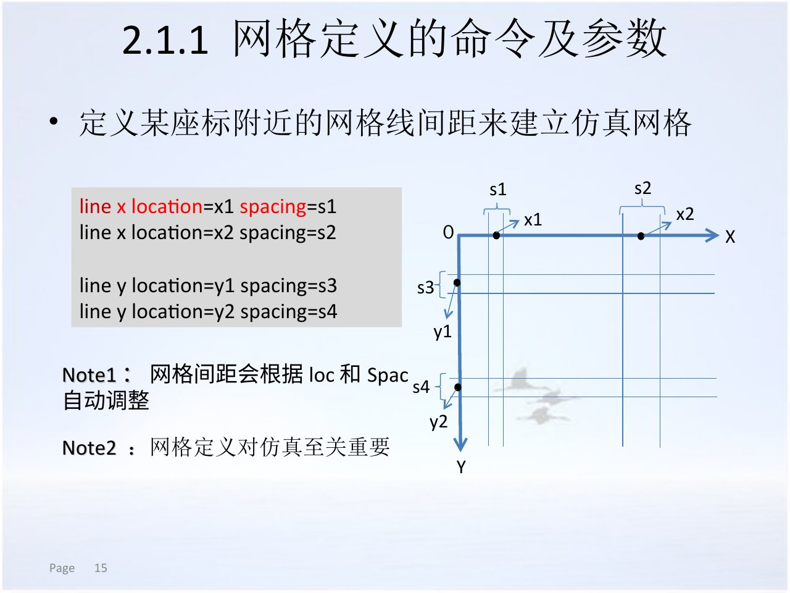
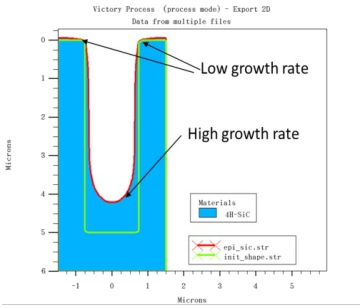
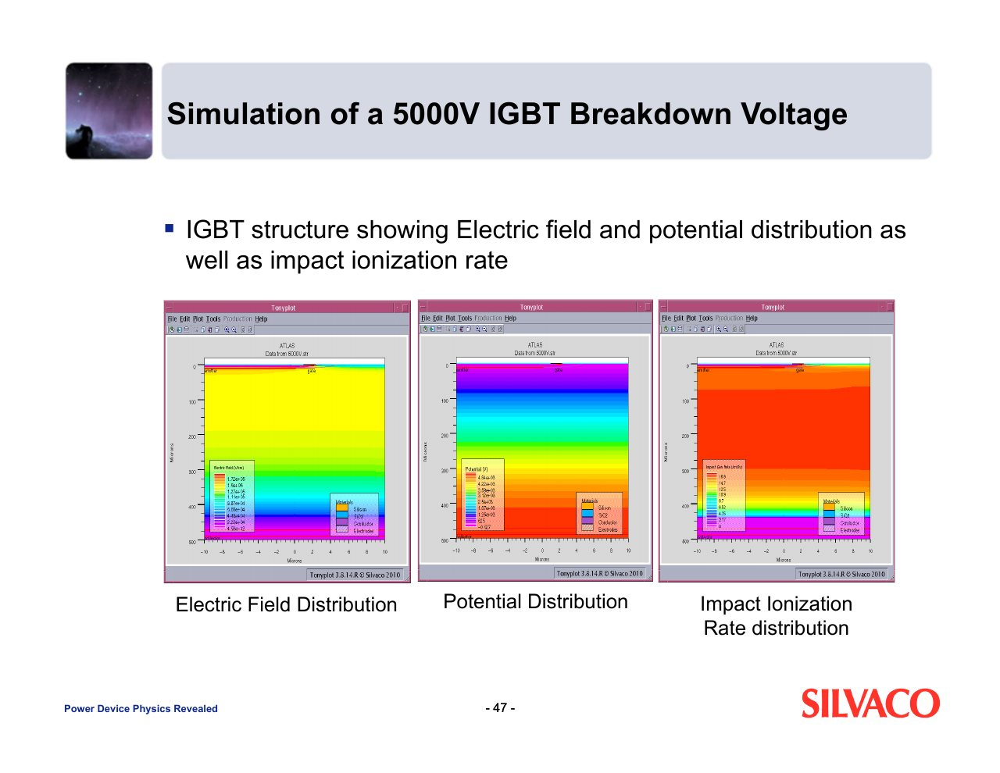
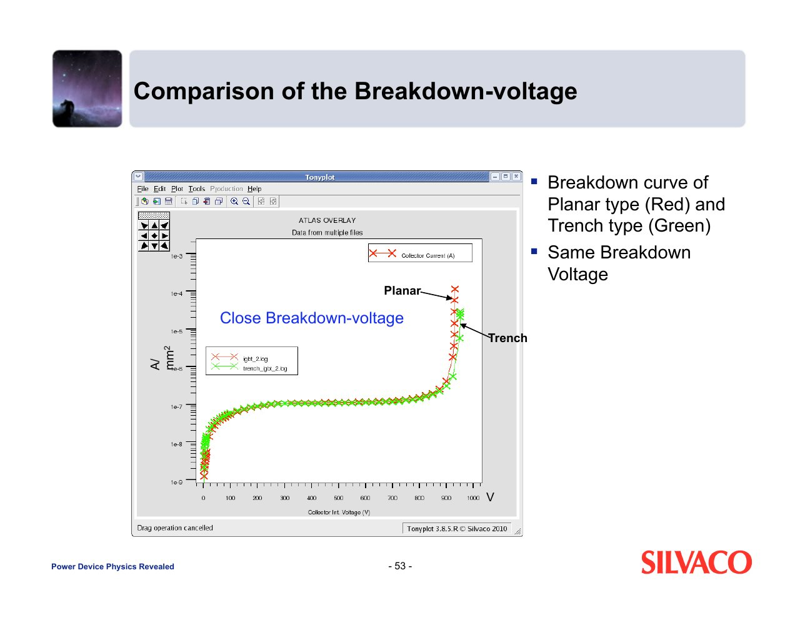
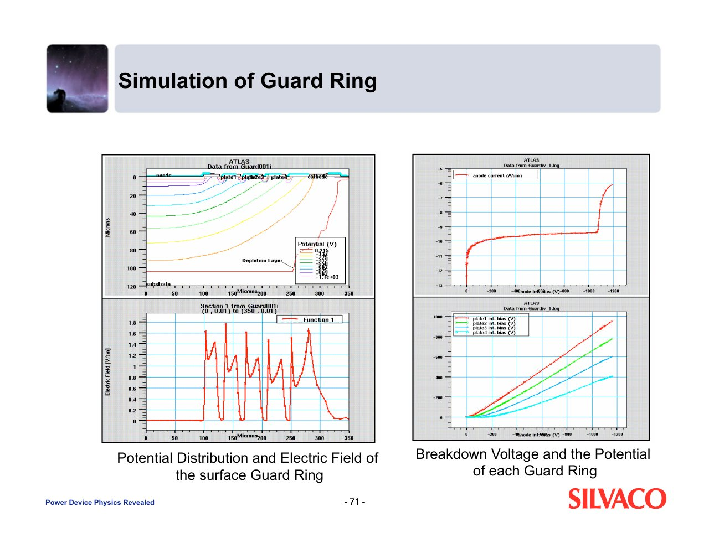

<!-- _class: lead -->

# 功率器件仿真

## 三节纯理论课 · PiN、SiC JBS、肖特基、MOSFET、IGBT 与保护环

<!-- 讲师备注：本章用三节纯理论课建立功率器件仿真的问题链、模型链和证据链。课堂只讨论器件内部物理与 TCAD 结果，不展开系统级分析。 -->

---

# 本章学习目标

<h3>定义问题</h3>
把耐压、导通、漏电和终端要求翻译成结构、材料、模型与扫描条件。

<h3>组织模型</h3>
解释工艺、结构、网格、材料参数和物理模型之间的依赖关系。

<h3>读结果</h3>
从 I–V、电场、电势和电流密度中提取可复核的物理证据。

<h3>形成判断</h3>
用条件、证据、指标、机制和局限评价一个功率器件方案。

<!-- 讲师备注：四个目标分别对应概念定义、建模约束、结果解释和设计评审。最后的判断能力比记住某个软件按钮更重要。 -->

---

# 三节课沿着“物理、模型、证据”递进

<h3>第1节 · 45 分钟</h3>
PiN、JBS、肖特基、MOSFET、IGBT 和保护环需要回答哪些物理问题。

<h3>第2节 · 45 分钟</h3>
工艺结构、网格、材料和击穿相关模型怎样组成可计算的问题。

<h3>第3节 · 45 分钟</h3>
怎样联读曲线与二维分布，形成可辩护的设计结论。

<blockquote>贯穿三节的主线：设计目标 → 器件结构 → 物理模型 → 数值证据 → 设计判断。</blockquote>

<!-- 讲师备注：先让学生看到全章结构。三节都围绕同一条证据主线，不在第1节提前堆软件细节，也不在第3节重复基础定义。 -->

---

<!-- _class: lead -->

# 第1节｜器件物理与问题定义

## 45 分钟 · 从耐压与导通要求确定仿真对象

<!-- 讲师备注：第1节只做问题定义。重点是识别每种器件的主载流子、电导调制、耐压层和终端失效位置，为第2节建模建立物理目标。 -->

---

# 功率器件仿真是在多重约束下求可行设计

<h3>耐压</h3>
目标电压、温度范围和击穿裕量。

<h3>导通</h3>
正向压降、比导通电阻与电流密度。

<h3>漏电</h3>
势垒、隧穿、界面与结终端漏电。

<h3>可靠性</h3>
峰值电场、局部温升与失效位置。

<blockquote>一条 I–V 曲线只是结果入口；结构内部的电场、电流和温度才解释“为什么”。</blockquote>

<!-- 讲师备注：强调功率器件设计不是单一指标最大化。结构改动常常改善一项指标、恶化另一项指标，因此仿真必须保留完整的条件集合。 -->

---

# 五类对象共享漂移区，却采用不同注入机制

| 器件 | 主载流子与注入 | 耐压层 | 首要风险 |
| --- | --- | --- | --- |
| PiN 二极管 | 电子、空穴双注入 | 低掺杂漂移区 | 存储电荷与边缘击穿 |
| 肖特基二极管 | 多数载流子越过势垒 | 外延漂移区 | 反向隧穿与势垒漏电 |
| SiC JBS | 肖特基与 PN 结并联 | 4H-SiC 漂移区 | 有源区与终端电场竞争 |
| 功率 MOSFET | 栅控沟道电流 | 漂移区与终端 | 导通电阻与栅氧电场 |
| IGBT | MOS 控流加双极注入 | 漂移区与缓冲层 | 饱和压降、拖尾与击穿 |

<!-- 讲师备注：这一页是第1节的索引。后续不逐一讲软件操作，而是解释每种器件为什么需要不同的物理模型和结果证据。 -->

---

# PiN 的核心矛盾是“导通时存储、关断时释放”

P+ 注入区
低掺杂本征或漂移区
N+ 注入区

-  正向时两侧向漂移区注入载流子，形成电导调制。
- 漂移区电阻下降，但大量存储电荷必须在关断过程中消失。
- 反向时漂移区承担电压，结边缘和终端通常先于体内达到临界场。

<!-- 讲师备注：这里把“i”解释为近似本征的低掺杂漂移区，不把它误写成完全无掺杂材料。PiN 的设计价值与代价来自同一个存储电荷机制。 -->

---

# PiN 正向压降由结压降与漂移区压降共同组成

<h3>结压降</h3>
由势垒、注入水平和复合决定，不等同于单一肖特基势垒。

<h3>漂移区压降</h3>
由载流子浓度、迁移率、厚度和电流密度决定。

<h3>存储电荷</h3>
<code>Q ≈ I·τ_eff</code> 表明寿命越长，调制越强但关断电荷越多。

<h3>自热</h3>
大电流下迁移率和本征浓度变化会反过来改变压降。

<blockquote>不能只用“正向电压低”评价 PiN；必须同时报告电流密度、温度和提取位置。</blockquote>

<!-- 讲师备注：不要求学生推导完整双极输运方程，但要能解释 Q 与寿命、电流的关系，并知道正向结果必须带电流密度和温度。 -->

---

# PiN 反向击穿首先检查终端而不是只看体内

- 漂移区厚度和掺杂决定理想平行平面击穿电压。
- 曲率、场氧、金属场板和结终端会改变表面电场。
- 体内电场峰值与表面电场峰值可能出现在不同位置。
- 击穿结论必须由 I–V 拐点、电场分布和碰撞电离共同支撑。

目标耐压不是“扫描到一个大数字”，而是可控、可重复且位置明确的击穿。

<!-- 讲师备注：引导学生区分理想一维耐压和二维终端耐压，后续的 JBS 与保护环都建立在这个差别上。 -->

---

# PiN 的四个设计变量彼此牵制

| 变量 | 增大时的收益 | 同时付出的代价 |
| --- | --- | --- |
| 漂移区厚度 | 更容易承担高电压 | 导通压降增大、热阻增加 |
| 漂移区掺杂 | 降低导通电阻 | 耗尽区变窄、耐压下降 |
| 载流子寿命 | 增强电导调制 | 存储电荷和关断拖尾增加 |
| 终端尺寸 | 降低表面峰值电场 | 占用面积、增加工艺复杂度 |

<!-- 讲师备注：提醒学生不要用单一变量解释全部行为。任何“优化”都要说明受益指标和受损指标，否则结论没有设计意义。 -->

---

# 用二极管结构示例读懂“命令到几何”的映射

<h3>读图顺序</h3>
<ul>
<li>网格如何覆盖结区</li>
<li>区域与电极在哪里</li>
<li>掺杂类型和结深怎样定义</li>
<li>TonyPlot 中的颜色对应什么物理量</li>
</ul>

示例为二极管结构，不是 PiN 的完整终端版图。

<figure>

<figcaption>结构命令与二维掺杂结果一一对应</figcaption>
</figure>

<!-- 讲师备注：明确这是二极管基础示例，不冒充完整 PiN 案例。目的是让学生先建立命令、几何和掺杂之间的可追溯关系。 -->

---

# 肖特基二极管用势垒选择，而不是用少数载流子存储

<h3>金属势垒</h3>
势垒高度影响正向开启和反向漏电。

<h3>多数载流子</h3>
没有明显的少数载流子存储，因此有利于快速开关。

<h3>漏电代价</h3>
高场下势垒降低和隧穿会使反向电流快速增加。

<blockquote>肖特基的“快”和“低开启电压”建立在势垒物理上，不能照搬 PiN 的电导调制解释。</blockquote>

<!-- 讲师备注：这里不展开开关电路，只说明载流子机制差异。学生应能说出肖特基为什么快，以及为什么反向漏电更敏感。 -->

---

# SiC 肖特基漏电必须把势垒与隧穿模型放在一起

<h3>结果条件</h3>
<ul>
<li>4H-SiC，外延浓度约 <code>1e16 cm⁻³</code></li>
<li>反向阳极电压扫描至约 1400 V</li>
<li>比较普通、二次和扩展精度</li>
<li>比较有、无场发射模型</li>
</ul>

<figure>

<figcaption>场发射模型与数值精度会改变漏电量级</figcaption>
</figure>

<!-- 讲师备注：先让学生看纵轴是对数量级。启用场发射后漏电显著抬升，说明“未显示漏电”可能只是模型或精度不足。 -->

---

# JBS 把肖特基低开启与 PN 结钳位放在同一元胞

肖特基接触
P+ 注入区
N− 漂移区
N+ 衬底

- 正向时肖特基路径提供较低开启压降。
- 反向时相邻 PN 结帮助耗尽漂移区并钳位势垒。
- P+ 区尺寸、间距和终端设计决定两条路径的竞争。
- JBS 不是简单“肖特基加二极管”，而是共享电场与电流分布的复合结构。

<!-- 讲师备注：只讲器件内部结构，不引入电路连接。强调 JBS 的收益来自二维电荷耦合，单看金属势垒无法解释耐压。 -->

---

# JBS 中有源区与终端区承担不同的电场任务

<h3>有源区</h3>
兼顾正向电流路径与反向势垒屏蔽。

<h3>P+ 保护结构</h3>
在反向偏压下调制漂移区电势和肖特基界面电场。

<h3>终端保护区</h3>
把表面电场从主结边缘分散到多个环或场板。

<h3>版图边界</h3>
终端占用面积，但决定器件能否达到目标击穿电压。

<!-- 讲师备注：提醒学生检查结果图时区分有源区和终端。若只在中心截线看到低电场，不能据此宣布整个器件终端安全。 -->

---

# 功率 MOSFET 让栅控沟道与耐压漂移区串联

<h3>栅</h3>
通过栅氧控制沟道形成，栅氧电场是可靠性边界。

<h3>沟道</h3>
阈值、迁移率和沟道长度影响开启与跨导。

<h3>漂移区</h3>
承担大部分反向电压，同时贡献导通电阻。

<h3>终端</h3>
决定表面电场分布与可达击穿电压。

<blockquote>功率 MOSFET 的优化不是只降 <code>R_on</code>，而是同时约束阈值、电容、击穿和栅氧可靠性。</blockquote>

<!-- 讲师备注：不进入电路开关过程，只讲内部串联关系。学生应理解为什么同一漂移区既影响耐压又影响导通损耗。 -->

---

# 功率 MOSFET 需要同时检查四条约束

<h3>阈值与跨导</h3>
<code>V_th</code>、亚阈值和沟道迁移率必须与目标工作区一致。

<h3>比导通电阻</h3>
按面积归一化的 <code>R_on,sp</code> 才能比较不同结构。

<h3>栅电荷与电容</h3>
栅氧厚度、交叠和耗尽行为决定动态代价。

<h3>击穿与安全工作区</h3>
峰值电场、电流拥挤和温度共同决定可靠性。

<!-- 讲师备注：这一页只列评价维度，不展开开关波形。提醒学生在报告里将指标归一化，否则不同面积和电流条件不可比较。 -->

---

# IGBT 用 MOS 控流，再用双极注入降低漂移区电阻

P+ 集电区
N 缓冲层
N− 漂移区
MOS 栅控沟道

-  集电侧空穴注入增强漂移区电导调制。
- 漂移区压降下降，但关断时需要清除存储电荷。
- 缓冲层厚度与掺杂影响电场形状、注入效率和拖尾。
- 击穿分析仍要回到电场、电势和碰撞电离的空间分布。

<!-- 讲师备注：IGBT 不是“MOSFET 加一个 PN 结”这么简单，关键是双极注入改变了漂移区电导和存储电荷。此处不进入外部电路。 -->

---

# 平面栅与沟槽栅比较必须锁定同一测试面

| 比较项 | 平面栅 | 沟槽栅 |
| --- | --- | --- |
| 沟道位置 | 表面横向沟道 | 沿沟槽侧壁形成 |
| 元胞利用率 | 受结深和间距限制 | 更利于提高沟道密度 |
| 饱和压降 | 与沟道和漂移区共同决定 | 常通过沟道设计降低压降 |
| 电场风险 | 表面与场氧边缘 | 沟槽底部和栅氧拐角 |

<!-- 讲师备注：比较必须以同一电流密度、温度和栅压为条件。否则结构差异和测试条件差异混在一起，不能形成设计判断。 -->

---

# 保护环用耗尽区与电荷共享分散表面电场

保护环不是单纯增加一个 P+ 区，而是通过环间距、环宽、结深和表面电荷共同重塑终端电势。

- 环数不足时，主结边缘承受过高表面电场。
- 环间距过大时，电压不能均匀分配到各环。
- 环数增加到一定程度后，击穿电压可能出现饱和。
- 表面电荷、钝化和温度会改变终端实际耐压。

<!-- 讲师备注：把保护环与一般“加一圈保护”区分开。设计变量是间距和电势分配，不是只看环数。 -->

---

# 功率器件选型应从目标曲线反推主矛盾

| 目标 | 优先检查的物理机制 | 不能忽略的代价 |
| --- | --- | --- |
| 低正向压降 | 电导调制或势垒高度 | 漏电、存储电荷或热效应 |
| 高击穿电压 | 漂移区耗尽与终端分散 | 导通电阻和芯片面积 |
| 低反向漏电 | 势垒、隧穿和界面质量 | 开启压降与工艺窗口 |
| 快速关断 | 少子存储与载流子寿命 | 导通调制减弱、压降上升 |

<!-- 讲师备注：这是第1节的选型总表。先找主矛盾，再决定后续模型；不要在还不知道目标时就打开所有物理模型。 -->

---

# 网格应加密在结、界面、终端和电流路径上

<h3>局部加密优先级</h3>
<ul>
<li>PN 结和肖特基界面</li>
<li>栅氧拐角与沟槽底部</li>
<li>保护环边缘和表面</li>
<li>高电流密度与高电场路径</li>
</ul>

<figure>

<figcaption>网格间距需要在关键位置局部控制</figcaption>
</figure>

<!-- 讲师备注：全局加密会增加计算量，却不保证关键区域足够细。让学生把网格问题理解为“误差控制问题”，而不是软件按钮问题。 -->

---

# 模型选择由材料、场强、温度和接触共同决定

<h3>选择问题</h3>
<ul>
<li>低场还是高场输运？</li>
<li>是否需要碰撞电离？</li>
<li>势垒接触是否需要隧穿？</li>
<li>温度是否改变迁移率和本征浓度？</li>
</ul>

<figure>

<figcaption>模型参数改变载流子输运，不是装饰性选项</figcaption>
</figure>

<!-- 讲师备注：这页从物理机制过渡到第2节的建模细节。强调模型选择必须有理由，并与目标输出对应。 -->

---

# 第1节检查点：把规格翻译成五个输入

目标指标
器件结构
材料与接触
物理模型
验证曲线

任选 PiN、SiC JBS、肖特基、MOSFET 或 IGBT：用一句话写出目标，再给出结构与模型的最低输入清单。

<!-- 讲师备注：给学生两分钟口头检查。教师只判断输入能否支撑目标，不评价软件操作步骤。这个检查点保证第2节不是从零开始。 -->

---

<!-- _class: lead -->

# 第2节｜从结构到物理模型

## 45 分钟 · 让每个模型都有几何、材料和物理依据

<!-- 讲师备注：第2节进入可计算模型。课堂仍为理论讲解，重点不是点击菜单，而是每个输入为什么存在、会影响哪一类结果。 -->

---

# 一条可复现的功率器件证据链有五环

工艺结构
网格与电极
材料参数
物理模型
特性与场量

<!-- 讲师备注：这五环与第6、7章的通用流程一致，本节把它们落到功率器件。任何一环缺失，后续曲线和云图都很难复核。 -->

---

# 工艺结构优先，避免几何与掺杂脱离工艺历史

<h3>结构文件要能回答</h3>
<ul>
<li>区域和材料从哪里来</li>
<li>结深与终端形状怎样形成</li>
<li>电极位于哪个表面</li>
<li>哪些网格随工艺几何自适应</li>
</ul>

<figure>

<figcaption>工艺结果提供材料、几何和网格的共同来源</figcaption>
</figure>

<!-- 讲师备注：该图用于说明工艺结构包含材料、几何和网格，不把它当成某个具体 JBS 或 IGBT 的唯一结构。重点是结构来源可追溯。 -->

---

# SiC 选择性掺杂主要依赖离子注入

<h3>读注入结果</h3>
<ul>
<li>比较 SIMS 数据与计算曲线</li>
<li>看峰值深度和长尾</li>
<li>记录能量、剂量和倾角</li>
<li>判断是否需要多次注入</li>
</ul>

<figure>

<figcaption>不同能量对应不同射程和分布宽度</figcaption>
</figure>

<!-- 讲师备注：碳化硅杂质扩散系数低，选择性掺杂更依赖注入。图中最重要的事实是深度分布和尾部，不是单个峰值。 -->

---

# 多次注入用于形成箱形掺杂，而不是堆叠峰值

<h3>设计含义</h3>
<ul>
<li>单一能量难以形成平台分布</li>
<li>多能量与多剂量可覆盖目标深度</li>
<li>注入后仍需检查损伤和激活假设</li>
<li>掺杂剖面要与结深和终端需求对应</li>
</ul>

<figure>

<figcaption>多组注入叠加可逼近箱形净掺杂</figcaption>
</figure>

<!-- 讲师备注：让学生区分“叠加曲线”与“最终激活掺杂”。模型里看到的净掺杂还可能受损伤、激活率和后续热处理假设影响。 -->

---

# 外延、刻蚀和热处理会改变终端的真实边界

<h3>结构检查</h3>
<ul>
<li>外延层厚度是否匹配耐压设计</li>
<li>沟槽底部曲率是否被网格解析</li>
<li>表面形貌是否导致局部电场增强</li>
<li>工艺结构是否经过前后版本对比</li>
</ul>

<figure>

<figcaption>工艺边界决定二维电场问题的几何条件</figcaption>
</figure>

<!-- 讲师备注：功率器件的终端和沟槽细节经常决定峰值电场。结构图不是为了好看，而是用来确认数值模型是否忠实表达工艺边界。 -->

---

# 网格要同时覆盖几何细节和物理梯度

<h3>几何型加密</h3>
栅氧、沟槽底部、保护环拐角和材料界面。

<h3>解型加密</h3>
耗尽边沿、高电场区、电流拥挤区和碰撞电离峰。

<h3>尺度检查</h3>
至少用两套网格验证击穿电压和峰值电场没有明显漂移。

<blockquote>网格无关性不是“看起来更细”，而是关键指标在可接受误差内稳定。</blockquote>

<!-- 讲师备注：为后续结果可信性做铺垫。理论上可以说清：几何细节需要小网格，高梯度区域也需要小网格，两者不总是同一位置。 -->

---

# 材料参数必须绑定材料版本与适用温区

<h3>最低参数集</h3>
<ul>
<li>禁带宽度与亲和势</li>
<li>介电常数和有效状态密度</li>
<li>低场与高场迁移率</li>
<li>碰撞电离系数</li>
<li>热导率和热容</li>
</ul>

<figure>

<figcaption>材料参数是物理模型的输入合同</figcaption>
</figure>

<!-- 讲师备注：材料参数不是软件默认值集合。报告至少说明材料数据库版本、温区和未启用参数，避免结果不可追溯。 -->

---

# 4H-SiC 的宽禁带与各向异性不能忽略

4H-SiC 本征载流子浓度很低，漏电和击穿计算容易受数值精度、材料方向与模型范围影响。

- 迁移率、碰撞电离和介电常数可能存在晶向差异。
- 高温下本征浓度和电离杂质比例改变。
- 极小漏电流需要与数值精度、收敛残差一起报告。
- 材料方向必须与器件截面坐标一致。

<!-- 讲师备注：这里不展开复杂张量公式，只强调材料各向异性和数值精度会改变量级。功率器件报告不能只写“4H-SiC 默认材料”。 -->

---

# 迁移率模型至少覆盖掺杂、电场和温度

<h3>三个物理区间</h3>
<ul>
<li>低场：杂质散射与晶格散射</li>
<li>高场：速度饱和和热载流子</li>
<li>高温：声子散射增强</li>
</ul>
<blockquote>如果目标包含大电流或自热，不能只启用低场迁移率。</blockquote>

<figure>

<figcaption>模型参数同时影响导通和局部热耗散</figcaption>
</figure>

<!-- 讲师备注：同一张模型表在本节再次使用，是为了说明它不只影响某一条 I–V，还会通过电流和热源影响温度与击穿路径。 -->

---

# 击穿判据是碰撞电离积分，而不是单点电场颜色

<code>α_n(E)</code>、<code>α_p(E)</code> 描述载流子在高场下产生电子空穴对的能力；碰撞电离积分达到判据时，电流才进入雪崩增长。

- 碰撞电离系数依赖材料、晶向和温度。
- 高场区必须与电流路径和碰撞电离峰重合。
- 峰值电场接近临界值只说明风险升高，不等于已经击穿。
- 应同时记录击穿电压、击穿电流判据和发生位置。

<!-- 讲师备注：这里纠正“最大电场最高就是击穿点”的常见误解。理论课只要求能说明积分判据，不要求手算复杂二维积分。 -->

---

# 肖特基与场发射模型决定漏电的物理量级

<h3>比较时要固定</h3>
<ul>
<li>势垒高度与温度</li>
<li>外延掺杂和厚度</li>
<li>反向电压区间</li>
<li>数值精度和网格</li>
</ul>

<figure>

<figcaption>是否启用场发射模型会改变反向电流数量级</figcaption>
</figure>

<!-- 讲师备注：同一张结果在不同建模阶段有不同意义。第1节用它识别器件风险，本节用它解释“模型选择为何改变可见漏电”。 -->

---

# JBS 正向模型要同时约束势垒和 PN 结

<h3>金属界面</h3>
势垒高度、温度与场发射共同决定肖特基支路。

<h3>PN 支路</h3>
P+ 注入区在较高正偏下参与注入与电导调制。

<h3>电流分配</h3>
两条路径随偏压变化，不能用单一路径拟合全曲线。

<blockquote>JBS 的正向结果要说明哪一段由肖特基主导，哪一段开始出现 PN 注入。</blockquote>

<!-- 讲师备注：纯理论重点是支路随偏压的转换。不要在课堂展开外部电路，只用器件内部电流路径解释曲线形状。 -->

---

# SiC JBS 反向曲线用于比较保护环数量

<h3>曲线阅读</h3>
<ul>
<li>比较理想、无环和多环条件</li>
<li>确认反向电流拐点</li>
<li>标记击穿电压判据</li>
<li>检查环数增加后的饱和趋势</li>
</ul>

<figure>

<figcaption>多组保护环条件下反向击穿曲线的叠图</figcaption>
</figure>

<!-- 讲师备注：图中多环曲线不是越高越好，还要看增加环数是否带来饱和和版图成本。曲线是终端设计的入口，不是唯一证据。 -->

---

# 低偏压电场图提供后续比较的共同基线

*同一结构、相近色标：从 0 V 到 400 V，耗尽区开始向漂移区扩展。*

<!-- 讲师备注：先确认色标、坐标和材料图例，再比较颜色。低偏压基线帮助学生判断高压时新增的电场集中来自哪里。 -->

---

# 高压电场图显示边缘峰值和路径重排

*接近击穿时，应定位高场区、保护环边缘和可能先失效的局部位置。*

<!-- 讲师备注：要求学生用同一色标比较，不只看颜色最深的位置。高压下要同时描述峰值位置、扩展路径和终端是否有效分担电压。 -->

---

# 中等偏压电势图说明电压落在哪些区域

*电势等值线的弯曲和间距变化，反映耗尽区与终端结构共同承担偏压。*

<!-- 讲师备注：电场是电势的负梯度，读图时应把两者对应。学生若只能描述颜色，而不能指出等值线位置变化，说明还没有完成物理读图。 -->

---

# 高压电势图验证保护环是否分担电压

*越接近击穿，越应检查各保护环之间的电势台阶是否均匀。*

<!-- 讲师备注：这一页把电势图与保护环设计联系起来。环间台阶过小表示分担不足，局部台阶过大可能意味着相邻区域电场压力过高。 -->

---

# 电流密度图揭示局部拥挤，不直接等于击穿

*接近击穿时要区分电场峰值位置、碰撞电离位置与电流拥挤路径。*

<!-- 讲师备注：相同高压下，电场最大处、碰撞电离最强处和电流最拥挤处不一定完全重合。报告应分别给出位置证据。 -->

---

# 温度会同时改变漏电、碰撞电离和击穿裕量

<h3>判读热效应</h3>
<ul>
<li>先确认是固定晶格温度还是自热求解</li>
<li>比较漏电与击穿电压的方向</li>
<li>检查热点是否落在高场区</li>
<li>区分本征温度效应与数值设置变化</li>
</ul>

<figure>

<figcaption>固定温度与自热条件会产生不同击穿曲线</figcaption>
</figure>

<!-- 讲师备注：该图用于说明热模型改变击穿结果。不要给出通用“温度一定升压或降压”的结论，方向取决于材料和器件机制。 -->

---

# 第2节检查点：任取两张云图完成四步解释

按“条件 → 观察 → 机制 → 限制”解释两张 SiC JBS 云图，并指出至少一个不能从图中直接证明的结论。

<h3>条件</h3>
偏压、温度、结构和模型。

<h3>观察</h3>
峰值、路径、等值线和材料界面。

<h3>机制</h3>
耗尽、势垒、碰撞电离或电流拥挤。

<h3>限制</h3>
色标、截线位置、网格或缺失数据。

<!-- 讲师备注：四步解释是本节的出口能力。课内让学生口头完成一次，教师纠正把颜色直接等同于物理结论的表达。 -->

---

<!-- _class: lead -->

# 第3节｜结果解释与设计判断

## 45 分钟 · 从“看见图”走向“能辩护的结论”

<!-- 讲师备注：第3节把所有结果放回器件设计。重点是联读 I–V 与二维场量，比较结构，并识别结论的证据边界。 -->

---

# 第3节的目标是形成可复核的设计判断

<h3>读曲线</h3>
提取击穿、漏电、阈值和压降。

<h3>读场图</h3>
定位电场、电势与碰撞电离峰值。

<h3>做比较</h3>
锁定条件后比较结构差异。

<h3>写结论</h3>
用指标和机制支撑设计判断。

<!-- 讲师备注：第3节不再新增器件类型，而是训练同一套结果解释方法。四个目标对应急需在课堂评审中反复使用的四类动作。 -->

---

# 5000 V IGBT 要同时读击穿曲线与截面场图

<h3>联读顺序</h3>
<ol>
<li>确认扫描终点和击穿判据</li>
<li>识别击穿电压附近电流拐点</li>
<li>在对应偏压截取结构</li>
<li>定位电场峰值、结和终端</li>
</ol>

<figure>

<figcaption>端特性与空间截线必须使用同一偏压背景</figcaption>
</figure>

<!-- 讲师备注：这页展示端特性与空间分布之间的对应关系。如果曲线图和截面图偏压不一致，就不能用截面解释该电流拐点。 -->

---

# IGBT 击穿要联读电场、电势和碰撞电离

<h3>三图分工</h3>
<ul>
<li>电场：哪里接近临界场</li>
<li>电势：偏压落在哪个区域</li>
<li>碰撞电离：哪里真正产生雪崩载流子</li>
</ul>
<blockquote>三者空间重合时，击穿解释最有说服力。</blockquote>

<figure>

<figcaption>5000 V IGBT 的电场、电势与碰撞电离率</figcaption>
</figure>

<!-- 讲师备注：引导学生把三张图按同一结构和偏压对应。高场只是风险条件，碰撞电离给出更强的击穿证据。 -->

---

# 高场不等于击穿，空间重合才构成证据

最高电场可能位于钝化层、栅氧或金属边缘；如果该处没有载流子输运和碰撞电离，不能直接把它当作器件雪崩击穿点。

- 检查材料：不同材料的临界场和击穿机制不同。
- 检查载流子：绝缘区中的高场不等于导电区雪崩。
- 检查积分：碰撞电离率要和电流路径对应。
- 检查边界：电极和截断边界可能制造伪峰值。

<!-- 讲师备注：这一页训练证据边界。学生常把仿真色标最大值当结论，教学中要反复追问“这个位置是否有可电离的载流子”。 -->

---

# 温度条件改变击穿结果，报告必须说明模型路径

| 条件 | 主要影响 | 报告必须写明 |
| --- | --- | --- |
| 固定晶格温度 | 只改变材料参数和输运参数 | 温度值、模型开关 |
| 开启自热 | 电流产生热源，温度反过来改变电流 | 热边界、热导率、求解耦合 |
| 高温击穿 | 本征浓度、碰撞电离和迁移率同时变化 | 击穿判据与温度曲线 |

<!-- 讲师备注：不要用一个温度的结果代表全部工作区。课堂只讨论器件内部热与电的耦合，不扩展到封装热网络或外部电路。 -->

---

# 平面与沟槽 IGBT 的比较要先锁定测试条件

<h3>公平比较</h3>
<ul>
<li>同一电流密度和电压范围</li>
<li>同一温度与栅极偏压</li>
<li>相同击穿电流判据</li>
<li>明确面积归一化方式</li>
</ul>

<figure>

<figcaption>相近击穿电压不代表两种结构所有指标相同</figcaption>
</figure>

<!-- 讲师备注：图中两种结构击穿电压接近，但这不是“完全等价”。比较结论只能覆盖相同测试条件下的击穿指标。 -->

---

# 同击穿电压不等于同设计：继续比较其他指标

| 指标 | 为什么必须补测 | 可能的冲突 |
| --- | --- | --- |
| 阈值电压 | 反映沟道与栅氧设计 | 开启难易与误开启风险 |
| 饱和压降 | 反映导通损耗 | 与击穿和栅氧电场权衡 |
| 栅电荷与电容 | 反映控制代价 | 与元胞几何和交叠有关 |
| 峰值电场位置 | 反映可靠性风险 | 可能隐藏在沟槽底部或拐角 |

<!-- 讲师备注：这一段不进入开关电路，只列出结构设计中的多指标约束。击穿相近只说明一个维度，不足以支持“哪一结构更好”。 -->

---

# 沟槽栅改变沟道密度，也改变电场边界

<h3>沟道</h3>
侧壁沟道提高元胞利用率，但表面质量与晶向会影响迁移率。

<h3>栅氧</h3>
沟槽底部曲率会造成局部电场增强，需要更细网格。

<h3>漂移区</h3>
电流路径更集中，导通压降与电流拥挤需同时检查。

<h3>终端</h3>
有源区结构改变后，终端电场分布也必须重新验证。

<!-- 讲师备注：沟槽结构不是天然“更先进”。几何复杂度会提高网格、栅氧和局部电场风险，必须在结果中逐项验证。 -->

---

# 正向结果必须区分欧姆段、调制段和自热段

| 曲线区域 | 主要物理 | 常见误判 |
| --- | --- | --- |
| 低电流 | 结开启、接触和势垒 | 用单点电压代表整个工作区 |
| 中等电流 | 漂移区电阻或电导调制 | 忽略面积和电流密度归一化 |
| 大电流 | 迁移率下降、自热和串联电阻 | 把热效应误当成模型失效 |
| 接近极限 | 电流拥挤和局部温升 | 只看总电流、不看空间路径 |

<!-- 讲师备注：不同区段有不同的主导物理。纯理论课要求学生能说出“这一段为什么不能用上一段模型解释”。 -->

---

# 肖特基与 JBS 漏电比较必须使用一致纵轴和判据

<h3>对数纵轴</h3>
漏电跨多个数量级，线性坐标会掩盖差异。

<h3>温度点</h3>
势垒热发射和隧穿随温度变化，不可混用数据集。

<h3>模型开关</h3>
场发射、势垒降低和精度设置需逐项说明。

<blockquote>“漏电更低”只有在相同结构、温度、电压和数值条件下才有意义。</blockquote>

<!-- 讲师备注：学生常把不同截图叠在一起比较。这里强调比较合同：纵轴、温度、结构和模型开关必须一致，否则差异不能归因于设计。 -->

---

# JBS 终端用环数、间距和电势分配换取耐压

<h3>环数</h3>
增加电压台阶数量，但受到面积和工艺窗口限制。

<h3>间距</h3>
控制相邻环耗尽区耦合，间距不当会造成局部过压。

<h3>环宽与结深</h3>
影响电荷量和曲率，必须在同一工艺结构下比较。

<h3>表面电荷</h3>
钝化和界面电荷可改变实际电势分配。

<!-- 讲师备注：不要将保护环优化简化为“数量优化”。环数只是外显变量，真正要看的是电势台阶和表面电场。 -->

---

# 保护环增加会出现饱和，并带来版图与工艺代价

-  环数增加通常先提高击穿电压，随后出现收益递减。
- 环间距过小会使相邻环过早共享耗尽区。
- 环间距过大则末端环承担不足或表面电场反弹。
- 更多环意味着更大终端面积、更多注入步骤和更高工艺敏感性。

<blockquote>设计目标是“足够且稳健的耐压”，不是不设上限地增加环数。</blockquote>

<!-- 讲师备注：这一页与前一页形成推理闭环。学生应能用饱和现象解释为什么优化必须同时考虑电学收益和版图、工艺成本。 -->

---

# 保护环图的正确读法是表面电场加各环电势

<h3>四张图的分工</h3>
<ul>
<li>电势分配：看各环是否均匀承接电压</li>
<li>表面电场：找峰值与环间低场区</li>
<li>反向 I–V：确认击穿电压</li>
<li>各环偏压：检查末端环是否裕量不足</li>
</ul>

<figure>

<figcaption>保护环终端必须联读表面电场、电势和击穿曲线</figcaption>
</figure>

<!-- 讲师备注：该图是终端分析的典型结果页。讲解顺序从结构位置到表面场，再到击穿曲线和各环电势，避免只看一条反向曲线。 -->

---

# 不同器件的输出曲线不能脱离结构直接横比

<h3>载流子机制</h3>
多数载流子与双极注入的曲线形状不同。

<h3>归一化方式</h3>
电流、面积和电流密度必须统一。

<h3>温度与热模型</h3>
自热是否启用以决定能否直接比较。

<blockquote>比较之前先问：同一材料、同一面积、同一温度和同一判据吗？</blockquote>

<!-- 讲师备注：这里回收全章的“条件先行”原则。比较的目的不是给器件排名，而是判断某结构是否满足某组目标。 -->

---

# 结果不一致时按固定顺序回溯

结构
网格
材料
模型
数值

- 先检查区域、电极和掺杂是否定义在同一结构上。
- 再检查关键结区、表面和终端是否被网格解析。
- 然后核对材料方向、接触模型和碰撞电离参数。
- 最后才调整扫描步长、收敛参数和求解策略。

<!-- 讲师备注：这是第6、7章排查顺序在功率器件上的复用。把模型参数当作第一反应容易掩盖真正的结构或网格错误。 -->

---

# 收敛不等于正确，物理自洽才是验收线

求解器返回收敛，只说明离散方程在该容差下得到解；它不能证明材料、网格和物理模型符合真实器件。

- 检查端电流是否守恒。
- 检查网格加密后关键指标是否稳定。
- 检查电场峰值是否落在合理材料区域。
- 检查温度、漏电和击穿趋势是否符合物理预期。
- 检查扫描是否越过真正的电流拐点。

<!-- 讲师备注：从软件结果走向科学结果的关键一页。学生应在报告中区分“数值收敛”“模型合理”和“实验验证”三个层次。 -->

---

# 可信结果至少包含六类证据

<h3>输入</h3>
结构、模型与扫描条件可复现。

<h3>结构</h3>
二维几何、材料、电极与掺杂可追溯。

<h3>日志</h3>
求解过程、警告与端特性数据。

<h3>图表</h3>
I–V 与关键二维场量使用一致条件。

<h3>指标</h3>
击穿电压、漏电、压降或阈值有提取方法。

<h3>局限</h3>
未校准参数、网格误差和适用范围明确。

<!-- 讲师备注：这六类证据可作为期末报告检查表。截图只是图表的一部分，不能替代输入、结构、日志和指标提取。 -->

---

# 一条合格结论把五件事绑在一起

| 组成 | 要回答的问题 | 示例表达结构 |
| --- | --- | --- |
| 条件 | 在什么结构、温度和偏压下？ | “在 4H-SiC、300 K、反向扫描至……” |
| 证据 | 哪张曲线或云图支持？ | “反向电流在约……处出现拐点” |
| 指标 | 数值是多少？ | “按给定判据提取击穿电压为……” |
| 机制 | 哪个物理过程解释它？ | “终端环分担电压并压低表面峰值场” |
| 限制 | 哪些结论还不能下？ | “未做实验校准，不能外推到其他终端结构” |

<!-- 讲师备注：学生报告最容易只给“击穿电压提高了”而没有条件、机制和限制。这里给出统一表述模板，后续任务直接使用。 -->

---

# 常见错误集中在四类“单证据”判断

| 常见错误 | 为什么不可靠 | 应补的证据 |
| --- | --- | --- |
| 只看峰值颜色 | 颜色受色标和材料区域影响 | 同尺度比较、电场与碰撞电离联读 |
| 只报一条 I–V | 不知道失效位置和机制 | 对应偏压的结构截面与场图 |
| 只改模型参数 | 可能掩盖结构或网格错误 | 结构、网格、材料、模型逐层回溯 |
| 跨结构直接比较 | 面积、温度、偏压和判据不同 | 统一归一化和测试合同 |

<!-- 讲师备注：用错误清单收束方法。教师可以让学生互相检查报告中的每一个数字是否有对应证据。 -->

---

# 第3节检查点：完成一页“设计判断”

<h3>选择对象</h3>
PiN、SiC JBS、肖特基、MOSFET、IGBT 或保护环终端。

<h3>给出指标</h3>
至少一个击穿、漏电、压降、阈值或峰值场指标。

<h3>引用图表</h3>
一张端特性图与一张二维场量图，条件必须一致。

<h3>写出边界</h3>
明确未校准、未验证或未覆盖的工作条件。

<blockquote>检查标准：别人能否只凭这一页复述你的条件、证据、数值、机制和局限。</blockquote>

<!-- 讲师备注：这是第3节的课堂出口任务，不要求运行软件。学生用现有课程图或教师给出的结果图完成纯理论评审。 -->

---

# 本章小结

<h3>器件差异</h3>
PiN、JBS、肖特基、MOSFET、IGBT 和保护环的主导物理不同。

<h3>模型链条</h3>
工艺结构、网格、材料参数和物理模型必须共同支撑目标。

<h3>证据联读</h3>
I–V 需要与电场、电势、电流密度或碰撞电离对应解释。

<h3>设计判断</h3>
可辩护结论必须包含条件、指标、机制和适用边界。

<blockquote>功率器件仿真的终点不是一张漂亮云图，而是一条能回溯到物理和设计目标的证据链。</blockquote>

<!-- 讲师备注：总结三节：先定义物理问题，再建立模型，最后形成可复核判断。强调本章不教授外部电路分析，始终围绕器件内部。 -->

---

# 课堂任务与提交检查点

1. 选择一种功率器件或保护环终端，写出一句可检验的设计目标。
2. 列出结构、材料、接触、模型和扫描条件。
3. 选一张端特性图和一张二维场量图，确认偏压与温度一致。
4. 按“条件、证据、指标、机制、限制”完成一页评审。
5. 用两分钟口头说明一个结论和一个不能从结果中证明的判断。

<!-- 讲师备注：这是纯理论课的综合任务，可个人完成也可小组互评。重点是证据链和边界表达，不要求运行 Silvaco 或搭建电路。 -->

---

# 本章参考文献

<ol class="reference-list">
<li>SILVACO INTERNATIONAL. <em>Power Device Physics Revealed: TCAD for Power Device Technologies</em>[Z]. Silvaco International, 2010.</li>
<li>SILVACO INTERNATIONAL. <em>ATLAS User's Manual</em>[Z]. Santa Clara, CA: Silvaco International, n.d.</li>
<li>PESIC I. <em>Integrated Simulation Solution for Advanced Power Devices</em>[Z]. Silvaco International, 2011.</li>
<li>SILVACO INTERNATIONAL. <em>TCAD Workshop Using Silvaco TCAD Tools: Volumes II-III</em>[Z]. Silvaco International, n.d.</li>
<li>COURSE TEAM. <em>Silvaco Device Simulation Software: Function Overview</em>[Z]. Course materials, 2026.</li>
</ol>

<!-- 讲师备注：参考文献与图像来源覆盖功率器件案例、SiC迁移率、注入和材料各向异性。课堂中引用图片时保留原始页和正式文献信息，便于复核。 -->
